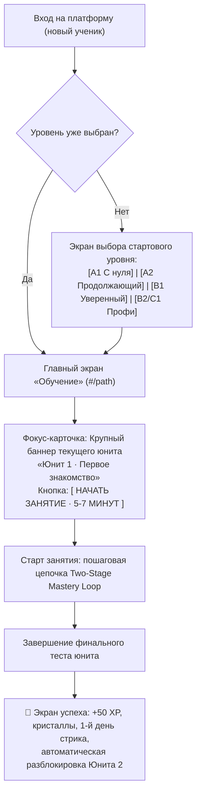

# Генеральный мастер-план платформы ClickLing: Архитектура, Методология и Полный учебный курс (A1–C1)

> **Статус документа:** Финальный утверждённый архитектурный и методический эталон.  
> **Цель:** Полная ликвидация когнитивной перегрузки, унификация навигации, внедрение двухэтапной петли закрепления (Two-Stage Mastery Loop) и детальный поурочный сценарий для всех 37 юнитов немецкого языка.

---

## 1. Глубокий продуктовый диагноз: почему возникла «каша» и как её устранить

### 1.1. Анализ текущего пользовательского опыта (UX Friction)

При анализе текущей рабочей версии платформы (`https://language-iota-two.vercel.app`) и пользовательских сценариев выявлены следующие фундаментальные барьеры:

1. **Паралич выбора в боковом меню (7 разрозненных пунктов):**
   - Меню содержало пункты: `Сегодня`, `Библиотека слов`, `Каталог`, `Учебный путь`, `Материалы`, `Игры`, `Прогресс`.
   - Пользователь, только что зарегистрировавшийся или вошедший на платформу, видит 7 вкладок и испытывает когнитивный ступор: _«Куда мне нажимать в первую очередь? В Каталог? В Путь? В Материалы? В Библиотеку?»_.
2. **Парадокс разделения «Учебного пути» (`#/path`) и «Материалов» (`#/materials`):**
   - Вкладка `#/path` («Учебный путь») вываливала на ученика бесконечную вертикальную ленту из 40+ юнитов от A1 до C1. Ученик видит огромный массив тем («Овощи и фрукты», «Аренда», «IT-системы», «Базы данных», «Собеседование медсестры») и впадает в уныние от неподъёмного объёма.
   - Вкладка `#/materials` («Материалы») содержала самую правильную и интуитивную педагогическую модель платформы: карточки новых слов $\rightarrow$ слова из библиотеки по теме $\rightarrow$ интерактивная мини-игра на соединение пар $\rightarrow$ тест. Однако эта вкладка была оторвана от общего прогресса, называлась непонятным словом «Материалы» и не имела удобного переключения между уровнями и модулями.
3. **Бесполезность «Каталога» (`#/catalog`) для учащегося:**
   - Ученик ожидает увидеть в каталоге каталог практических занятий или упражнений, а попадает в административный реестр черновиков уроков, курсов и модулей. Обучаться внутри каталога нельзя, играть нельзя — это вызывало обоснованное раздражение.
4. **Неудобная навигация в «Библиотеке слов» (`#/library`):**
   - В текущей библиотеке слов 45 тематических словарей отображались плитками с пагинацией по 8 штук. Фильтр предлагал лишь технические срезы: `<option value="all">Все модули</option>`, `<option value="new">Есть новые карточки</option>`, `<option value="learned">Есть закреплённые</option>`.
   - При этом в разделе `#/games` уже существовал идеальный селектор:
     ```html
     <label class="module-select-label"
       >Слова из модуля
       <select>
         <option value="1">Модуль 1 · Я, ты, быть, иметь</option>
         <option value="2">Модуль 2 · Хочу, могу, должен</option>
         ...
         <option value="205">Модуль 205 · Собеседование · программист</option>
       </select>
     </label>
     ```
     Пользователь справедливо требовал перенести этот удобный выбор модулей прямо в библиотеку слов, чтобы открывать конкретный модуль с ясной целью выучить его лексику.

---

### 1.2. Новая архитектура навигации: 4 фокусных раздела

Боковое меню сокращается с 7 до **4 кристально ясных разделов**:

```
┌─────────────────────────────────────────────────────────────────────────────┐
│                           НОВОЕ БОКОВОЕ МЕНЮ (SIDEBAR)                      │
├─────────────────────────────────────────────────────────────────────────────┤
│  🚀 1. Обучение   [#/path]      Пошаговый трек: текущий юнит, микро-шаги,  │
│                                  грамматика, спикинг, мини-игры и тест.    │
│  📚 2. Словарь    [#/library]   Библиотека слов с прямым селектором        │
│                                  модулей (1–39, 200–205), аудиоплеером      │
│                                  и режимом карточек.                       │
│  🎮 3. Игры       [#/games]     Свободная песочница: 25+ игровых механик   │
│                                  для тренировки скорости и реакции.        │
│  📊 4. Прогресс   [#/stats]     Личная статистика: стрик (дни подряд),     │
│                                  накопленный XP, ранг и банк ошибок.       │
└─────────────────────────────────────────────────────────────────────────────┘
```

#### Служебные и скрытые разделы:

- **Каталог (`#/catalog`)** полностью исключён из меню учеников и перенесён в панель администратора (`Админка` $\rightarrow$ `Каталог контента`).
- **Системная защита маршрутов (Route Guard & 404):**
  - Если раздел скрыт глобально, по роли, по тарифу PRO или в профиле пользователя, прямой переход по URL (например, попытка ввести в адресной строке `#/catalog` обычным учеником) не открывает страницу, а отображает фирменную страницу **404** («Кажется, мы немного заблудились») с иллюстрацией панды и кнопкой «Вернуться к обучению».

---

## 2. Пользовательский сценарий новичка (Onboarding & First-Time User Experience)

Новый пользователь никогда не должен гадать, что делать дальше. Система ведёт его по бесшовному маршруту «Мгновенное погружение»:



### Принцип «Анти-простыня» в интерфейсе «Обучения»:

- Вместо одновременного показа 40+ юнитов интерфейс показывает:
  1. **Селектор текущего уровня:** аккуратные табы `[ A1 ]`, `[ A2 ]`, `[ B1 ]`, `[ B2 ]`, `[ C1 ]`.
  2. **Герой-карточка текущего юнита:** статус прохождения (например, `Шаг 3 из 7`), прогресс-бар, кнопка быстрого возобновления.
  3. **Горизонтальная карусель ближайших юнитов:** показывает только следующие 3–4 юнита с замочками, чтобы ученик видел ближайшую перспективу, не перегружаясь далёкими горизонтами.

---

## 3. Редизайн раздела «Словарь» (`#/library`)

Вместо плоской пагинации по 8 плиток раздел «Словарь» получает мощный и лаконичный интерфейс:

1. **Главный селектор модулей в шапке:**
   ```html
   <div class="library-header-selector">
     <label class="module-select-label">
       <span class="label-text">Выберите модуль для изучения:</span>
       <select class="module-dropdown">
         <optgroup label="Базовые модули (A1–A2)">
           <option value="1">Модуль 1 · Я, ты, быть, иметь</option>
           <option value="2">Модуль 2 · Хочу, могу, должен</option>
           <option value="3">Модуль 3 · Вопросы и ответы</option>
           ...
         </optgroup>
         <optgroup label="Специализированные и профессиональные">
           <option value="35">Модуль 35 · Программирование</option>
           <option value="36">Модуль 36 · IT-системы</option>
           <option value="200">Модуль 200 · В аэропорту</option>
           <option value="205">Модуль 205 · Собеседование · программист</option>
         </optgroup>
       </select>
     </label>
   </div>
   ```
2. **Панель быстрых действий выбранного модуля:**
   - `[ 🎧 Слушать в аудио-плеере ]` — мгновенный запуск фонового режима Hands-Free для выбранного модуля.
   - `[ 🎴 Учить карточками ]` — интерактивный флип-режим запоминания.
   - `[ 🎮 Тренировать в играх ]` — переход в раздел игр с предустановленным фильтром на этот модуль.
3. **Статусная плашка модуля:**
   - Отображение: `Всего слов: 25`, `Новые: 10`, `На повторении: 8`, `Выучено: 7`.
   - Карточки слов с озвучкой носителя, примером предложения в контексте и транскрипцией.

---

## 4. Методология: Two-Stage Mastery Loop (Двухступенчатая петля мастерства)

Ключевой педагогический инсайт: **знание должно немедленно закрепляться активным действием, а не откладываться на конец длинного урока**.

Традиционная ошибка онлайн-курсов — дать ученику 10 слов, потом длинную статью по грамматике, и только потом общий тест. К моменту теста ученик уже забыл слова, которые учил 15 минут назад.

В ClickLing каждый юнит построен по строгому алгоритму **Two-Stage Mastery Loop**:

```
┌────────────────────────────────────────────────────────────────────────┐
│  ЭТАП 1: ЛЕКСИКА (Слова)                                               │
│                                                                        │
│  [1. Ввод 5-6 слов] ──► [2. Мини-игра слов] ──► [3. Спикинг слов]      │
│  Озвучка, транскрипция,   Соедини пары / Блиц    Проговаривание в      │
│  контекст и перевод.      на быструю реакцию.    микрофон с проверкой. │
└───────────────────────────────────┬────────────────────────────────────┘
                                    ▼
┌────────────────────────────────────────────────────────────────────────┐
│  ЭТАП 2: ГРАММАТИКА (Конструкция)                                      │
│                                                                        │
│  [4. Микро-правило] ──► [5. Игра по грамматике] ──► [6. Спикинг фразы] │
│  Формула на 2-3 строки    Сборка предложений /      Проговаривание     │
│  без академической воды.  Поезд слов / Падежи.      целой фразы вслух. │
└───────────────────────────────────┬────────────────────────────────────┘
                                    ▼
┌────────────────────────────────────────────────────────────────────────┐
│  ЭТАП 3: ФИНАЛЬНАЯ АТТЕСТАЦИЯ                                          │
│                                                                        │
│  [7. Контрольный тест юнита (5 вопросов)] ──► [8. Триумф и награда]    │
│  Комплексная проверка лексики, грамматики и       +50 XP, кристаллы,   │
│  аудирования с разбором ошибок.                   переход к след. теме.│
└────────────────────────────────────────────────────────────────────────┘
```

---

## 5. Инновационный режим: «Аудио-запоминалка» (Hands-Free плеер)

Для изучения языка во время пробежек, тренировок, прогулок и за рулём автомобиля внедрён автономный режим фонового плеера:

- **3 режима направления озвучки:**
  1. 🇷🇺 $\rightarrow$ 🇩🇪 **«Русский $\rightarrow$ Немецкий»**: диктор произносит русское слово, даётся пауза (1.5–3 сек) для самостоятельного воспоминания перевода учеником, затем звучит чёткий немецкий оригинал.
  2. 🇩🇪 $\rightarrow$ 🇷🇺 **«Немецкий $\rightarrow$ Русский»**: тренировка распознавания беглой иностранной речи на слух.
  3. 🇩🇪 **«Только немецкий»**: полное погружение в языковую среду с повторением.
- **Гибкая цикличность:**
  - Повтор каждого слова: 1×, 2× или 3× раза подряд.
  - Цикл модуля: 1 раз, 3 раза или бесконечный цикл ($\infty$).
  - Автоматический переход к следующему модулю словаря без касания экрана.
- **Интеграция с MediaSession API:**
  - Управление воспроизведением через гарнитуру (наушники) и кнопки руля автомобиля.
  - Отображение текущего немецкого слова, транскрипции и русского перевода на экране блокировки iOS / Android и смарт-часах.

---

## 6. Полная учебная программа курса: 37 интерактивных юнитов (A1–C1)

---

### СТУПЕНЬ A1 · НАЧАЛЬНЫЙ ЭЛЕМЕНТАРНЫЙ УРОВЕНЬ (8 ЮНИТОВ)

#### Юнит A1-01. Первое знакомство (Begrüßung und Kennenlernen)

- **Цель юнита:** Научиться здороваться, называть своё имя, страну происхождения, родной язык и задавать встречные вопросы собеседнику.
- **1. Словарь юнита (Лексика из Модулей 1 и 3):**
  1. `heißen` [хайсен] — зваться / иметь имя (_Ich heiße Alex._ — Меня зовут Алекс.)
  2. `kommen` [коммен] — приходить / быть родом (_Ich komme aus Kasachstan._ — Я родом из Казахстана.)
  3. `sprechen` [шпрехен] — говорить (_Ich spreche Deutsch und Russisch._ — Я говорю по-немецки и по-русски.)
  4. `die Sprache` [ди шпрахе] — язык / речь (_Deutsch ist eine schöne Sprache._ — Немецкий — красивый язык.)
  5. `Guten Tag` [гутэн так] — добрый день / здравствуйте (_Guten Tag, wie geht es Ihnen?_ — Добрый день, как ваши дела?)
- **2. Игра со словами («Соедините пары»):**
  - Карточка 1: `heißen` $\leftrightarrow$ `зваться`
  - Карточка 2: `kommen` $\leftrightarrow$ `быть родом`
  - Карточка 3: `sprechen` $\leftrightarrow$ `говорить`
  - Карточка 4: `die Sprache` $\leftrightarrow$ `язык`
  - Карточка 5: `Guten Tag` $\leftrightarrow$ `добрый день`
- **3. Спикинг слов (Тренировка произношения в микрофон):**
  - Слово 1: `Guten Tag` (фонетический совет: на конце слова `Tag` звук [к], а не мягкий [г]).
  - Слово 2: `heißen` (фонетический совет: буква `ß` звучит как глухой протяжный [с], ударение на дифтонг [ай]).
  - Слово 3: `die Sprache` (фонетический совет: сочетание `sp` в начале корня всегда читается как [шп]).
- **4. Микро-правило грамматики (Спряжение глаголов в настоящем времени с ich и du):**
  - Чтобы изменить глагол, отбрасываем окончание инфинитива `-en` и добавляем личное окончание:
    - С местоимением **ich** (я) добавляется окончание **-e**: `ich heiß-e`, `ich komm-e`, `ich sprech-e`.
    - С местоимением **du** (ты) добавляется окончание **-st**: `du kommst`, `du sprichst` (у сильного глагола _sprechen_ корневая гласная меняется: _e_ $\rightarrow$ _i_).
  - **Формула порядка слов в утверждении:** Подлежащее (1-е место) + Глагол-сказуемое (строго 2-е место): `Ich komme aus Berlin.`
- **5. Игра по грамматике («Сборка фразы из блоков»):**
  - Задание 1: Собрать фразу из блоков: `[ Ich ]` `[ heiße ]` `[ Nino ]` `[ . ]`
  - Задание 2: Собрать фразу из блоков: `[ Du ]` `[ kommst ]` `[ aus ]` `[ Deutschland ]` `[ . ]`
  - Задание 3: Исправить ошибку в блоках: `[ Nino ]` `[ aus Italien ]` `[ kommt ]` $\rightarrow$ Правильно: `[ Nino ]` `[ kommt ]` `[ aus Italien ]` (глагол строго на 2-м месте!).
- **6. Фразовый спикинг (Проговаривание связной речи вслух):**
  - _Фраза для записи:_ **«Guten Tag! Ich heiße Anna und ich komme aus Deutschland.»**
  - _Перевод:_ «Добрый день! Меня зовут Анна, и я родом из Германии.»
- **7. Контрольный тест юнита (5 вопросов):**
  - **Вопрос 1 (Лексика):** Как переводится глагол «говорить» на немецкий язык?
    - A) heißen
    - **B) sprechen** [Правильно]
    - C) kommen
    - D) wohnen
    - _Пояснение:_ Глагол _sprechen_ переводится как «говорить». _heißen_ — «зваться», _kommen_ — «приходить/быть родом».
  - **Вопрос 2 (Грамматика):** Выберите правильную форму глагола: «Ich _____ aus Kasachstan.»
    - **A) komme** [Правильно]
    - B) kommst
    - C) kommt
    - D) kommen
    - _Пояснение:_ С местоимением 1-го лица _ich_ глагол принимает окончание _-e_ (_ich komme_).
  - **Вопрос 3 (Грамматика):** Выберите правильную форму для вопроса: «Wie _____ du?»
    - A) heiße
    - **B) heißt** [Правильно]
    - C) heißen
    - D) heißet
    - _Пояснение:_ С местоимением _du_ основа глагола _heiß-_ оканчивается на шипящий, поэтому добавляется только _-t_ (_du heißt_).
  - **Вопрос 4 (Аудирование):** Прослушайте фразу: _«Ich spreche Deutsch.»_ Что сказал диктор?
    - A) Я учу немецкий язык.
    - **B) Я говорю по-немецки.** [Правильно]
    - C) Я еду в Германию.
    - D) Мне нравится немецкий.
    - _Пояснение:_ _sprechen_ означает «говорить», _Deutsch_ — немецкий язык.
  - **Вопрос 5 (Синтаксис):** Какое предложение построено грамматически корректно?
    - A) Aus Berlin ich komme.
    - B) Ich aus Berlin komme.
    - **C) Ich komme aus Berlin.** [Правильно]
    - D) Komme ich aus Berlin.
    - _Пояснение:_ В простом повествовательном предложении в немецком языке спрягаемый глагол ВСЕГДА стоит на втором месте.

---

#### Юнит A1-02. Личная информация и город (Wohnort und Beruf)

- **Цель юнита:** Рассказать о месте проживания, профессии, учёбе и научиться задавать базовые W-вопросы (Wo? Woher? Was?).
- **1. Словарь юнита (Лексика из Модулей 1, 4 и 17):**
  1. `wohnen` [вонен] — жить / проживать (_Ich wohne in Berlin._ — Я живу в Берлине.)
  2. `arbeiten` [арбайтен] — работать (_Er arbeitet als Entwickler._ — Он работает разработчиком.)
  3. `studieren` [штудирэн] — учиться в университете (_Wir studieren an der Universität._ — Мы учимся в университете.)
  4. `die Stadt` [ди штат] — город (_Wien ist eine schöne Stadt._ — Вена — красивый город.)
  5. `in` [ин] — в (предлог места) (_Ich lebe in Deutschland._ — Я живу в Германии.)
  6. `jetzt` [йетцт] — сейчас / теперь (_Jetzt lerne ich fleißig Deutsch._ — Сейчас я усердно учу немецкий.)
- **2. Игра со словами («Блиц Правда/Ложь на скорость»):**
  - `wohnen` переводится как «работать» $\rightarrow$ **Ложь** (это «жить»).
  - `die Stadt` переводится как «город» $\rightarrow$ **Правда**.
  - `jetzt` переводится как «сейчас» $\rightarrow$ **Правда**.
  - `arbeiten` переводится как «учиться в вузе» $\rightarrow$ **Ложь** (это _studieren_).
- **3. Спикинг слов (Тренировка произношения):**
  - `wohnen` (звук [h] после гласной не читается, гласная [o:] звучит долго).
  - `arbeiten` (ударение на первый слог [а́рбайтен]).
  - `die Stadt` (начальное [st] читается как [шт], краткий звук [а]).
- **4. Микро-правило грамматики (W-вопросы: Wo? Woher? Was?):**
  - Вопросительные предложения со специальным словом строятся по формуле:
    - **Позиция 1:** Вопросительное слово (`Wo?` — Где? / `Woher?` — Откуда? / `Was?` — Что?)
    - **Позиция 2:** Спрягаемый глагол
    - **Позиция 3:** Подлежащее
    - _Примеры:_ `Wo (1) wohnst (2) du (3)?` | `Woher (1) kommst (2) er (3)?`
- **5. Игра по грамматике («Поезд вопросов»):**
  - Соединить локомотив и вагоны в правильном порядке:
    - `[ Woher ]` $\rightarrow$ `[ kommst ]` $\rightarrow$ `[ du ]` $\rightarrow$ `[ ? ]`
    - `[ Jetzt ]` $\rightarrow$ `[ wohne ]` $\rightarrow$ `[ ich ]` $\rightarrow$ `[ in Hamburg ]` $\rightarrow$ `[ . ]` (обратный порядок слов: если на 1-м месте обстоятельство _jetzt_, глагол всё равно строго на 2-м месте!).
- **6. Фразовый спикинг:**
  - _Фраза для записи:_ **«Jetzt wohne ich in Berlin und ich arbeite hier als Ingenieur.»**
  - _Перевод:_ «Сейчас я живу в Берлине и работаю здесь инженером.»
- **7. Контрольный тест юнита (5 вопросов):**
  - **Вопрос 1 (Грамматика):** Вставьте правильное окончание глагола: «Er _____ in München.»
    - A) wohne
    - **B) wohnt** [Правильно]
    - C) wohnst
    - D) wohnen
    - _Пояснение:_ Для 3-го лица единственного числа (_er/sie/es_) окончание глагола _-t_.
  - **Вопрос 2 (Предлоги):** Выберите подходящий предлог: «Ich wohne _____ Frankfurt.»
    - A) aus
    - **B) in** [Правильно]
    - C) nach
    - D) zu
    - _Пояснение:_ С городами и большинством стран при указании местонахождения используется предлог _in_ («где? в Франкфурте»).
  - **Вопрос 3 (Синтаксис):** Как правильно спросить собеседника «Откуда ты родом?»:
    - **A) Woher kommst du?** [Правильно]
    - B) Wo kommst du?
    - C) Woher wohnst du?
    - D) Was machst du?
    - _Пояснение:_ Вопрос происхождения строится с вопросительным словом _Woher_ («откуда»).
  - **Вопрос 4 (Порядок слов):** Выберите предложение с правильным порядком слов:
    - A) Jetzt ich studiere in Köln.
    - **B) Jetzt studiere ich in Köln.** [Правильно]
    - C) Jetzt studiere in Köln ich.
    - D) Studiere ich jetzt in Köln.
    - _Пояснение:_ Если предложение начинается со слова _Jetzt_, глагол обязан остаться на 2-м месте, а подлежащее смещается на 3-е.
  - **Вопрос 5 (Аудирование):** Прослушайте: _«Was machst du beruflich?»_ Что означает данный вопрос?
    - A) Где ты живёшь?
    - B) Куда ты идёшь?
    - **C) Кто ты по профессии? / Чем занимаешься?** [Правильно]
    - D) Какой язык ты учишь?
    - _Пояснение:_ _beruflich_ переводится как «по профессии / в профессиональном плане».

---

#### Юнит A1-03. Семья и люди (Familie und Beziehungen)

- **Цель юнита:** Называть членов семьи, понимать категорию грамматического рода (der/die/das) и использовать притяжательные местоимения mein / meine.
- **1. Словарь юнита (Лексика из Модулей 9 и 10):**
  1. `der Vater` [дер фатер] — отец (_Mein Vater heißt Markus._ — Моего отца зовут Маркус.)
  2. `die Mutter` [ди муттер] — мать (_Meine Mutter kocht sehr gut._ — Моя мама очень вкусно готовит.)
  3. `der Bruder` [дер брудер] — брат (_Hast du einen Bruder?_ — У тебя есть брат?)
  4. `die Schwester` [ди швестер] — сестра (_Meine Schwester studiert Medizin._ — Моя сестра изучает медицину.)
  5. `das Kind` [дас кинд] — ребёнок (_Das Kind spielt im Park._ — Ребёнок играет в парке.)
  6. `die Eltern` [ди эльтерн] — родители (_Meine Eltern wohnen in Berlin._ — Мои родители живут в Берлине.)
- **2. Игра со словами («Колесо родов der / die / das»):**
  - `Vater` $\rightarrow$ **der** (мужской род)
  - `Mutter` $\rightarrow$ **die** (женский род)
  - `Kind` $\rightarrow$ **das** (средний род)
  - `Schwester` $\rightarrow$ **die** (женский род)
  - `Eltern` $\rightarrow$ **die** (множественное число)
- **3. Спикинг слов (Тренировка в микрофон):**
  - `der Vater` (буква `v` читается как русский [ф], артикль произносится слитно).
  - `die Schwester` (сочетание `sch` читается как твёрдый [ш], ударение на первый слог).
  - `die Eltern` (краткое открытое [э], ударение на первый слог).
- **4. Микро-правило грамматики (Притяжательные местоимения mein / dein):**
  - Окончание местоимения зависит от рода существительного:
    - **Мужской род (der) и средний род (das):** окончание нулевое $\rightarrow$ **mein / dein** (_mein Vater, mein Kind_).
    - **Женский род (die) и множественное число (die):** добавляется окончание **-e** $\rightarrow$ **meine / deine** (_meine Mutter, meine Eltern_).
- **5. Игра по грамматике («Сортировка по корзинам MEIN vs MEINE»):**
  - Корзина **MEIN**: `Bruder` (der), `Vater` (der), `Kind` (das).
  - Корзина **MEINE**: `Mutter` (die), `Schwester` (die), `Eltern` (Plural).
- **6. Фразовый спикинг:**
  - _Фраза для записи:_ **«Das ist mein Bruder Peter und das ist meine Schwester Lisa.»**
  - _Перевод:_ «Это мой брат Петер, а это моя сестра Лиза.»
- **7. Контрольный тест юнита (5 вопросов):**
  - **Вопрос 1 (Грамматика):** Вставьте верное местоимение: «Das ist _____ Mutter (die).»
    - A) mein
    - **B) meine** [Правильно]
    - C) meinen
    - D) meinem
    - _Пояснение:_ Для существительных женского рода используется форма _meine_.
  - **Вопрос 2 (Грамматика):** Вставьте верное местоимение: «Ist das _____ Bruder (der)?»
    - **A) dein** [Правильно]
    - B) deine
    - C) deines
    - D) deinem
    - _Пояснение:_ Для мужского рода в именительном падеже окончание отсутствует: _dein Bruder_.
  - **Вопрос 3 (Множественное число):** Выберите правильную форму: «Wo wohnen _____ Eltern?»
    - A) mein
    - **B) deine** [Правильно]
    - C) dein
    - D) deines
    - _Пояснение:_ Существительное _Eltern_ употребляется только во множественном числе (_die Eltern_), поэтому форма _deine_.
  - **Вопрос 4 (Лексика):** Какое слово означает «ребёнок»?
    - A) der Bruder
    - B) die Schwester
    - **C) das Kind** [Правильно]
    - D) der Vater
    - _Пояснение:_ _das Kind_ переводится как «ребёнок».
  - **Вопрос 5 (Аудирование):** Прослушайте: _«Meine Schwester ist zwanzig Jahre alt.»_ Сколько лет сестре?
    - A) 12 лет
    - **B) 20 лет** [Правильно]
    - C) 22 года
    - D) 30 лет
    - _Пояснение:_ Числительное _zwanzig_ означает 20.

---

#### Юнит A1-04. День и расписание (Tagesablauf und Uhrzeit)

- **Цель юнита:** Называть время на часах, части суток, описывать свой распорядок дня и использовать глаголы с отделяемыми приставками.
- **1. Словарь юнита (Лексика из Модулей 5, 6 и 7):**
  1. `die Uhr` [ди ур] — часы / время (_Es ist acht Uhr._ — Сейчас восемь часов.)
  2. `am Morgen` [ам морген] — утром (_Am Morgen trinke ich Kaffee._ — Утром я пью кофе.)
  3. `am Abend` [ам абент] — вечером (_Am Abend lese ich ein Buch._ — Вечером я читаю книгу.)
  4. `aufstehen` [ауфштеен] — вставать / просыпаться (_Ich stehe um sieben Uhr auf._ — Я встаю в семь часов.)
  5. `frühstücken` [фрюштюккен] — завтракать (_Wir frühstücken zusammen._ — Мы завтракаем вместе.)
  6. `schlafen` [шлафен] — спать (_Am Wochenende schlafe ich lange._ — На выходных я сплю долго.)
- **2. Игра со словами («Пары распорядка дня»):**
  - `aufstehen` $\leftrightarrow$ `вставать с постели`
  - `frühstücken` $\leftrightarrow$ `завтракать`
  - `am Morgen` $\leftrightarrow$ `утром`
  - `am Abend` $\leftrightarrow$ `вечером`
  - `die Uhr` $\leftrightarrow$ `часы`
- **3. Спикинг слов (Тренировка в микрофон):**
  - `am Morgen` (ударение на первый слог, четкий звук [о]).
  - `frühstücken` (гласный `ü` произносится с округлёнными губами как в слове «мюсли»).
  - `aufstehen` (ударение падает на отделяемую приставку [а́уфштеен]).
- **4. Микро-правило грамматики (Предлоги времени и отделяемые приставки):**
  - **Предлоги времени:**
    - С точным временем на часах используется предлог **um**: `um 8 Uhr` (в 8 часов).
    - С частями суток и днями недели используется предлог **am**: `am Morgen` (утром), `am Montag` (в понедельник).
  - **Отделяемые приставки (Trennbare Verben):**
    - В простом предложении приставка отрывается от глагола и уходит **в самый конец предложения**:
    - `Ich stehe (глагол на 2 месте) jeden Tag früh auf (приставка в конце).`
- **5. Игра по грамматике («Сборка цепочки с отделяемой приставкой»):**
  - Расставить блоки: `[ Ich ]` `[ stehe ]` `[ um 7 Uhr ]` `[ auf ]` `[ . ]`
  - Расставить с инверсией: `[ Am Morgen ]` `[ frühstücke ]` `[ ich ]` `[ um 8 Uhr ]` `[ . ]`
- **6. Фразовый спикинг:**
  - _Фраза для записи:_ **«Ich stehe jeden Morgen um sieben Uhr auf und trinke Kaffee.»**
  - _Перевод:_ «Я встаю каждое утро в семь часов и пью кофе.»
- **7. Контрольный тест юнита (5 вопросов):**
  - **Вопрос 1 (Предлоги времени):** Выберите предлог перед временем: «Der Film beginnt _____ 20 Uhr.»
    - A) am
    - **B) um** [Правильно]
    - C) im
    - D) von
    - _Пояснение:_ С точным указанием часа всегда употребляется предлог _um_.
  - **Вопрос 2 (Предлоги времени):** Выберите предлог для времени суток: «_____ Abend koche ich gern.»
    - **A) Am** [Правильно]
    - B) Um
    - C) Im
    - D) An
    - _Пояснение:_ С временами суток используется слияние предлога _an + dem_ = _am_.
  - **Вопрос 3 (Отделяемые приставки):** Куда встаёт приставка глагола _aufstehen_? «Wann stehst du gewöhnlich _____?»
    - A) an
    - **B) auf** [Правильно]
    - C) aus
    - D) ein
    - _Пояснение:_ Приставка глагола _aufstehen_ — это _auf_, в вопросе она уходит в конец.
  - **Вопрос 4 (Синтаксис):** Выберите грамматически верный порядок слов:
    - A) Um 8 Uhr ich stehe auf.
    - **B) Um 8 Uhr stehe ich auf.** [Правильно]
    - C) Um 8 Uhr aufstehe ich.
    - D) Ich aufstehe um 8 Uhr.
    - _Пояснение:_ При выносе обстоятельства времени вперед глагол занимает строго 2-е место, а приставка уходит на последнее.
  - **Вопрос 5 (Аудирование):** Прослушайте: _«Am Sonntag schlafe ich bis zehn Uhr.»_ До скольки часов спит говорящий?
    - A) До 8 часов
    - B) До 9 часов
    - **C) До 10 часов** [Правильно]
    - D) До 12 часов
    - _Пояснение:_ _zehn Uhr_ означает 10 часов.

---

#### Юнит A1-05. Кафе, еда и покупки (Essen, Trinken und Akkusativ)

- **Цель юнита:** Заказывать еду и напитки в кафе, просить счёт и освоить винительный падеж (Akkusativ) для мужского рода.
- **1. Словарь юнита (Лексика из Модулей 13, 14 и 15):**
  1. `der Kaffee` [дер кафэ] — кофе (_Ich trinke morgens Kaffee._ — Утром я пью кофе.)
  2. `der Tee` [дер тэ] — чай (_Möchten Sie einen Tee?_ — Вы хотите чай?)
  3. `das Wasser` [дас вассер] — вода (_Ein Glas Wasser, bitte._ — Стакан воды, пожалуйста.)
  4. `die Rechnung` [ди рехнунг] — счёт (_Die Rechnung, bitte!_ — Счёт, пожалуйста!)
  5. `möchten` [мёхьтен] — хотеть / желать (_Was möchten Sie bestellen?_ — Что вы хотите заказать?)
  6. `zahlen` [цален] — платить / оплачивать (_Wir möchten bitte zahlen._ — Мы хотим заплатить.)
- **2. Игра со словами («Удар по слову: Клиент $\leftrightarrow$ Официант»):**
  - `Die Rechnung, bitte!` $\leftrightarrow$ `Счёт, пожалуйста!`
  - `Zahlen, bitte!` $\leftrightarrow$ `Рассчитайте, пожалуйста!`
  - `der Kaffee` $\leftrightarrow$ `кофе`
  - `das Wasser` $\leftrightarrow$ `вода`
- **3. Спикинг слов (Тренировка в микрофон):**
  - `Zahlen, bitte!` (начальное [ц], краткое [а], четкое ударение).
  - `die Rechnung` (звук [хь] после гласной [е], окончание [-унг] без звонкого [г]).
  - `das Wasser` (буква `w` звучит как русский [в], ударение на первый слог).
- **4. Микро-правило грамматики (Винительный падеж — Akkusativ):**
  - Падеж Akkusativ отвечает на вопрос _Кого? Что? (Wen? Was?)_ при прямом объекте:
    - **Мужской род (der) МЕНЯЕТСЯ:** артикль `der` переходит в **den**, а `ein` переходит в **einen**!
    - **Женский род (die) и средний род (das) НЕ МЕНЯЮТСЯ:** `die / eine`, `das / ein`.
    - _Примеры:_ `Ich möchte einen Kaffee (der Kaffee).` | `Ich möchte ein Wasser (das Wasser).` | `Ich nehme eine Suppe (die Suppe).`
- **5. Игра по грамматике («Поезд заказов EINEN vs EIN vs EINE»):**
  - Вагон **EINEN** (мужской род): `Kaffee` (der), `Tee` (der), `Salat` (der).
  - Вагон **EIN** (средний род): `Wasser` (das), `Brötchen` (das).
  - Вагон **EINE** (женский род): `Cola` (die), `Pizza` (die).
- **6. Фразовый спикинг:**
  - _Фраза для записи:_ **«Guten Tag! Ich möchte einen Kaffee und ein Wasser, bitte.»**
  - _Перевод:_ «Добрый день! Я хотел бы кофе и воду, пожалуйста.»
- **7. Контрольный тест юнита (5 вопросов):**
  - **Вопрос 1 (Akkusativ мужской род):** Вставьте артикль: «Ich trinke jeden Morgen _____ Tee (der).»
    - A) ein
    - **B) einen** [Правильно]
    - C) eine
    - D) einem
    - _Пояснение:_ В винительном падеже неопределенный артикль мужского рода принимает форму _einen_.
  - **Вопрос 2 (Akkusativ средний род):** Вставьте артикль: «Wir möchten _____ Wasser (das).»
    - A) einen
    - **B) ein** [Правильно]
    - C) eine
    - D) eines
    - _Пояснение:_ Существительные среднего рода в Akkusativ не меняют артикль: _ein Wasser_.
  - **Вопрос 3 (Фраза этикета):** Какая фраза используется, чтобы попросить счёт у официанта?
    - **A) Die Rechnung, bitte!** [Правильно]
    - B) Wo ist Wasser?
    - C) Wie heißt du?
    - D) Guten Morgen!
    - _Пояснение:_ Стандартная общепринятая фраза для оплаты в кафе и ресторане — _Die Rechnung, bitte!_ или _Zahlen, bitte!_.
  - **Вопрос 4 (Спряжение möchten):** Вставьте глагол: «Was _____ du trinken?»
    - A) möchte
    - **B) möchtest** [Правильно]
    - C) möchten
    - D) möchtet
    - _Пояснение:_ Для местоимения 2-го лица _du_ форма глагола — _möchtest_.
  - **Вопрос 5 (Аудирование):** Прослушайте: _«Das macht zusammen vier Euro fünfzig.»_ Какова сумма заказа?
    - A) 4 евро ровно
    - **B) 4 евро 50 центов** [Правильно]
    - C) 5 евро 40 центов
    - D) 45 евро
    - _Пояснение:_ _vier Euro fünfzig_ = 4.50 €.

---

#### Юнит A1-06. Город, транспорт и направления (Orientierung in der Stadt)

- **Цель юнита:** Ориентироваться на улицах города, спрашивать дорогу к вокзалу и аптеке и использовать вежливый повелительный наклонение (Imperativ mit Sie).
- **1. Словарь юнита (Лексика из Модулей 12, 17 и 18):**
  1. `der Bahnhof` [дер банхоф] — вокзал (_Wo ist der Bahnhof?_ — Где находится вокзал?)
  2. `die Straße` [ди штрассе] — улица (_Die Apotheke ist in dieser Straße._ — Аптека на этой улице.)
  3. `geradeaus` [герадэаус] — прямо (_Gehen Sie bitte geradeaus!_ — Идите, пожалуйста, прямо!)
  4. `links` [линкс] — налево / слева (_Biegen Sie nach links ab._ — Поверните налево.)
  5. `rechts` [рехьтс] — направо / справа (_Der Supermarkt ist rechts._ — Супермаркет справа.)
  6. `die Apotheke` [ди апoтэке] — аптека (_Ich brauche eine Apotheke._ — Мне нужна аптека.)
- **2. Игра со словами («Стрелки навигатора»):**
  - Стрелка $\uparrow$ $\leftrightarrow$ `geradeaus` (прямо)
  - Стрелка $\leftarrow$ $\leftrightarrow$ `links` (налево)
  - Стрелка $\rightarrow$ $\leftrightarrow$ `rechts` (направо)
  - Пиктограмма вокзала 🚉 $\leftrightarrow$ `der Bahnhof`
  - Пиктограмма креста 💊 $\leftrightarrow$ `die Apotheke`
- **3. Спикинг слов (Тренировка в микрофон):**
  - `geradeaus` (ударение на последний слог [-а́ус], протяжный гласный [а]).
  - `der Bahnhof` (слово сложено из двух: _Bahn_ [бан] + _Hof_ [хоф], звук [h] чётко выдыхается).
  - `die Apotheke` (буквосочетание `th` читается как обычное твёрдое [т]).
- **4. Микро-правило грамматики (Вежливый повелительный наклонение — Imperativ mit Sie):**
  - Чтобы вежливо дать указание или совет, ставим глагол в форме инфинитива **на первое место**, а за ним местоимение **Sie**:
    - `Gehen Sie geradeaus!` (Идите прямо!)
    - `Biegen Sie rechts ab!` (Поверните направо! Приставка _ab_ уходит в конец).
    - `Fahren Sie mit dem Bus!` (Поезжайте на автобусе!)
- **5. Игра по грамматике («Сборка маршрута навигатора»):**
  - Собрать блоки маршрута: `[ Gehen Sie ]` `[ geradeaus , ]` `[ dann ]` `[ biegen Sie ]` `[ nach links ]` `[ ab ]` `[ . ]`
- **6. Фразовый спикинг:**
  - _Фраза для записи:_ **«Entschuldigung, wie komme ich zum Bahnhof? Gehen Sie geradeaus!»**
  - _Перевод:_ «Извините, как мне пройти к вокзалу? Идите прямо!»
- **7. Контрольный тест юнита (5 вопросов):**
  - **Вопрос 1 (Imperativ):** Выберите вежливую форму приказа: «_____ Sie bitte geradeaus!»
    - **A) Gehen** [Правильно]
    - B) Geht
    - C) Gehst
    - D) Ging
    - _Пояснение:_ В вежливой форме повелительного наклонения глагол сохраняет форму инфинитива: _Gehen Sie_.
  - **Вопрос 2 (Лексика):** Что означает указатель «rechts»?
    - A) Налево
    - **B) Направо** [Правильно]
    - C) Прямо
    - D) Назад
    - _Пояснение:_ _rechts_ — «направо / справа», _links_ — «налево / слева».
  - **Вопрос 3 (Синтаксис):** Вставьте форму глагола sein: «Wo _____ die Apotheke?»
    - A) bin
    - B) bist
    - **C) ist** [Правильно]
    - D) sind
    - _Пояснение:_ Аптека (_die Apotheke_) — 3-е лицо единственного числа (_sie_), поэтому форма глагола _ist_.
  - **Вопрос 4 (Лексика):** Переведите: «Вокзал находится слева.»
    - **A) Der Bahnhof ist links.** [Правильно]
    - B) Der Bahnhof ist rechts.
    - C) Der Bahnhof ist geradeaus.
    - D) Die Apotheke ist links.
    - _Пояснение:_ _der Bahnhof_ — вокзал, _links_ — слева.
  - **Вопрос 5 (Аудирование):** Прослушайте: _«Nehmen Sie die nächste Straße links.»_ В какую улицу нужно свернуть?
    - A) Направо на первой улице
    - **B) Налево на следующей улице** [Правильно]
    - C) Идти прямо до конца улицы
    - D) Перейти через площадь
    - _Пояснение:_ _die nächste Straße_ = следующая улица, _links_ = налево.

---

#### Юнит A1-07. Дом, вещи и предлоги места (Wohnen und Dativ)

- **Цель юнита:** Описывать квартиру и мебель, освоить конструкцию Es gibt и дательный падеж (Dativ) при ответе на вопрос Где? (Wo?).
- **1. Словарь юнита (Лексика из Модулей 19, 20 и 21):**
  1. `das Zimmer` [дас циммер] — комната (_Das Zimmer ist sehr hell._ — Комната очень светлая.)
  2. `die Wohnung` [ди вонунг] — квартира (_Wir mieten eine Wohnung._ — Мы снимаем квартиру.)
  3. `der Tisch` [дер тиш] — стол (_Auf dem Tisch steht eine Lampe._ — На столе стоит лампа.)
  4. `das Bett` [дас бэтт] — кровать (_Das Bett ist bequem._ — Кровать удобная.)
  5. `der Schrank` [дер шранк] — шкаф (_Die Kleidung ist im Schrank._ — Одежда в шкафу.)
  6. `groß / klein` [грос / кляйн] — большой / маленький (_Die Küche ist klein, aber fein._ — Кухня маленькая, но уютная.)
- **2. Игра со словами («Пары предметов интерьера»):**
  - `der Tisch` $\leftrightarrow$ `стол`
  - `das Bett` $\leftrightarrow$ `кровать`
  - `der Schrank` $\leftrightarrow$ `шкаф`
  - `das Zimmer` $\leftrightarrow$ `комната`
  - `die Wohnung` $\leftrightarrow$ `квартира`
- **3. Спикинг слов (Тренировка в микрофон):**
  - `das Zimmer` (начальное [ц], краткий звук [и]).
  - `die Wohnung` (долгий [о:], звук [h] не читается, окончание [-унг]).
  - `der Schrank` (сочетание [шр-], краткий звук [а]).
- **4. Микро-правило грамматики (Конструкция Es gibt и Dativ места Wo?):**
  - **Конструкция Es gibt (имеется / есть):** Всегда требует после себя **Akkusativ**:
    - `Es gibt einen Tisch (der Tisch $\rightarrow$ einen Tisch).`
    - `Es gibt ein Bett (das Bett $\rightarrow$ ein Bett).`
  - **Дательный падеж (Dativ) на вопрос Где? (Wo?):**
    - Мужской род (der) и средний род (das) меняются на **dem**: `auf dem Tisch`, `im (in dem) Zimmer`.
    - Женский род (die) меняется на **der**: `in der Küche`.
- **5. Игра по грамматике («Расстановка артиклей Dativ»):**
  - Предложение 1: _«Das Buch liegt auf _____ Tisch (der).»_ $\rightarrow$ Выбрать карточку `[ dem ]`.
  - Предложение 2: _«Das Kissen liegt auf _____ Bett (das).»_ $\rightarrow$ Выбрать карточку `[ dem ]`.
  - Предложение 3: _«Die Tasse steht in _____ Küche (die).»_ $\rightarrow$ Выбрать карточку `[ der ]`.
- **6. Фразовый спикинг:**
  - _Фраза для записи:_ **«In meinem Zimmer gibt es einen Schreibtisch und ein bequemes Bett.»**
  - _Перевод:_ «В моей комнате есть письменный стол и удобная кровать.»
- **7. Контрольный тест юнита (5 вопросов):**
  - **Вопрос 1 (Конструкция Es gibt):** Вставьте артикль: «In der Wohnung gibt es _____ Schrank (der).»
    - **A) einen** [Правильно]
    - B) einem
    - C) ein
    - D) einer
    - _Пояснение:_ После _es gibt_ всегда используется Akkusativ. Мужской род принимает форму _einen_.
  - **Вопрос 2 (Dativ места):** Вставьте артикль на вопрос Wo?: «Die Lampe steht auf _____ Schreibtisch (der).»
    - A) den
    - **B) dem** [Правильно]
    - C) des
    - D) das
    - _Пояснение:_ На вопрос «где?» (Wo?) предлог требует Dativ. Мужской род в Dativ имеет артикль _dem_.
  - **Вопрос 3 (Dativ женский род):** Вставьте форму артикля: «Meine Mutter kocht in _____ Küche (die).»
    - A) die
    - **B) der** [Правильно]
    - C) den
    - D) dem
    - _Пояснение:_ В дательном падеже артикль женского рода _die_ меняется на _der_.
  - **Вопрос 4 (Антонимы):** Какое слово противоположно по смыслу слову «groß»?
    - A) hell
    - **B) klein** [Правильно]
    - C) teuer
    - D) neu
    - _Пояснение:_ _groß_ — большой, _klein_ — маленький.
  - **Вопрос 5 (Аудирование):** Прослушайте: _«Die Wohnung hat drei Zimmer und einen Balkon.»_ Сколько комнат в квартире?
    - A) 2 комнаты
    - **B) 3 комнаты** [Правильно]
    - C) 4 комнаты
    - D) 1 комната
    - _Пояснение:_ _drei Zimmer_ означает 3 комнаты.

---

#### Юнит A1-08. Модальные глаголы и Аттестационный Экзамен A1 (Abschlussprüfung A1)

- **Цель юнита:** Освоить модальные глаголы können, müssen, wollen, рамочную конструкцию предложения и успешно сдать экзамен ступени A1.
- **1. Словарь юнита (Лексика из Модулей 2 и 24):**
  1. `können` [кённен] — мочь / уметь (_Ich kann gut Deutsch sprechen._ — Я умею хорошо говорить по-немецки.)
  2. `müssen` [мюссен] — быть должным / обязанным (_Ich muss heute arbeiten._ — Я должен сегодня работать.)
  3. `wollen` [воллен] — хотеть (_Wir wollen nach Berlin fahren._ — Мы хотим поехать в Берлин.)
  4. `helfen` [хельфен] — помогать (_Können Sie mir helfen?_ — Вы можете мне помочь?)
  5. `die Zeit` [ди цайт] — время (_Hast du heute Zeit?_ — У тебя есть сегодня время?)
  6. `heute` [хойте] — сегодня (_Heute lerne ich viel._ — Сегодня я много учусь.)
- **2. Игра со словами («Анаграммы модальных глаголов»):**
  - Собрать из букв `[ k, ö, n, n, e, n ]` $\rightarrow$ `können`
  - Собрать из букв `[ m, ü, s, s, e, n ]` $\rightarrow$ `müssen`
  - Собрать из букв `[ w, o, l, l, e, n ]` $\rightarrow$ `wollen`
- **3. Спикинг слов (Тренировка в микрофон):**
  - `Ich kann` (краткий звук [а], твердый [н]).
  - `Ich muss` (краткий звук [у], глухой [с]).
  - `Können Sie mir helfen?` (вежливая вопросительная интонация с повышением в конце).
- **4. Микро-правило грамматики (Рамочная конструкция с модальными глаголами):**
  - Модальный глагол образует «золотую рамку немецкого предложения»:
    - **Позиция 2:** Спрягаемый модальный глагол (`kann`, `muss`, `will`).
    - **Самый конец предложения:** Смысловой глагол в неопределённой форме (Infinitiv)!
    - _Формула:_ `Ich (1) MUSS (2) heute viele Hausaufgaben MACHEN (конец).`
- **5. Игра по грамматике («Сборка золотой рамки»):**
  - Задание 1: `[ Ich ]` `[ kann ]` `[ gut ]` `[ schwimmen ]` `[ . ]`
  - Задание 2: `[ Morgen ]` `[ müssen ]` `[ wir ]` `[ früh ]` `[ aufstehen ]` `[ . ]`
- **6. Фразовый спикинг:**
  - _Фраза для записи:_ **«Entschuldigung, können Sie mir bitte helfen? Ich muss zum Bahnhof fahren.»**
  - _Перевод:_ «Извините, не могли бы вы мне помочь? Мне нужно поехать на вокзал.»
- **7. Контрольный тест юнита (Комплексный экзамен ступени A1 — 5 вопросов):**
  - **Вопрос 1 (Спряжение können):** Вставьте правильную форму: «Er _____ sehr gut kochen.»
    - A) könnt
    - **B) kann** [Правильно]
    - C) kannst
    - D) können
    - _Пояснение:_ В 1-м и 3-м лице единственного числа модальные глаголы не имеют окончания: _ich kann, er/sie/es kann_.
  - **Вопрос 2 (Рамочная конструкция):** Где в предложении с модальным глаголом стоит второй глагол?
    - A) На 1-м месте
    - B) На 2-м месте рядом с модальным
    - **C) В самом конце предложения в инфинитиве** [Правильно]
    - D) На 3-м месте
    - _Пояснение:_ Инфинитив смыслового глагола выносится в абсолютный конец предложения, замыкая рамку.
  - **Вопрос 3 (Вежливая просьба):** Выберите корректную форму вопроса: «_____ Sie mir bitte helfen?»
    - **A) Können** [Правильно]
    - B) Kann
    - C) Musst
    - D) Willst
    - _Пояснение:_ С местоимением _Sie_ (вежливое «Вы») используется форма _Können Sie_.
  - **Вопрос 4 (Синтаксис):** Какое предложение построено правильно?
    - A) Wir müssen morgen lernen viel.
    - **B) Wir müssen morgen viel lernen.** [Правильно]
    - C) Wir lernen morgen viel müssen.
    - D) Wir morgen müssen viel lernen.
    - _Пояснение:_ Модальный глагол _müssen_ стоит на 2-м месте, инфинитив _lernen_ — в самом конце предложения.
  - **Вопрос 5 (Аудирование A1):** Прослушайте: _«Ich habe heute leider keine Zeit, weil ich arbeiten muss.»_ Почему собеседник не может встретиться?
    - A) Он заболел
    - **B) Он должен работать** [Правильно]
    - C) Он уезжает в отпуск
    - D) Он забыл про встречу
    - _Пояснение:_ _weil ich arbeiten muss_ переводится «потому что я должен работать».

### СТУПЕНЬ A2 · БАЗОВЫЙ УРОВЕНЬ (8 ЮНИТОВ)

#### Юнит A2-01. Прошедшее время Perfekt (Выходные и быт)

- **Цель юнита:** Рассказывать о событиях прошлого (выходные, покупки, домашние дела) с использованием прошедшего времени Perfekt со вспомогательным глаголом haben.
- **1. Словарь юнита (Лексика из Модулей 6, 7 и 24):**
  1. `am Wochenende` [ам вохенэндэ] — на выходных (_Am Wochenende habe ich mich ausgeruht._ — На выходных я отдохнул.)
  2. `gemacht` [гемахт] — сделал / приготовил (от _machen_) (_Was hast du gestern gemacht?_ — Что ты вчера делал?)
  3. `gekauft` [гекауфт] — купил (от _kaufen_) (_Ich habe ein neues Buch gekauft._ — Я купил новую книгу.)
  4. `gekocht` [гекохт] — сварил / приготовил (от _kochen_) (_Wir haben Pizza gekocht._ — Мы приготовили пиццу.)
  5. `gesehen` [гезеен] — увидел / посмотрел (от _sehen_) (_Ich habe einen Film gesehen._ — Я посмотрел фильм.)
  6. `danach` [данах] — затем / после этого (_Zuerst habe ich gegessen, danach habe ich gelernt._ — Сначала я поел, затем позанимался.)
- **2. Игра со словами («Пары Infinitiv $\leftrightarrow$ Partizip II»):**
  - `machen` $\leftrightarrow$ `gemacht`
  - `kaufen` $\leftrightarrow$ `gekauft`
  - `kochen` $\leftrightarrow$ `gekocht`
  - `sehen` $\leftrightarrow$ `gesehen`
  - `am Wochenende` $\leftrightarrow$ `на выходных`
- **3. Спикинг слов (Тренировка произношения):**
  - `Ich habe gemacht` (четкий звук [х] в приставке `ge-`, краткий [а]).
  - `Ich habe gekauft` (дифтонг [ау], глухой звук [т] на конце).
  - `danach` (ударение на второй слог [данáх], звук [х] на конце).
- **4. Микро-правило грамматики (Разговорное прошедшее время Perfekt mit haben):**
  - Формула прошедшего времени Perfekt:
    - **Позиция 2:** Спрягаемая форма вспомогательного глагола **haben** (`ich habe`, `du hast`, `er hat`, `wir haben`).
    - **Конец предложения:** Причастие прошедшего времени **Partizip II** (обычно `ge-` + корень + `-t` или `-en`).
    - _Пример:_ `Ich (1) HABE (2) gestern eine Suppe GEKOCHT (конец).`
- **5. Игра по грамматике («Сборка рамки времени Perfekt»):**
  - Блоки 1: `[ Am Wochenende ]` `[ habe ]` `[ ich ]` `[ meine Freunde ]` `[ besucht ]` `[ . ]`
  - Блоки 2: `[ Gestern ]` `[ hat ]` `[ er ]` `[ einen spannenden Film ]` `[ gesehen ]` `[ . ]`
- **6. Фразовый спикинг:**
  - _Фраза для записи:_ **«Am Wochenende habe ich Freunde besucht und wir haben zusammen gekocht.»**
  - _Перевод:_ «На выходных я навестил друзей, и мы вместе готовили еду.»
- **7. Контрольный тест юнита (5 вопросов):**
  - **Вопрос 1 (Вспомогательный глагол):** Вставьте форму глагола haben: «Was _____ du am Wochenende gemacht?»
    - A) bist
    - **B) hast** [Правильно]
    - C) hat
    - D) haben
    - _Пояснение:_ Для местоимения 2-го лица _du_ форма глагола haben — _hast_.
  - **Вопрос 2 (Форма Partizip II):** Выберите правильную форму глагола lesen в Perfekt: «Er hat ein spannendes Buch _____ .»
    - A) geleset
    - **B) gelesen** [Правильно]
    - C) gelest
    - D) geleezt
    - _Пояснение:_ Сильный глагол _lesen_ образует Partizip II как _gelesen_.
  - **Вопрос 3 (Синтаксис Perfekt):** Где в предложении должно стоять причастие Partizip II?
    - A) На первом месте
    - B) На втором месте рядом с haben
    - **C) В самом конце предложения** [Правильно]
    - D) На третьем месте
    - _Пояснение:_ В немецком предложении глагольная рамка требует выноса неизменяемой части сказуемого в абсолютный конец.
  - **Вопрос 4 (Перевод):** Как правильно перевести «Я купил новую куртку»?
    - **A) Ich habe eine neue Jacke gekauft.** [Правильно]
    - B) Ich bin eine neue Jacke gekauft.
    - C) Ich kaufte eine neue Jacke haben.
    - D) Ich habe gekauft eine neue Jacke.
    - _Пояснение:_ Глагол _kaufen_ образует Perfekt с _haben_, причастие _gekauft_ замыкает предложение.
  - **Вопрос 5 (Аудирование):** Прослушайте: _«Gestern habe ich den ganzen Tag gearbeitet.»_ Что делал говорящий вчера?
    - A) Отдыхал весь день
    - **B) Работал весь день** [Правильно]
    - C) Гулял по городу
    - D) Спал до обеда
    - _Пояснение:_ _den ganzen Tag gearbeitet_ означает «работал весь день».

---

#### Юнит A2-02. Движение в Perfekt и предлоги места (Bewegung und Wechselpräpositionen)

- **Цель юнита:** Описывать поездки и перемещения с Perfekt (вспомогательный глагол sein) и различать падежи при ответе на вопросы Wohin? (Куда? $\rightarrow$ Akkusativ) и Wo? (Где? $\rightarrow$ Dativ).
- **1. Словарь юнита (Лексика из Модулей 12, 18 и 20):**
  1. `gefahren` [гефарен] — поехал (от _fahren_) (_Wir sind nach Berlin gefahren._ — Мы поехали в Берлин.)
  2. `gegangen` [геганген] — пошёл (от _gehen_) (_Er ist nach Hause gegangen._ — Он пошёл домой.)
  3. `angekommen` [ангекоммен] — прибыл (от _ankommen_) (_Der Zug ist pünktlich angekommen._ — Поезд прибыл вовремя.)
  4. `stellen` [штеллен] — ставить (куда? Akkusativ) (_Ich stelle die Tasse auf den Tisch._ — Я ставлю чашку на стол.)
  5. `stehen` [штеен] — стоять (где? Dativ) (_Die Tasse steht auf dem Tisch._ — Чашка стоит на столе.)
  6. `zwischen` [цвишен] — между (_Das Bild hängt zwischen den Fenstern._ — Картина висит между окнами.)
- **2. Игра со словами («Сортировка вспомогательных глаголов HABEN vs SEIN»):**
  - Корзина **SEIN** (движение и смена состояния): `gefahren`, `gegangen`, `angekommen`, `aufgestanden`.
  - Корзина **HABEN** (действие на месте): `gekocht`, `gekauft`, `gemacht`, `gelernt`.
- **3. Спикинг слов (Тренировка произношения):**
  - `Ich bin gefahren` (долгий гласный [а:], звонкий звук [в]).
  - `Er ist angekommen` (ударение на приставку [áнгекоммен]).
  - `zwischen` (начальное [цв-], краткий гласный [и], звук [ш]).
- **4. Микро-правило грамматики (Perfekt mit sein и Wechselpräpositionen):**
  - **Глаголы движения:** Если глагол обозначает перемещение из точки А в точку Б (_fahren, gehen, fliegen, ankommen_), в Perfekt используется **sein** (`ich bin`, `du bist`, `er ist`, `wir sind`).
  - **Предлоги двойного управления (in, an, auf, neben, hinter, unter, über, vor, zwischen):**
    - **Wohin? (Куда? Движение/действие):** $\rightarrow$ **Akkusativ** (`Ich stelle den Stuhl neben den Tisch`).
    - **Wo? (Где? Покой/состояние):** $\rightarrow$ **Dativ** (`Der Stuhl steht neben dem Tisch`).
- **5. Игра по грамматике («Куда или Где? Выбор падежа»):**
  - Задание 1: «Ich lege das Buch auf _____ Tisch (der).» (Куда?) $\rightarrow$ Выбрать `[ den ]`.
  - Задание 2: «Das Buch liegt auf _____ Tisch (der).» (Где?) $\rightarrow$ Выбрать `[ dem ]`.
- **6. Фразовый спикинг:**
  - _Фраза для записи:_ **«Gestern bin ich nach Berlin gefahren und spät im Hotel angekommen.»**
  - _Перевод:_ «Вчера я поехал в Берлин и поздно прибыл в отель.»
- **7. Контрольный тест юнита (5 вопросов):**
  - **Вопрос 1 (Глаголы движения в Perfekt):** Выберите вспомогательный глагол: «Wir _____ gestern zu Fuß nach Hause gegangen.»
    - A) haben
    - **B) sind** [Правильно]
    - C) seid
    - D) waren
    - _Пояснение:_ Глагол _gehen_ выражает перемещение, поэтому в Perfekt спрягается со вспомогательным глаголом _sein_ (_wir sind_).
  - **Вопрос 2 (Вопрос Куда? Akkusativ):** Вставьте артикль: «Stell den Stuhl bitte neben _____ Schreibtisch (der)!»
    - **A) den** [Правильно]
    - B) dem
    - C) des
    - D) das
    - _Пояснение:_ Глагол _stellen_ отвечает на вопрос «Куда?» (Wohin?), требуя Akkusativ. Артикль мужского рода — _den_.
  - **Вопрос 3 (Вопрос Где? Dativ):** Вставьте артикль: «Der Stuhl steht schon neben _____ Schreibtisch (der).»
    - A) den
    - **B) dem** [Правильно]
    - C) des
    - D) die
    - _Пояснение:_ Глагол _stehen_ отвечает на вопрос «Где?» (Wo?), требуя Dativ. Артикль мужского рода — _dem_.
  - **Вопрос 4 (Форма Partizip II):** Выберите правильную форму: «Wann bist du in Wien _____ ?»
    - **A) angekommen** [Правильно]
    - B) ankommen
    - C) angekommt
    - D) geankommen
    - _Пояснение:_ У глаголов с отделяемой приставкой приставка `ge-` встаёт между приставкой и корнем: _an-ge-kommen_.
  - **Вопрос 5 (Аудирование):** Прослушайте: _«Er ist mit dem ICE-Zug nach München gefahren.»_ На чём он поехал?
    - A) На машине
    - B) На автобусе
    - **C) На скоростном поезде ICE** [Правильно]
    - D) На самолёте
    - _Пояснение:_ _mit dem Zug_ = на поезде.

---

#### Юнит A2-03. Здоровье, самочувствие и визит к врачу (Gesundheit und Arztbesuch)

- **Цель юнита:** Описывать симптомы недомогания, записываться на приём к врачу и давать советы с модальным глаголом sollen/sollte.
- **1. Словарь юнита (Лексика из Модулей 25 и 26):**
  1. `der Kopf` [дер копф] — голова (_Mein Kopf tut weh._ — У меня болит голова.)
  2. `weh tun` [вэ тун] — болеть / причинять боль (_Was tut Ihnen weh?_ — Что у вас болит?)
  3. `die Schmerzen` [ди шмерцен] — боли (_Ich habe starke Rückenschmerzen._ — У меня сильные боли в спине.)
  4. `das Fieber` [дас фибер] — температура / жар (_Das Kind hat hohes Fieber._ — У ребёнка высокая температура.)
  5. `der Termin` [дер термин] — запись / приём к врачу (_Ich brauche einen Termin beim Arzt._ — Мне нужна запись к врачу.)
  6. `die Tablette` [ди таблеттэ] — таблетка (_Nehmen Sie diese Tabletten dreimal täglich._ — Принимайте эти таблетки трижды в день.)
- **2. Игра со словами («Орган и симптом»):**
  - `Kopf` $\leftrightarrow$ `Kopfschmerzen`
  - `Rücken` $\leftrightarrow$ `Rückenschmerzen`
  - `Fieber` $\leftrightarrow$ `Tabletten nehmen`
  - `der Arzt` $\leftrightarrow$ `einen Termin vereinbaren`
- **3. Спикинг слов (Тренировка в микрофон):**
  - `Mir tut der Kopf weh` (ударение на `weh`, долгий звук [е:]).
  - `Ich brauche einen Termin` (звук [ch] мягкий [хь], ударение в слове Termin на второй слог [-и́н]).
  - `die Kopfschmerzen` (сложное слово, ударение на первый корень [кóпф-шмерцен]).
- **4. Микро-правило грамматики (Конструкции боли и совет с sollte):**
  - **Выражение боли:**
    - С глаголом _weh tun_ лицо ставится в Dativ: `Mir tut der Hals weh.` (У меня болит горло) / `Ihm tut der Bauch weh.` (У него болит живот).
    - С существительным: `Ich habe Kopfschmerzen / Halsschmerzen / Fieber.`
  - **Рекомендация и совет (sollte):**
    - `Du solltest viel Tee trinken und im Bett bleiben.` (Тебе следовало бы пить много чая и оставаться в постели).
- **5. Игра по грамматике («Рецепт врача: совет с sollte»):**
  - Собрать совет: `[ Du ]` `[ solltest ]` `[ viel Wasser ]` `[ trinken ]` `[ . ]`
  - Собрать жалобу: `[ Meinem Bruder ]` `[ tut ]` `[ das Bein ]` `[ weh ]` `[ . ]`
- **6. Фразовый спикинг:**
  - _Фраза для записи:_ **«Guten Tag, mein Kopf tut weh und ich habe Fieber. Ich brauche bitte einen Termin beim Arzt.»**
  - _Перевод:_ «Добрый день, у меня болит голова и температура. Мне нужна запись к врачу, пожалуйста.»
- **7. Контрольный тест юнита (5 вопросов):**
  - **Вопрос 1 (Конструкция weh tun):** Вставьте недостающую часть фразы: «Mir tut der Rücken _____ .»
    - **A) weh** [Правильно]
    - B) aus
    - C) an
    - D) mit
    - _Пояснение:_ Устойчивое выражение боли — _weh tun_. В простом времени глагол распадается: _tut weh_.
  - **Вопрос 2 (Лексика визита к врачу):** Как сказать «запись на приём»?
    - A) die Verspätung
    - **B) der Termin** [Правильно]
    - C) die Quittung
    - D) das Gleis
    - _Пояснение:_ Запись на определённое время к врачу или специалисту называется _der Termin_.
  - **Вопрос 3 (Модальный совет):** Выберите подходящую форму для дружеского совета: «Du _____ heute lieber zu Hause bleiben.»
    - A) sollst du
    - **B) solltest** [Правильно]
    - C) soll
    - D) musstest
    - _Пояснение:_ Форма сослагательного наклонения _solltest_ выражает мягкий и заботливый совет («тебе следовало бы»).
  - **Вопрос 4 (Грамматика местоимений):** Вставьте верное местоимение в Dativ: «_____ tut der Hals weh.» (У меня болит горло).
    - **A) Mir** [Правильно]
    - B) Mich
    - C) Ich
    - D) Mein
    - _Пояснение:_ В конструкции _weh tun_ субъект стоит в Dativ: кому? $\rightarrow$ _mir_ (мне).
  - **Вопрос 5 (Аудирование):** Прослушайте: _«Nehmen Sie bitte zwei Tabletten nach dem Essen.»_ Когда нужно принять таблетки?
    - A) До еды
    - **B) После еды** [Правильно]
    - C) Во время еды
    - D) Перед сном
    - _Пояснение:_ _nach dem Essen_ = после еды.

---

#### Юнит A2-04. Профессии, задачи и причины с Weil (Beruf und Kausalsätze)

- **Цель юнита:** Описывать свои рабочие задачи, профессию и обосновывать причины действий с помощью союза weil (потому что).
- **1. Словарь юнита (Лексика из Модулей 27, 28 и 29):**
  1. `die Aufgabe` [ди ауфгабэ] — задача / поручение (_Ich habe heute eine schwierige Aufgabe._ — У меня сегодня сложная задача.)
  2. `der Kollege` [дер коллеге] — коллега (_Mein Kollege hilft mir gern._ — Мой коллега охотно мне помогает.)
  3. `der Bericht` [дер берихьт] — отчёт (_Ich muss einen Bericht schreiben._ — Я должен написать отчёт.)
  4. `schreiben` [шрайбен] — писать (_Er schreibt täglich viele E-Mails._ — Он пишет ежедневно много писем.)
  5. `weil` [вайль] — потому что (подчинительный союз) (_Ich lerne Deutsch, weil ich in Berlin leben möchte._ — Я учу немецкий, потому что хочу жить в Берлине.)
  6. `verdienen` [фердинен] — зарабатывать (_In diesem Beruf kann man gutes Geld verdienen._ — В этой профессии можно зарабатывать хорошие деньги.)
- **2. Игра со словами («Связи рабочих задач»):**
  - `einen Bericht` $\leftrightarrow$ `schreiben`
  - `eine Aufgabe` $\leftrightarrow$ `lösen`
  - `mit Kollegen` $\leftrightarrow$ `zusammenarbeiten`
  - `gutes Geld` $\leftrightarrow$ `verdienen`
- **3. Спикинг слов (Тренировка произношения):**
  - `die Aufgabe` (ударение на корень [áуфгабэ], окончание на мягкий [э]).
  - `der Bericht` (безударная приставка [бе-], звук [хь] на конце).
  - `weil` (дифтонг [ай], твердый согласный [л]).
- **4. Микро-правило грамматики (Порядок слов в придаточном предложении с союзом weil):**
  - Союз **weil** (потому что) вводит придаточное предложение причины.
  - **Главное железное правило придаточных:** Спрягаемый глагол уходит **В САМЫЙ КОНЕЦ ПРЕДЛОЖЕНИЯ**!
  - Если в конце предложения встречаются два глагола (например, модальный и инфинитив), то спрягаемый глагол встаёт **после инфинитива**:
    - `Ich bleibe zu Hause, weil ich krank BIN.`
    - `Er lernt Deutsch, weil er in Deutschland arbeiten MÖCHTE.`
- **5. Игра по грамматике («Глагол в конец: магия weil»):**
  - Собрать фразу: `[ Ich lerne Deutsch , ]` `[ weil ]` `[ ich ]` `[ eine gute Arbeit ]` `[ finden ]` `[ möchte ]` `[ . ]`
  - Исправить ошибку: «...weil ich habe keine Zeit» $\rightarrow$ `[ weil ich keine Zeit habe ]`.
- **6. Фразовый спикинг:**
  - _Фраза для записи:_ **«Ich mag meinen Beruf sehr, weil meine Kollegen freundlich sind und die Arbeit Spaß macht.»**
  - _Перевод:_ «Мне очень нравится моя профессия, потому что мои коллеги дружелюбны, а работа приносит удовольствие.»
- **7. Контрольный тест юнита (5 вопросов):**
  - **Вопрос 1 (Порядок слов с weil):** Выберите верное окончание предложения: «Er kommt heute nicht, weil er viel Arbeit _____ .»
    - A) hat heute
    - **B) hat** [Правильно]
    - C) hat gehabt
    - D) haben
    - _Пояснение:_ В придаточном предложении с _weil_ сказуемое _hat_ стоит на самом последнем месте.
  - **Вопрос 2 (Два глагола в конце):** Какое предложение построено грамматически корректно?
    - A) ...weil er muss einen Bericht schreiben.
    - B) ...weil er einen Bericht muss schreiben.
    - **C) ...weil er einen Bericht schreiben muss.** [Правильно]
    - D) ...weil muss er einen Bericht schreiben.
    - _Пояснение:_ При наличии двух глаголов в конец уходит инфинитив, а за ним спрягаемый модальный глагол: _schreiben muss_.
  - **Вопрос 3 (Управление профессий):** С каким предлогом называют профессию? «Ich arbeite _____ Softwareentwickler.»
    - **A) als** [Правильно]
    - B) wie
    - C) für
    - D) bei
    - _Пояснение:_ В немецком языке профессия указывается с предлогом _als_ («в качестве / кем»).
  - **Вопрос 4 (Лексика):** Как переводится слово «die Aufgabe»?
    - A) Отчёт
    - **B) Задача / задание** [Правильно]
    - C) Коллега
    - D) Зарплата
    - _Пояснение:_ _die Aufgabe_ — задача / задание.
  - **Вопрос 5 (Аудирование):** Прослушайте: _«Sie wechselt den Job, weil sie mehr Geld verdienen will.»_ Почему она меняет работу?
    - A) Ей не нравятся коллеги
    - B) Она переезжает в другой город
    - **C) Она хочет зарабатывать больше денег** [Правильно]
    - D) У неё слишком сложный график
    - _Пояснение:_ _weil sie mehr Geld verdienen will_ = потому что она хочет зарабатывать больше денег.

---

#### Юнит A2-05. Поездки, билеты и союзы Dass / Ob (Reisen und Nebensätze)

- **Цель юнита:** Бронировать билеты на поезд и самолёт, уточнять расписание и строить сложноподчинённые предложения с союзами dass (что) и ob (ли).
- **1. Словарь юнита (Лексика из Модулей 18, 200 и 201):**
  1. `umsteigen` [умштайген] — делать пересадку (_Müssen wir in Frankfurt umsteigen?_ — Мы должны делать пересадку во Франкфурте?)
  2. `die Verspätung` [ди фершпэтунг] — опоздание / задержка (_Der Zug hat 15 Minuten Verspätung._ — Поезд опаздывает на 15 минут.)
  3. `die Reservierung` [ди резервирунг] — бронь / резервирование (_Ich habe eine Reservierung für zwei Personen._ — У меня бронь на двух человек.)
  4. `das Gleis` [дас гляйс] — железнодорожный путь / платформа (_Der Zug fährt von Gleis 4 ab._ — Поезд отправляется с 4-го пути.)
  5. `dass` [дас] — что (изъяснительный союз) (_Ich weiß, dass du Recht hast._ — Я знаю, что ты прав.)
  6. `ob` [об] — ли (союз косвенного вопроса) (_Können Sie mir sagen, ob der Zug pünktlich ist?_ — Можете сказать мне, вовремя ли поезд?)
- **2. Игра со словами («Термины вокзала и аэропорта»):**
  - `Gleis 3` $\leftrightarrow$ `3-й путь платформы`
  - `Verspätung haben` $\leftrightarrow$ `опаздывать`
  - `in einen anderen Zug umsteigen` $\leftrightarrow$ `пересаживаться на другой поезд`
  - `eine Reservierung bestätigen` $\leftrightarrow$ `подтвердить бронь`
- **3. Спикинг слов (Тренировка в микрофон):**
  - `der Zug hat Verspätung` (слово Verspätung с ударением на корень [-шпэ́тунг]).
  - `umsteigen` (ударение на отделяемую приставку [ýмштайген]).
  - `von Gleis vier` (дифтонг [ай], глухой [с] на конце).
- **4. Микро-правило грамматики (Синтаксис придаточных dass и ob):**
  - Союзы **dass** (что) и **ob** (ли) являются подчинительными.
  - Как и в случае с _weil_, спрягаемый глагол **всегда занимает последнее место** в придаточном предложении:
    - `Ich hoffe, dass alles gut GEHT.` (Я надеюсь, что всё пройдёт хорошо.)
    - `Ich möchte wissen, ob der Zug Verspätung HAT.` (Я хочу знать, опаздывает ли поезд.)
- **5. Игра по грамматике («Косвенный вопрос с ob»):**
  - Преобразовать прямой вопрос «Fährt der Zug nach Berlin?» в вежливый:
    - `[ Wissen Sie , ]` `[ ob ]` `[ dieser Zug ]` `[ nach Berlin ]` `[ fährt ]` `[ ? ]`
- **6. Фразовый спикинг:**
  - _Фраза для записи:_ **«Entschuldigung, wissen Sie, ob dieser Zug Verspätung hat und von welchem Gleis er abfährt?»**
  - _Перевод:_ «Извините, вы не знаете, опаздывает ли этот поезд и с какого пути он отправляется?»
- **7. Контрольный тест юнита (5 вопросов):**
  - **Вопрос 1 (Союз dass):** Вставьте форму глагола: «Ich freue mich, dass du morgen zu uns _____ .»
    - **A) kommst** [Правильно]
    - B) kommst morgen
    - C) kommen
    - D) bist gekommen
    - _Пояснение:_ Глагол _kommst_ занимает самое последнее место в придаточном предложении.
  - **Вопрос 2 (Косвенный вопрос ob):** Выберите правильный союз со значением «ли»: «Können Sie mir sagen, _____ der Platz noch frei ist?»
    - A) dass
    - **B) ob** [Правильно]
    - C) weil
    - D) wann
    - _Пояснение:_ Союз _ob_ переводится как «ли» и используется для передачи косвенных вопросов «да/нет».
  - **Вопрос 3 (Лексика вокзала):** Что означает «Gleis 7»?
    - A) Вагон 7
    - B) Место 7
    - **C) Путь / платформа 7** [Правильно]
    - D) Билет 7
    - _Пояснение:_ _das Gleis_ — железнодорожный путь / платформа.
  - **Вопрос 4 (Лексика):** Как переводится глагол «umsteigen»?
    - A) Выходить из поезда
    - B) Заходить в поезд
    - **C) Делать пересадку** [Правильно]
    - D) Опаздывать
    - _Пояснение:_ _umsteigen_ — делать пересадку с одного транспорта на другой.
  - **Вопрос 5 (Аудирование):** Прослушайте: _«Achtung am Gleis zwei: Der Zug hat voraussichtlich zwanzig Minuten Verspätung.»_ На сколько задерживается поезд?
    - A) На 10 минут
    - B) На 12 минут
    - **C) На 20 минут** [Правильно]
    - D) На 2 часа
    - _Пояснение:_ _zwanzig Minuten Verspätung_ = 20 минут задержки.

---

#### Юнит A2-06. Условия (Wenn) и Сравнения (Komparativ)

- **Цель юнита:** Сравнивать предметы и людей (быстрее, лучше, больше), строить условные предложения с союзом wenn (если/когда).
- **1. Словарь юнита (Лексика из Модулей 4, 32 и 33):**
  1. `das Wetter` [дас веттер] — погода (_Wie ist das Wetter heute?_ — Какая сегодня погода?)
  2. `warm / wärmer` [варм / вермер] — тёплый / теплее (_Im Sommer ist es wärmer als im Frühling._ — Летом теплее, чем весной.)
  3. `besser` [бессер] — лучше (сравнительная степень от _gut_) (_Mein Deutsch ist heute besser als gestern._ — Мой немецкий сегодня лучше, чем вчера.)
  4. `mehr` [мер] — больше (сравнительная степень от _viel_) (_Ich brauche mehr Zeit._ — Мне нужно больше времени.)
  5. `als` [альс] — чем (союз сравнения) (_Der Zug ist schneller als der Bus._ — Поезд быстрее, чем автобус.)
  6. `wenn` [венн] — если / когда (_Wenn das Wetter schön ist, gehen wir spazieren._ — Если погода будет хорошей, мы пойдем гулять.)
- **2. Игра со словами («Пары степеней сравнения»):**
  - `gut` $\leftrightarrow$ `besser` (лучше)
  - `viel` $\leftrightarrow$ `mehr` (больше)
  - `groß` $\leftrightarrow$ `größer` (больше по размеру)
  - `schnell` $\leftrightarrow$ `schneller` (быстрее)
  - `teuer` $\leftrightarrow$ `teurer` (дороже)
- **3. Спикинг слов (Тренировка в микрофон):**
  - `wärmer als gestern` (умлаут `ä` звучит как открытый [э], звук [р] на конце редуцируется).
  - `besser als zuvor` (краткий [э], удвоенный глухой [с]).
  - `wenn es regnet` (краткий гласный [е], глухой [т] на конце).
- **4. Микро-правило грамматики (Komparativ с союзом als и придаточное wenn):**
  - **Сравнительная степень (Komparativ):** Прилагательное + суффикс **-er** + союз **als** (чем):
    - `schnell` $\rightarrow$ `schneller als`
    - Корневые гласные _a, o, u_ часто принимают умлаут: `alt` $\rightarrow$ `älter`, `groß` $\rightarrow$ `größer`.
    - Исключения: `gut` $\rightarrow$ **besser**, `viel` $\rightarrow$ **mehr**, `gern` $\rightarrow$ **lieber**.
  - **Условные придаточные с wenn:**
    - Глагол уходит в конец: `Wenn das Wetter schön IST, ...`
    - Главное предложение после запятой начинается сразу с глагола: `... GEHE ich spazieren.`
- **5. Игра по грамматике («Сборка правила wenn... dann»):**
  - Блоки: `[ Wenn ]` `[ es morgen warm ist , ]` `[ fahren ]` `[ wir ]` `[ an den See ]` `[ . ]`
- **6. Фразовый спикинг:**
  - _Фраза для записи:_ **«Wenn das Wetter morgen sonnig und warm ist, fahre ich mit dem Fahrrad zur Arbeit.»**
  - _Перевод:_ «Если завтра погода будет солнечной и тёплой, я поеду на работу на велосипеде.»
- **7. Контрольный тест юнита (5 вопросов):**
  - **Вопрос 1 (Сравнительная степень исключения):** Выберите правильную форму «лучше» от слова gut:
    - A) guter
    - **B) besser** [Правильно]
    - C) am besten
    - D) güter
    - _Пояснение:_ Слово _gut_ является исключением и образует сравнительную степень не по правилам: _gut $\rightarrow$ besser_.
  - **Вопрос 2 (Союз сравнения):** Вставьте правильный союз: «Berlin ist viel größer _____ Hamburg.»
    - **A) als** [Правильно]
    - B) wie
    - C) denn
    - D) so
    - _Пояснение:_ При сравнении неравных величин (в сравнительной степени) используется союз _als_ («чем»).
  - **Вопрос 3 (Синтаксис с wenn):** Выберите верный порядок слов во второй части фразы: «Wenn ich Zeit habe, _____ ich ein Buch.»
    - A) ich lese
    - **B) lese ich** [Правильно]
    - C) lesen ich
    - D) habe gelesen ich
    - _Пояснение:_ Если предложение начинается с придаточного _wenn_, то главное предложение после запятой начинается непосредственно с глагола.
  - **Вопрос 4 (Умлаут в сравнении):** Какая форма от слова _warm_ является верной?
    - A) warmer
    - **B) wärmer** [Правильно]
    - C) warmste
    - D) warmere
    - _Пояснение:_ Односложные прилагательные с корневой гласной _a_ получают умлаут: _warm $\rightarrow$ wärmer_.
  - **Вопрос 5 (Аудирование):** Прослушайте: _«Morgen wird es viel kälter als heute.»_ Какая погода будет завтра?
    - A) Намного теплее, чем сегодня
    - **B) Намного холоднее, чем сегодня** [Правильно]
    - C) Такая же, как сегодня
    - D) Пойдёт дождь
    - _Пояснение:_ _kälter als heute_ = холоднее, чем сегодня (_kalt $\rightarrow$ kälter_).

---

#### Юнит A2-07. Покупки, возврат и вежливый Konjunktiv II (Einkaufen und Höflichkeit)

- **Цель юнита:** Осуществлять возврат и обмен товаров в магазине, формулировать предельно вежливые просьбы с формами könnten Sie и ich hätte gern.
- **1. Словарь юнита (Лексика из Модулей 13, 31 и 32):**
  1. `die Größe` [ди грёссе] — размер одежды / обуви (_Welche Größe haben Sie?_ — Какой у вас размер?)
  2. `umtauschen` [умтаушен] — обменивать товар (_Kann ich diesen Pullover umtauschen?_ — Могу я обменять этот пуловер?)
  3. `die Quittung` [ди квиттунг] — чек / квитанция (_Haben Sie noch die Quittung?_ — У вас остался чек?)
  4. `kaputt` [капут] — сломанный / испорченный (_Das Gerät ist leider kaputt._ — Прибор, к сожалению, сломан.)
  5. `günstiger` [гюнстигер] — выгоднее / дешевле (_Haben Sie etwas Günstigeres?_ — У вас есть что-нибудь подешевле?)
  6. `Könnten Sie...?` [кёнтен зи] — Не могли бы вы...? (_Könnten Sie mir bitte helfen?_ — Не могли бы вы мне помочь?)
- **2. Игра со словами («Магазин и возврат товара»):**
  - `kaputt sein` $\leftrightarrow$ `быть сломанным`
  - `den Artikel umtauschen` $\leftrightarrow$ `обменять товар`
  - `die Quittung vorlegen` $\leftrightarrow$ `предъявить чек`
  - `eine andere Größe anprobieren` $\leftrightarrow$ `примерить другой размер`
- **3. Спикинг слов (Тренировка произношения):**
  - `Könnten Sie mir helfen?` (умлаут [ö], мягкий вежливый тон).
  - `Ich hätte gern Größe L` (умлаут [ä], четкий звук [т]).
  - `die Quittung` (буквосочетание `qu` читается как [кв], ударение на первый слог).
- **4. Микро-правило грамматики (Формы вежливости Konjunktiv II: könnten и hätten):**
  - В немецкой культуре прямые просьбы звучат слишком грубо. Вместо повелительного наклонения используют формы **Konjunktiv II**:
    - Вместо _«Geben Sie mir...»_ говорят: **«Ich hätte gern...»** (Я хотел бы получить...).
    - Вместо _«Können Sie...»_ говорят: **«Könnten Sie bitte... + Infinitiv am Ende?»** (Не могли бы вы, пожалуйста...).
    - _Пример:_ `Könnten Sie mir bitte die Quittung geben?`
- **5. Игра по грамматике («Трансформация в вежливую речь»):**
  - Превратить грубую фразу «Zeig mir das Hemd!» в вежливую:
    - `[ Könnten ]` `[ Sie ]` `[ mir bitte ]` `[ das Hemd ]` `[ zeigen ]` `[ ? ]`
- **6. Фразовый спикинг:**
  - _Фраза для записи:_ **«Guten Tag, diese Jacke ist mir leider zu klein. Könnte ich sie bitte umtauschen? Hier ist die Quittung.»**
  - _Перевод:_ «Добрый день, эта куртка мне, к сожалению, маловата. Не мог бы я её обменять? Вот чек.»
- **7. Контрольный тест юнита (5 вопросов):**
  - **Вопрос 1 (Вежливая форма könnst/könnten):** Выберите максимально вежливый вариант вопроса: «_____ Sie mir bitte das zeigen?»
    - **A) Könnten** [Правильно]
    - B) Konnten
    - C) Können Sie nicht
    - D) Mussten
    - _Пояснение:_ Форма сослагательного наклонения _Könnten Sie..._ выражает высшую степень вежливости.
  - **Вопрос 2 (Вежливое желание):** Вставьте форму желания: «Ich _____ gern eine Tasse Kaffee.»
    - A) habe
    - **B) hätte** [Правильно]
    - C) hatte
    - D) hättest
    - _Пояснение:_ Устойчивая формула заказа и вежливой просьбы — _Ich hätte gern_ («Я хотел бы»).
  - **Вопрос 3 (Лексика):** Какое слово обозначает чек или кассовую квитанцию?
    - A) die Größe
    - **B) die Quittung** [Правильно]
    - C) die Verspätung
    - D) die Abfahrt
    - _Пояснение:_ _die Quittung_ (или _der Kassenbon_) — кассовый чек / квитанция.
  - **Вопрос 4 (Лексика):** Что означает прилагательное «kaputt»?
    - A) Дорогой
    - B) Красивый
    - **C) Сломанный / неисправный** [Правильно]
    - D) Новый
    - _Пояснение:_ _kaputt_ — разговорное и общеупотребительное слово для значения «сломанный / не работает».
  - **Вопрос 5 (Аудирование):** Прослушайте: _«Ein Umtausch ist nur innerhalb von vierzehn Tagen mit Quittung möglich.»_ В течение какого срока возможен возврат?
    - A) В течение 7 дней
    - **B) В течение 14 дней** [Правильно]
    - C) В течение 30 дней
    - D) Только сегодня
    - _Пояснение:_ _vierzehn Tagen_ = 14 дней.

---

#### Юнит A2-08. Финал ступени A2: Путешествие и Аттестационный Экзамен A2 (Abschlussprüfung A2)

- **Цель юнита:** Синтезировать все грамматические и лексические структуры уровня A2 (Perfekt, придаточные weil/dass/wenn, степени сравнения) и сдать итоговый экзамен уровня A2.
- **1. Словарь юнита (Лексика из Модулей 18, 23, 202 и 203):**
  1. `die Abfahrt` [ди абфарт] — отправление поезда/автобуса (_Die Abfahrt ist um 14 Uhr._ — Отправление в 14:00.)
  2. `die Unterkunft` [ди унтеркунфт] — жильё / размещение (_Wir suchen eine günstige Unterkunft._ — Мы ищем недорогое жильё.)
  3. `verschieben` [фершибен] — переносить встречу/срок (_Können wir den Termin verschieben?_ — Можем ли мы перенести встречу?)
  4. `der Treffpunkt` [дер трефпункт] — место встречи (_Wo ist unser Treffpunkt?_ — Где наше место встречи?)
  5. `die Nachricht` [ди нахрихьт] — сообщение / известие (_Schreib mir eine kurze Nachricht!_ — Напиши мне короткое сообщение!)
  6. `pünktlich` [пюнктлихь] — пунктуально / вовремя (_Bitte seien Sie pünktlich!_ — Пожалуйста, будьте вовремя!)
- **2. Игра со словами («Спринт уровня A2 на скорость»):**
  - `die Unterkunft buchen` $\leftrightarrow$ `забронировать жилье`
  - `einen Termin verschieben` $\leftrightarrow$ `перенести встречу на другой день`
  - `am Treffpunkt ankommen` $\leftrightarrow$ `прибыть на место встречи`
  - `pünktlich zur Abfahrt sein` $\leftrightarrow$ `быть вовремя к отправлению`
- **3. Спикинг слов (Тренировка в микрофон):**
  - `der Treffpunkt` (сложное слово, краткий гласный [е], глухой [к]).
  - `die Unterkunft` (ударение на первый слог [ýнтеркунфт]).
  - `den Termin verschieben` (звук [ш] перед [т], долгий гласный [и:] в корне).
- **4. Микро-правило грамматики (Генеральный синтаксический синтез уровня A2):**
  - Ступень A2 требует свободного объединения простого предложения и придаточных причинных или условных:
    - `Wir treffen uns am Bahnhof (Главное предложение).`
    - `Wenn der Zug Verspätung hat (Придаточное с глаголом в конце), schreibe ich dir eine Nachricht (Главное начинается с глагола).`
- **5. Игра по грамматике («Генеральный конструктор сложных фраз A2»):**
  - Собрать логическое высказывание: `[ Obwohl es regnet , ]` `[ gehen ]` `[ wir ]` `[ pünktlich ]` `[ zum Treffpunkt ]` `[ . ]`
- **6. Фразовый спикинг:**
  - _Фраза для записи:_ **«Wir treffen uns direkt am Bahnhof. Wenn mein Zug Verspätung hat, schreibe ich dir sofort eine Nachricht.»**
  - _Перевод:_ «Мы встретимся прямо на вокзале. Если мой поезд задержится, я сразу же напишу тебе сообщение.»
- **7. Контрольный тест юнита (Комплексный экзамен ступени A2 — 5 вопросов):**
  - **Вопрос 1 (Perfekt движения):** Выберите правильную форму: «Gestern _____ wir erst spät im Hotel angekommen.»
    - A) haben
    - **B) sind** [Правильно]
    - C) waren
    - D) wurden
    - _Пояснение:_ Глагол _ankommen_ выражает движение/прибытие, поэтому в Perfekt используется глагол _sein_ (_wir sind_).
  - **Вопрос 2 (Синтаксис придаточных):** Выберите правильную структуру: «Ich komme zehn Minuten später, weil mein Bus Verspätung _____ .»
    - **A) hat** [Правильно]
    - B) hat gehabt
    - C) haben
    - D) ist
    - _Пояснение:_ Подчинительный союз _weil_ требует глагол _hat_ на самом последнем месте.
  - **Вопрос 3 (Деловая лексика):** Какое слово означает «перенести запись/встречу на другое время»?
    - A) aufstehen
    - **B) verschieben** [Правильно]
    - C) umsteigen
    - D) ankommen
    - _Пояснение:_ _einen Termin verschieben_ — перенести встречу на другое время или день.
  - **Вопрос 4 (Лексика):** Что означает «der Treffpunkt»?
    - A) Путь отправления
    - **B) Место встречи** [Правильно]
    - C) Бронь жилья
    - D) Кассовый чек
    - _Пояснение:_ _der Treffpunkt_ образован от _treffen_ (встречать) и _Punkt_ (точка/место).
  - **Вопрос 5 (Аудирование A2):** Прослушайте: _«Das Hotel liegt zehn Minuten zu Fuß vom Hauptbahnhof entfernt.»_ Где расположен отель?
    - A) В 10 минутах на такси от центра
    - **B) В 10 минутах пешком от главного вокзала** [Правильно]
    - C) Прямо внутри здания вокзала
    - D) За городом
    - _Пояснение:_ _zehn Minuten zu Fuß vom Hauptbahnhof_ = в 10 минутах пешком от главного вокзала.

### СТУПЕНЬ B1 · САМОСТОЯТЕЛЬНЫЙ УРОВЕНЬ (8 ЮНИТОВ)

#### Юнит B1-01. Жизненные истории и Präteritum (Biografie und Vergangenheit)

- **Цель юнита:** Описывать биографию, ключевые жизненные этапы, использовать литературное прошедшее время Präteritum и различать союзы времени als и wenn.
- **1. Словарь юнита (Лексика из Модулей 4, 7 и 9):**
  1. `die Erfahrung` [ди эрфарунг] — жизненный / профессиональный опыт (_Ich habe viel Erfahrung in diesem Bereich._ — У меня большой опыт в этой сфере.)
  2. `damals` [дамальс] — тогда / в то время (_Damals lebte ich noch in einer Kleinstadt._ — В то время я ещё жил в маленьком городке.)
  3. `aufwachsen` [ауфваксен] — вырастать / взрослеть (_Ich bin auf dem Lande aufgewachsen._ — Я вырос в сельской местности.)
  4. `zuerst` [цуэрст] — сперва / сначала (_Zuerst lernte ich Deutsch, dann fand ich Arbeit._ — Сначала я выучил немецкий, затем нашел работу.)
  5. `später` [шпэтер] — позже / впоследствии (_Später zogen wir nach Wien um._ — Позже мы переехали в Вену.)
  6. `inzwischen` [инцвишен] — тем временем / к настоящему моменту (_Inzwischen spreche ich fließend Deutsch._ — Тем временем я свободно говорю по-немецки.)
- **2. Игра со словами («Пары Präteritum сильных глаголов»):**
  - `sein` $\leftrightarrow$ `war` (был)
  - `haben` $\leftrightarrow$ `hatte` (имел)
  - `müssen` $\leftrightarrow$ `musste` (должен был)
  - `können` $\leftrightarrow$ `konnte` (мог)
  - `gehen` $\leftrightarrow$ `ging` (пошёл)
- **3. Спикинг слов (Тренировка в микрофон):**
  - `Als ich ein Kind war` (связка союза `als` с глаголом `war` в конце).
  - `die Berufserfahrung` (сложное слово, ударение на [эрфáрунг]).
  - `inzwischen` (начальное [ин-], звук [цв-], мягкое окончание).
- **4. Микро-правило грамматики (Союз времени als vs wenn в прошлом):**
  - **Союз als:** Используется **ИСКЛЮЧИТЕЛЬНО для однократного действия или периода в прошлом** (когда-то однажды):
    - `Als ich 18 Jahre alt war, zog ich nach Berlin.` (Когда мне было 18 лет — это было один раз в жизни).
  - **Союз wenn:** Используется для повторяющихся действий в прошлом (_immer wenn / jedes Mal wenn_ — «всякий раз, когда»):
    - `Immer wenn ich Zeit hatte, besuchte ich meine Großeltern.`
- **5. Игра по грамматике («Сортировка ALS vs WENN»):**
  - «_____ ich mein Studium beendete...» (один раз) $\rightarrow$ Карточка `[ Als ]`.
  - «Immer _____ wir Urlaub hatten, fuhren wir ans Meer...» (повторялось) $\rightarrow$ Карточка `[ Wenn ]`.
- **6. Фразовый спикинг:**
  - _Фраза для записи:_ **«Als ich mit dem Studium fertig war, sammelte ich erste wertvolle Erfahrungen in einem internationalen Unternehmen.»**
  - _Перевод:_ «Когда я закончил учёбу в университете, я приобрёл первый ценный опыт в международной компании.»
- **7. Контрольный тест юнита (5 вопросов):**
  - **Вопрос 1 (Союз als):** Выберите правильный союз: «_____ ich zwanzig Jahre alt war, begann ich meine Karriere.»
    - **A) Als** [Правильно]
    - B) Wenn
    - C) Wann
    - D) Weil
    - _Пояснение:_ Для однократного события или периода в прошлом употребляется союз _als_.
  - **Вопрос 2 (Форма Präteritum):** Вставьте правильную форму глагола müssen в прошлом: «Damals _____ er jeden Tag zehn Stunden arbeiten.»
    - A) müsstet
    - **B) musste** [Правильно]
    - C) gemusst hat
    - D) müsst
    - _Пояснение:_ Форма Präteritum от _müssen_ для 3-го лица единственного числа — _musste_ (без умлаута!).
  - **Вопрос 3 (Повторяемость в прошлом):** Вставьте союз: «Jedes Mal, _____ wir uns trafen, sprachen wir über Bücher.»
    - A) als
    - **B) wenn** [Правильно]
    - C) dass
    - D) ob
    - _Пояснение:_ Маркер _Jedes Mal_ (всякий раз) указывает на многократность, что требует союза _wenn_.
  - **Вопрос 4 (Лексика):** Как переводится существительное «die Erfahrung»?
    - A) Профессия
    - B) Образование
    - **C) Жизненный / практический опыт** [Правильно]
    - D) Ошибка
    - _Пояснение:_ _die Erfahrung_ — опыт.
  - **Вопрос 5 (Аудирование):** Прослушайте: _«Zuerst wohnte er in Köln, später zog er aus beruflichen Gründen nach Hamburg.»_ Почему он переехал в Гамбург?
    - A) По семейным обстоятельствам
    - **B) По профессиональным причинам (по работе)** [Правильно]
    - C) Из-за климата
    - D) Ради учёбы
    - _Пояснение:_ _aus beruflichen Gründen_ = по профессиональным соображениям.

---

#### Юнит B1-02. Мнение и контраст: Obwohl vs Trotzdem (Meinung und Kontrast)

- **Цель юнита:** Вести дискуссию, аргументировать свою точку зрения, сопоставлять плюсы и минусы и правильно использовать уступительные союзы obwohl и trotzdem.
- **1. Словарь юнита (Лексика из Модулей 4, 10 и 11):**
  1. `die Meinung` [ди майнунг] — мнение / позиция (_Meiner Meinung nach ist das die beste Option._ — По моему мнению, это лучший вариант.)
  2. `der Vorteil` [дер фортайль] — преимущество / плюс (_Ein großer Vorteil ist die Flexibilität._ — Большое преимущество — это гибкость.)
  3. `der Nachteil` [дер нахтайль] — недостаток / минус (_Der Nachteil sind die hohen Kosten._ — Недостаток — это высокие затраты.)
  4. `überzeugen` [юберцойген] — убеждать (_Seine Argumente haben mich überzeugt._ — Его аргументы меня убедили.)
  5. `obwohl` [обволь] — хотя (подчинительный союз) (_Obwohl es regnete, gingen wir spazieren._ — Хотя шел дождь, мы пошли гулять.)
  6. `trotzdem` [тротцдэм] — тем не менее / несмотря на это (_Es regnete. Trotzdem gingen wir spazieren._ — Шел дождь. Тем не менее мы пошли гулять.)
- **2. Игра со словами («Взвешивание аргументов: Pro vs Contra»):**
  - `Flexibilität` $\leftrightarrow$ `Vorteil`
  - `hohe Kosten` $\leftrightarrow$ `Nachteil`
  - `gute Karrierechancen` $\leftrightarrow$ `Vorteil`
  - `starker Zeitdruck` $\leftrightarrow$ `Nachteil`
- **3. Спикинг слов (Тренировка в микрофон):**
  - `Meiner Meinung nach...` (мягкий переход, ударение на [мáйнунг]).
  - `Ich bin davon überzeugt, dass...` (звук [ц] в слове überzeugt, умлаут [y]).
  - `trotzdem` (краткий [о], твёрдый [ц]).
- **4. Микро-правило грамматики (Уступительный союз obwohl vs наречие trotzdem):**
  - **Союз obwohl (Хотя):** Вводит придаточное предложение, глагол стоит **в самом конце**:
    - `OBWOHL er krank IST, geht er zur Arbeit.`
  - **Слово trotzdem (Тем не менее):** Связывает два самостоятельных предложения. Стоит на 1-м месте, и **сразу за ним идёт глагол**:
    - `Er ist krank. TROTZDEM GEHT er zur Arbeit.`
- **5. Игра по грамматике («Синтаксическая дуэль: Obwohl против Trotzdem»):**
  - Преобразовать фразу: «Obwohl ich müde war, habe ich gelernt» $\rightarrow$
  - `[ Ich war müde . ]` `[ Trotzdem ]` `[ habe ]` `[ ich ]` `[ fleißig ]` `[ gelernt ]` `[ . ]`
- **6. Фразовый спикинг:**
  - _Фраза для записи:_ **«Obwohl dieses Projekt sehr anspruchsvoll ist, bin ich davon überzeugt, dass wir gemeinsam ein hervorragendes Ergebnis erzielen.»**
  - _Перевод:_ «Хотя этот проект очень требовательный, я убеждён, что вместе мы добьёмся выдающегося результата.»
- **7. Контрольный тест юнита (5 вопросов):**
  - **Вопрос 1 (Порядок слов с obwohl):** Выберите правильный вариант: «Er geht joggen, obwohl es kalt _____ .»
    - **A) ist** [Правильно]
    - B) ist es
    - C) sein
    - D) wird sein
    - _Пояснение:_ Союз _obwohl_ является подчинительным и требует глагол _ist_ в самом конце.
  - **Вопрос 2 (Порядок слов с trotzdem):** Какая структура после слова _trotzdem_ верна? «Es war spät. Trotzdem _____ .»
    - A) er arbeitete weiter
    - **B) arbeitete er weiter** [Правильно]
    - C) er weiterarbeitete
    - D) weiter er arbeitete
    - _Пояснение:_ _trotzdem_ занимает 1-ю позицию в предложении, следовательно, глагол _arbeitete_ обязан стоять сразу на 2-м месте.
  - **Вопрос 3 (Устойчивое выражение мнения):** Вставьте правильный предлог: «Meiner Meinung _____ sollten wir noch warten.»
    - A) zu
    - B) für
    - **C) nach** [Правильно]
    - D) von
    - _Пояснение:_ Идиома выражения своего мнения: _Meiner Meinung nach..._ («по моему мнению»).
  - **Вопрос 4 (Антонимы):** Какое слово противоположно слову «der Vorteil»?
    - A) die Erfahrung
    - **B) der Nachteil** [Правильно]
    - C) die Meinung
    - D) das Gleis
    - _Пояснение:_ _der Vorteil_ — плюс/преимущество, _der Nachteil_ — минус/недостаток.
  - **Вопрос 5 (Аудирование):** Прослушайте: _«Obwohl das Gehalt attraktiv war, lehnte er das Angebot ab.»_ Что сделал кандидат?
    - A) Принял предложение из-за зарплаты
    - **B) Отклонил предложение, несмотря на привлекательную зарплату** [Правильно]
    - C) Попросил время подумать
    - D) Согласился на меньшую ставку
    - _Пояснение:_ _lehnte das Angebot ab_ = отклонил предложение.

---

#### Юнит B1-03. Поиск работы и инфинитивный оборот Um... zu (Bewerbung und Karriere)

- **Цель юнита:** Составлять резюме, проходить собеседование, описывать свои компетенции и корректно использовать целевой инфинитивный оборот um... zu + Infinitiv.
- **1. Словарь юнита (Лексика из Модулей 27, 28 и 29):**
  1. `die Bewerbung` [ди бевербунг] — заявление о приёме на работу / отклик (_Ich habe meine Bewerbung abgeschickt._ — Я отправил свой отклик.)
  2. `der Lebenslauf` [дер лебенслауф] — резюме / CV (_Im Lebenslauf stehen alle Stationen._ — В резюме указаны все места работы.)
  3. `das Vorstellungsgespräch` [дас форштеллунгсгешпрехь] — собеседование (_Morgen habe ich ein Vorstellungsgespräch._ — Завтра у меня собеседование.)
  4. `verantwortlich für` [ферантвортлихь фюр] — ответственный за (_Ich war für das Qualitätsmanagement verantwortlich._ — Я отвечал за контроль качества.)
  5. `sich bewerben um` [зихь бевербен ум] — претендовать на должность (_Er bewirbt sich um die Stelle als Entwickler._ — Он претендует на должность разработчика.)
  6. `die Fähigkeit` [ди фэихькайт] — способность / навык (_Analytisches Denken ist eine wichtige Fähigkeit._ — Аналитическое мышление — важный навык.)
- **2. Игра со словами («Собеседование: вопрос $\leftrightarrow$ ответ»):**
  - `Warum bewerben Sie sich?` $\leftrightarrow$ `Um mich beruflich weiterzuentwickeln.`
  - `Welche Stärken haben Sie?` $\leftrightarrow$ `Ich bin teamfähig und zuverlässig.`
  - `Was steht im Lebenslauf?` $\leftrightarrow$ `Meine Ausbildung und bisherige Berufserfahrung.`
- **3. Спикинг слов (Тренировка в микрофон):**
  - `das Vorstellungsgespräch` (сложное слово из 4 корней, ударение на [фóр-]).
  - `sich bewerben um` (управление с предлогом _um + Akkusativ_).
  - `verantwortlich für die Ergebnisse` (звук [фюр] с кратким умлаутом).
- **4. Микро-правило грамматики (Инфинитивный оборот цели Um... zu):**
  - Оборот **um... zu + Infinitiv** переводится как «для того чтобы / чтобы»:
    - Используется **ТОЛЬКО тогда, когда подлежащее в обеих частях предложения одно и то же**:
    - `Ich lerne Deutsch (я). Ich möchte in Berlin arbeiten (я).` $\rightarrow$
    - `Ich lerne Deutsch, UM in Berlin ZU arbeiten.`
  - Если глагол с отделяемой приставкой, частица **zu** встаёт **внутрь**: `um vor-ZU-bereiten`.
- **5. Игра по грамматике («Конструктор инфинитивной цепочки»):**
  - Собрать фразу: `[ Ich bewerbe mich , ]` `[ um ]` `[ neue ]` `[ Erfahrungen ]` `[ zu ]` `[ sammeln ]` `[ . ]`
  - Собрать с приставкой: `[ Er liest Fachbücher , ]` `[ um ]` `[ sich ]` `[ weiterzubilden ]` `[ . ]`
- **6. Фразовый спикинг:**
  - _Фраза для записи:_ **«Ich bewerbe mich um diese Position, um meine Fachkenntnisse in Ihr engagiertes Team einzubringen.»**
  - _Перевод:_ «Я претендую на эту должность, чтобы внести свои профессиональные знания в вашу сплочённую команду.»
- **7. Контрольный тест юнита (5 вопросов):**
  - **Вопрос 1 (Управление глагола bewerben):** С каким предлогом используется глагол «sich bewerben» при указании вакансии?
    - A) für
    - **B) um** [Правильно]
    - C) an
    - D) über
    - _Пояснение:_ Глагол управляет предлогом _um + Akkusativ_: _sich bewerben um eine Stelle_.
  - **Вопрос 2 (Инфинитивный оборот с отделяемой приставкой):** Какая форма инфинитива с _zu_ верна для глагола _aufstehen_?
    - A) zu aufstehen
    - B) aufstehen zu
    - **C) aufzustehen** [Правильно]
    - D) aufgestanden zu
    - _Пояснение:_ В глаголах с отделяемой приставкой частица _zu_ помещается строго между приставкой и корнем: _auf-zu-stehen_.
  - **Вопрос 3 (Условие использования um...zu):** В каком случае допустимо использовать оборот _um... zu_?
    - **A) Только когда действующее лицо в обеих частях предложения совпадает** [Правильно]
    - B) Только когда действуют разные лица
    - C) В любых типах предложений
    - D) Только в прошедшем времени
    - _Пояснение:_ Оборот _um... zu_ требует обязательного совпадения субъекта действия в главном и придаточном предложениях.
  - **Вопрос 4 (Лексика):** Что означает «das Vorstellungsgespräch»?
    - A) Трудовой договор
    - **B) Собеседование при приёме на работу** [Правильно]
    - C) Увольнение
    - D) Испытательный срок
    - _Пояснение:_ _das Vorstellungsgespräch_ — собеседование.
  - **Вопрос 5 (Аудирование):** Прослушайте: _«Er hat drei Jahre lang als Projektleiter gearbeitet und war für fünfzehn Mitarbeiter verantwortlich.»_ За что он отвечал?
    - A) За бюджет отдела
    - **B) За 15 сотрудников** [Правильно]
    - C) За маркетинг продукта
    - D) За закупку оборудования
    - _Пояснение:_ _war für fünfzehn Mitarbeiter verantwortlich_ = отвечал за пятнадцать сотрудников.

---

#### Юнит B1-04. Технологии, IT и Пассивный залог (Technologie und Passiv Präsens)

- **Цель юнита:** Описывать технические процессы, информационные системы и использовать страдательный залог (Passiv Präsens) со вспомогательным глаголом werden и предлогом von.
- **1. Словарь юнита (Лексика из Модулей 35, 36 и 37):**
  1. `die Daten` [ди датэн] — данные / информация (_Die sensiblen Daten sind geschützt._ — Конфиденциальные данные защищены.)
  2. `das Gerät` [дас герэт] — прибор / устройство (_Dieses moderne Gerät spart viel Strom._ — Это современное устройство экономит много энергии.)
  3. `speichern` [шпайхерн] — сохранять в памяти / на диске (_Die Datei wird automatisch gespeichert._ — Файл сохраняется автоматически.)
  4. `löschen` [лёшен] — удалять / стирать (_Versehentlich gelöschte Daten kann man wiederherstellen._ — Случайно удалённые данные можно восстановить.)
  5. `entwickeln` [энтвиккельн] — разрабатывать / создавать (_Wir entwickeln eine neue mobile App._ — Мы разрабатываем новое мобильное приложение.)
  6. `die Sicherheit` [ди зихерхайт] — безопасность (_IT-Sicherheit hat höchste Priorität._ — IT-безопасность имеет высший приоритет.)
- **2. Игра со словами («Преобразование в пассив: Актив $\leftrightarrow$ Пассив»):**
  - `Der Ingenieur testet die Software.` $\leftrightarrow$ `Die Software wird getestet.`
  - `Der Server speichert die Daten.` $\leftrightarrow$ `Die Daten werden gespeichert.`
  - `Der Admin sperrt das Konto.` $\leftrightarrow$ `Das Konto wird gesperrt.`
- **3. Спикинг слов (Тренировка в микрофон):**
  - `Die Daten werden gespeichert` (множественное число глагола werden: [вéрден]).
  - `das mobile Gerät` (умлаут `ä` в корне, ударение на второй слог [герэ́т]).
  - `die IT-Sicherheit` (ударение на первый слог [зúхерхайт]).
- **4. Микро-правило грамматики (Страдательный залог — Passiv Präsens):**
  - В пассиве внимание сфокусировано на **самом действии**, а не на том, кто его совершает.
  - **Формула Passiv Präsens:**
    - **Позиция 2:** Спрягаемая форма глагола **werden** (`wird` для ед.ч. / `werden` для мн.ч.).
    - **Самый конец:** Причастие прошедшего времени **Partizip II**!
    - **Указание исполнителя:** Предлог **von + Dativ**:
    - _Пример:_ `Der Fehler (1) WIRD (2) von den Entwicklern BEHOBEN (конец).`
- **5. Игра по грамматике («Пассивный конвейер»):**
  - Собрать фразу: `[ Die neuen Programme ]` `[ werden ]` `[ heute ]` `[ von uns ]` `[ installiert ]` `[ . ]`
- **6. Фразовый спикинг:**
  - _Фраза для записи:_ **«In unserem Unternehmen werden alle vertraulichen Daten täglich auf externen Servern gesichert.»**
  - _Перевод:_ «В нашей компании все конфиденциальные данные ежедневно архивируются на внешних серверах.»
- **7. Контрольный тест юнита (5 вопросов):**
  - **Вопрос 1 (Формула Passiv):** Из каких элементов строится Passiv Präsens в немецком языке?
    - A) haben + Partizip II
    - B) sein + Infinitiv
    - **C) werden + Partizip II** [Правильно]
    - D) würden + Infinitiv
    - _Пояснение:_ Passiv Präsens всегда образуется сочетанием спрягаемого вспомогательного глагола _werden_ на 2-м месте и _Partizip II_ в конце.
  - **Вопрос 2 (Спряжение werden для мн.ч.):** Вставьте правильную форму: «Die Berichte _____ jeden Freitag an die Geschäftsleitung geschickt.»
    - A) wird
    - **B) werden** [Правильно]
    - C) werdet
    - D) wurde
    - _Пояснение:_ Подлежащее _die Berichte_ стоит во множественном числе, поэтому форма — _werden_.
  - **Вопрос 3 (Предлог автора действия):** С каким предлогом указывается исполнитель действия в пассиве?
    - A) durch + Genitiv
    - B) mit + Dativ
    - **C) von + Dativ** [Правильно]
    - D) aus + Dativ
    - _Пояснение:_ Одушевлённый деятель или автор действия в пассивной конструкции вводится предлогом _von + Dativ_.
  - **Вопрос 4 (Лексика IT):** Что означает глагол «löschen» в работе с файлами?
    - A) Сохранять копию
    - B) Отправлять по почте
    - **C) Удалять / стирать** [Правильно]
    - D) Скачивать
    - _Пояснение:_ _löschen_ — удалять данные / файлы.
  - **Вопрос 5 (Аудирование):** Прослушайте: _«Das Betriebssystem wird zurzeit aktualisiert, bitte schalten Sie den Computer nicht aus.»_ Что происходит с компьютером?
    - A) Он сломался
    - **B) Операционная система сейчас обновляется** [Правильно]
    - C) Идёт сканирование на вирусы
    - D) Удаляются старые программы
    - _Пояснение:_ _wird zurzeit aktualisiert_ = в настоящее время обновляется.

---

#### Юнит B1-05. Экология, климат и Родительный падеж (Umwelt und Genitiv)

- **Цель юнита:** Обсуждать вопросы защиты климата и природы, экономии ресурсов и правильно использовать родительный падеж (Genitiv) с предлогами wegen, während, trotz.
- **1. Словарь юнита (Лексика из Модулей 33 и 34):**
  1. `die Umwelt` [ди умвельт] — окружающая среда (_Wir müssen die Umwelt für die Zukunft schützen._ — Мы должны защищать окружающую среду для будущего.)
  2. `der Klimawandel` [дер климавандель] — изменение климата (_Der Klimawandel betrifft alle Länder der Erde._ — Изменение климата затрагивает все страны мира.)
  3. `schützen` [шютцен] — защищать / охранять (_Naturparks schützen bedrohte Tiere._ — Природные парки защищают животных под угрозой.)
  4. `die Energie` [ди энергú] — энергия / электричество (_Erneuerbare Energien sind die Zukunft._ — Возобновляемая энергетика — это будущее.)
  5. `sparen` [шпарен] — экономить / сберегать (_Mit moderner Technik kann man viel Strom sparen._ — С современной техникой можно экономить много электричества.)
  6. `wegen` [веген] — из-за / по причине (предлог родительного падежа) (_Wegen des starken Sturms fiel der Zug aus._ — Из-за сильного шторма поезд был отменён.)
- **2. Игра со словами («Экологический баланс»):**
  - `Ressourcen` $\leftrightarrow$ `schonen und sparen`
  - `die Umwelt` $\leftrightarrow$ `vor Verschmutzung schützen`
  - `erneuerbare Energie` $\leftrightarrow$ `nutzen`
  - `Klimawandel` $\leftrightarrow$ `bekämpfen`
- **3. Спикинг слов (Тренировка в микрофон):**
  - `die Umwelt schützen` (умлаут `ü` в глаголе schützen).
  - `wegen des Klimawandels` (окончание Genitiv [-с] у мужского рода).
  - `Energie sparen` (звук [шп] в слове sparen).
- **4. Микро-правило грамматики (Родительный падеж — Genitiv и предлоги wegen, während, trotz):**
  - Падеж **Genitiv** отвечает на вопрос _Чей? Кого? Чего? (Wessen?)_:
    - **Мужской род (der) и средний род (das):** артикль **des** + существительное получает окончание **-(e)s** (`des Klimas`, `des Kindes`).
    - **Женский род (die) и множественное число (die):** артикль **der** (окончание у существительного НЕ добавляется!): `der Umwelt`, `der Tiere`.
  - **Предлоги, требующие строго Genitiv:**
    - `wegen` (из-за): `wegen des Wetters`
    - `während` (во время): `während der Pause`
    - `trotz` (несмотря на): `trotz des Regens`
- **5. Игра по грамматике («Вставка артикля Genitiv»):**
  - Предложение 1: «Wegen _____ Klimawandels (der) müssen wir handeln.» $\rightarrow$ Выбрать `[ des ]`.
  - Предложение 2: «Während _____ Konferenz (die) sprachen Experten.» $\rightarrow$ Выбрать `[ der ]`.
  - Предложение 3: «Trotz _____ Regens (der) machten wir die Tour.» $\rightarrow$ Выбрать `[ des ]`.
- **6. Фразовый спикинг:**
  - _Фраза для записи:_ **«Wegen des voranschreitenden Klimawandels ist der weltweite Schutz der Umwelt eine der dringendsten Aufgaben.»**
  - _Перевод:_ «Из-за прогрессирующего изменения климата защита окружающей среды во всём мире является одной из самых неотложных задач.»
- **7. Контрольный тест юнита (5 вопросов):**
  - **Вопрос 1 (Окончание Genitiv):** Какое окончание получает существительное мужского рода в Genitiv?
    - A) -en
    - **B) -(e)s** [Правильно]
    - C) -em
    - D) нулевое
    - _Пояснение:_ В родительном падеже существительные мужского и среднего рода получают окончание _-s_ или _-es_.
  - **Вопрос 2 (Предлог wegen):** Вставьте правильную форму: «Wegen _____ schlechten Wetters (das) blieben alle zu Hause.»
    - **A) des** [Правильно]
    - B) dem
    - C) den
    - D) das
    - _Пояснение:_ Предлог _wegen_ требует Genitiv. Для среднего рода форма артикля — _des_.
  - **Вопрос 3 (Женский род в Genitiv):** Вставьте форму: «Während _____ Konferenz (die) war das Handy ausgeschaltet.»
    - A) des
    - **B) der** [Правильно]
    - C) den
    - D) dem
    - _Пояснение:_ Существительные женского рода в Genitiv имеют артикль _der_.
  - **Вопрос 4 (Лексика экологии):** Что означает термин «der Klimawandel»?
    - A) Прогноз погоды
    - **B) Изменение климата** [Правильно]
    - C) Защита животных
    - D) Сортировка мусора
    - _Пояснение:_ _der Klimawandel_ = изменение климата.
  - **Вопрос 5 (Аудирование):** Прослушайте: _«Trotz der hohen Kosten entschied sich die Stadt für erneuerbare Solarenergie.»_ Что выбрал город, несмотря на высокие расходы?
    - A) Угольные станции
    - **B) Возобновляемую солнечную энергию** [Правильно]
    - C) Атомную энергетику
    - D) Отказ от электричества
    - _Пояснение:_ _Solarenergie_ = солнечная энергия.

---

#### Юнит B1-06. Аналитика, графики и придаточные Relativsätze (Grafikbeschreibung und Relativsätze)

- **Цель юнита:** Описывать тренды на графиках и диаграммах (рост, падение, доли в процентах) и связывать мысли с помощью определительных придаточных (Relativsätze).
- **1. Словарь юнита (Лексика из Модулей 37, 38 и 39):**
  1. `die Grafik` [ди график] — график / диаграмма (_Die Grafik zeigt die Entwicklung der Verkaufszahlen._ — График показывает динамику продаж.)
  2. `steigen` [штайген] — расти / увеличиваться (_Die Preise sind um fünf Prozent gestiegen._ — Цены выросли на 5%.)
  3. `sinken` [зинкен] — падать / снижаться (_Die Arbeitslosigkeit ist deutlich gesunken._ — Безработица заметно снизилась.)
  4. `der Prozent` [дер процент] — процент (_Fast fünfzig Prozent der Befragten stimmen zu._ — Почти 50% опрошенных согласны.)
  5. `im Vergleich zu` [им фергляйхь цу] — в сравнении с (_Im Vergleich zum Vorjahr gab es ein Plus._ — В сравнении с прошлым годом был прирост.)
  6. `die Entwicklung` [ди энтвиклунг] — развитие / динамика (_Die wirtschaftliche Entwicklung ist stabil._ — Экономическая динамика стабильна.)
- **2. Игра со словами («Тренды и стрелки графиков»):**
  - Стрелка $\nearrow$ $\leftrightarrow$ `steigen / zunehmen`
  - Стрелка $\searrow$ $\leftrightarrow$ `sinken / abnehmen`
  - Горизонталь $\rightarrow$ $\leftrightarrow$ `konstant bleiben`
  - Круговая диаграмма $\leftrightarrow$ `der Anteil in Prozent`
- **3. Спикинг слов (Тренировка в микрофон):**
  - `Die Zahlen steigen kontinuierlich` (глагол steigen с дифтонгом [ай]).
  - `im Vergleich zum Vorjahr` (звук [хь] в слове Vergleich, слияние zum = zu dem).
  - `die dynamische Entwicklung` (ударение на [-вúклунг]).
- **4. Микро-правило грамматики (Определительные придаточные предложения — Relativsätze):**
  - Предложение отвечает на вопрос _Какой? Какая? Какое? (Welcher? Welches?)_.
  - **Род** относительного местоимения определяется существительным из главного предложения.
  - **Падеж** определяется ролью этого местоимения внутри придаточного!
  - **Глагол стоит в самом конце придаточного предложения**:
    - `Das ist der Bericht (муж. род), DEN ich gestern geschrieben habe (Akkusativ: я написал кого? что?).`
    - `Das ist der Kollege (муж. род), MIT DEM ich arbeite (Dativ после mit).`
- **5. Игра по грамматике («Сборка цепочки Relativsatz»):**
  - Собрать: `[ Das ist die Grafik , ]` `[ die ]` `[ die Umsätze ]` `[ darstellt ]` `[ . ]`
  - Собрать в Akkusativ: `[ Das ist der Kunde , ]` `[ den ]` `[ wir ]` `[ heute ]` `[ anrufen ]` `[ müssen ]` `[ . ]`
- **6. Фразовый спикинг:**
  - _Фраза для записи:_ **«Die vorliegende Grafik verdeutlicht, dass die Nachfrage im Vergleich zum Vorjahr um zwanzig Prozent gestiegen ist.»**
  - _Перевод:_ «Представленный график наглядно показывает, что спрос в сравнении с прошлым годом вырос на 20%.»
- **7. Контрольный тест юнита (5 вопросов):**
  - **Вопрос 1 (Relativsatz в Akkusativ):** Вставьте относительное местоимение: «Der Bericht, _____ er gestern vorgelegt hat, ist sehr detailliert.»
    - A) der
    - **B) den** [Правильно]
    - C) dem
    - D) dessen
    - _Пояснение:_ Существительное мужского рода _der Bericht_ внутри придаточного является объектом (он представил кого? что? $\rightarrow$ Akkusativ = _den_).
  - **Вопрос 2 (Relativsatz после предлога mit):** Вставьте относительное местоимение: «Die Kollegin, mit _____ ich das Projekt leite, ist sehr kompetent.»
    - A) die
    - **B) der** [Правильно]
    - C) denen
    - D) deren
    - _Пояснение:_ Предлог _mit_ требует Dativ. Относительное местоимение женского рода в Dativ — _der_.
  - **Вопрос 3 (Лексика графиков):** Какой глагол означает «снижаться / идти на спад»?
    - A) steigen
    - **B) sinken** [Правильно]
    - C) speichern
    - D) entwickeln
    - _Пояснение:_ _sinken_ — опускаться, снижаться.
  - **Вопрос 4 (Позиция глагола в Relativsatz):** Где стоит сказуемое в относительном придаточном?
    - A) На 1-м месте
    - B) На 2-м месте
    - **C) На самом последнем месте** [Правильно]
    - D) Сразу после относительного слова
    - _Пояснение:_ _Relativsatz_ является придаточным предложением, поэтому спрягаемый глагол всегда занимает абсолютный конец предложения.
  - **Вопрос 5 (Аудирование):** Прослушайте: _«Der Anteil der Online-Bestellungen stieg im letzten Quartal auf fünfunddreißig Prozent.»_ Какова доля онлайн-заказов?
    - A) 25%
    - B) 30%
    - **C) 35%** [Правильно]
    - D) 53%
    - _Пояснение:_ _fünfunddreißig Prozent_ = 35%.

---

#### Юнит B1-07. Официальная претензия и парные союзы (Reklamation und Doppelkonjunktionen)

- **Цель юнита:** Составлять официальные рекламационные письма, формулировать требования о компенсации и обогащать речь парными союзами nicht nur... sondern auch и sowohl... als auch.
- **1. Словарь юнита (Лексика из Модулей 13, 29 и 31):**
  1. `die Beschwerde` [ди бешвердэ] — официальная жалоба / рекламация (_Ich möchte eine schriftliche Beschwerde einreichen._ — Я хочу подать письменную жалобу.)
  2. `unzufrieden` [унцуфриден] — недовольный качеством (_Ich bin mit der Lieferung sehr unzufrieden._ — Я очень недоволен доставкой.)
  3. `die Frist` [ди фрист] — установленный срок (_Ich setze Ihnen eine Frist bis Freitag._ — Я устанавливаю вам срок до пятницы.)
  4. `fordern` [фордерн] — требовать возмещения (_Wir fordern den vollen Betrag zurück._ — Мы требуем вернуть полную сумму.)
  5. `erstatten` [эрштаттен] — возмещать / возвращать деньги (_Die Kosten wurden vollständig erstattet._ — Расходы были полностью возмещены.)
  6. `die Mängel` [ди менгель] — недостатки / дефекты (_Das gelieferte Gerät weist schwere Mängel auf._ — Доставленный прибор имеет серьёзные дефекты.)
- **2. Игра со словами («Деловой регистр: претензия $\leftrightarrow$ решение»):**
  - `mangelhafte Ware` $\leftrightarrow$ `Ersatz verlangen`
  - `eine Frist setzen` $\leftrightarrow$ `rechtzeitig reagieren`
  - `den Betrag erstatten` $\leftrightarrow$ `Geld zurücküberweisen`
  - `unzufriedener Kunde` $\leftrightarrow$ `Beschwerde einreichen`
- **3. Спикинг слов (Тренировка в микрофон):**
  - `Ich möchte mich offiziell beschweren` (звук [ш] в корне `beschweren`, мягкий тон).
  - `die Mängel beheben` (умлаут `ä` в корне [мéнгель]).
  - `eine angemessene Frist` (твердый [ф], глухой [ст] на конце).
- **4. Микро-правило грамматики (Парные союзы nicht nur... sondern auch и sowohl... als auch):**
  - Парные союзы служат для усиления перечисления:
    - **nicht nur..., sondern auch... (не только..., но и...):**
      - `Das Gerät ist NICHT NUR defekt, SONDERN AUCH gefährlich.`
    - **sowohl... als auch... (как..., так и...):**
      - `Wir fordern SOWOHL eine Entschuldigung ALS AUCH die Rückerstattung.`
- **5. Игра по грамматике («Сборка парного союза»):**
  - Собрать: `[ Wir waren ]` `[ nicht nur ]` `[ vom Service enttäuscht , ]` `[ sondern auch ]` `[ von der Qualität ]` `[ . ]`
- **6. Фразовый спикинг:**
  - _Фраза для записи:_ **«Ich bin mit Ihrer Dienstleistung äußerst unzufrieden und fordere Sie auf, mir den Betrag innerhalb einer Frist von zehn Tagen zu erstatten.»**
  - _Перевод:_ «Я крайне недоволен вашей услугой и требую от вас возместить мне сумму в течение десятидневного срока.»
- **7. Контрольный тест юнита (5 вопросов):**
  - **Вопрос 1 (Парный союз):** Дополните вторую часть парного союза: «Er spricht nicht nur Deutsch, _____ .»
    - A) aber auch Englisch
    - **B) sondern auch Englisch** [Правильно]
    - C) und auch Englisch
    - D) als auch Englisch
    - _Пояснение:_ Устойчивая неразрывная пара: _nicht nur ..., sondern auch ..._ («не только, но и»).
  - **Вопрос 2 (Парный союз sowohl):** С каким словом образует пару союз _sowohl_?
    - A) oder
    - B) sondern
    - **C) als auch** [Правильно]
    - D) noch
    - _Пояснение:_ Парный соединительный союз — _sowohl ... als auch ..._ («как ..., так и ...»).
  - **Вопрос 3 (Лексика официальной переписки):** Что означает выражение «eine Frist setzen»?
    - A) Предоставить скидку
    - **B) Установить временной срок для ответа / исправления** [Правильно]
    - C) Отказаться от заказа
    - D) Оплатить счёт
    - _Пояснение:_ _eine Frist setzen_ = установить точный крайний срок выполнения обязательств.
  - **Вопрос 4 (Финансовая лексика):** Какое слово означает «возместить финансовые средства»?
    - A) fordern
    - **B) erstatten** [Правильно]
    - C) sparen
    - D) löschen
    - _Пояснение:_ _Kosten / Betrag erstatten_ — возмещать затраты / возвращать деньги покупателю.
  - **Вопрос 5 (Аудирование):** Прослушайте: _«Sollte die Frist fruchtlos verstreichen, werde ich rechtliche Schritte einleiten.»_ Чем угрожает автор письма, если срок истечёт без ответа?
    - A) Напишет плохой отзыв в соцсетях
    - **B) Предпримет юридические / судебные шаги** [Правильно]
    - C) Отменит заказ и забудет
    - D) Позвонит на горячую линию
    - _Пояснение:_ _rechtliche Schritte einleiten_ = обратиться к юристам / начать судебное разбирательство.

---

#### Юнит B1-08. Финал ступени B1: Презентация и Аттестационный Экзамен B1 (Zertifikat B1 Prüfung)

- **Цель юнита:** Овладеть структурой публичного доклада, логическими связками вступления и заключения и успешно сдать комплексный экзамен уровня B1 (по стандартам Goethe-Zertifikat B1).
- **1. Словарь юнита (Лексика из Модулей 4, 30 и 39):**
  1. `zusammenfassen` [цузамменфассен] — резюмировать / подводить итог (_Lassen Sie mich die Hauptpunkte zusammenfassen._ — Позвольте мне обобщить главные пункты.)
  2. `das Fazit` [дас фацит] — итоговый вывод (_Als Fazit kann man sagen..._ — В качестве итога можно сказать...)
  3. `die Struktur` [ди структу́р] — структура доклада (_Mein Vortrag hat eine klare Struktur._ — Мой доклад имеет четкую структуру.)
  4. `begründen` [бегрюнден] — обосновывать аргументами (_Ich möchte meine Meinung kurz begründen._ — Я хотел бы кратко обосновать своё мнение.)
  5. `abschließend` [апшлиссент] — в заключение / напоследок (_Abschließend bedanke ich mich für Ihre Aufmerksamkeit._ — В заключение благодарю вас за внимание.)
  6. `betonen` [бетóнен] — подчёркивать значимость (_Ich möchte betonen, wie wichtig dieser Schritt ist._ — Я хочу подчеркнуть, насколько важен этот шаг.)
- **2. Игра со словами («Структура доклада: Шаги оратора»):**
  - `Einleitung` $\leftrightarrow$ `Das Thema meines Vortrags lautet...`
  - `Hauptteil` $\leftrightarrow$ `Ein wichtiger Aspekt ist...`
  - `Eigene Erfahrung` $\leftrightarrow$ `In meinem Heimatland ist das so...`
  - `Schluss` $\leftrightarrow$ `Abschließend möchte ich betonen...`
- **3. Спикинг слов (Тренировка в микрофон):**
  - `Lassen Sie mich zusammenfassen` (глагол zusammenfassen с отделяемой приставкой).
  - `das Fazit ziehen` (ударение на первый слог [фáцит]).
  - `Vielen Dank für Ihre Aufmerksamkeit` (дифтонг [ау], суффикс [-кайт]).
- **4. Микро-правило грамматики (Синтаксический каркас аргументированного выступления):**
  - Для свободного владения уровнем B1 необходимо использовать устойчивые ораторские формулы:
    - _Введение:_ `Ich habe mich für dieses Thema entschieden, weil...`
    - _Контраргумент:_ `Einerseits ist das vorteilhaft, andererseits gibt es Risiken.`
    - _Заключение:_ `Zusammenfassend lässt sich sagen, dass...`
- **5. Игра по грамматике («Сборка ораторского вывода»):**
  - Собрать: `[ Zusammenfassend ]` `[ lässt sich ]` `[ sagen , ]` `[ dass ]` `[ diese Methode ]` `[ sehr effektiv ]` `[ ist ]` `[ . ]`
- **6. Фразовый спикинг:**
  - _Фраза для записи:_ **«Zusammenfassend bin ich der festen Ansicht, dass die Vorteile dieser modernen Technologie die potenziellen Risiken deutlich überwiegen.»**
  - _Перевод:_ «Подводя итог, я твердо убежден, что преимущества этой современной технологии существенно перевешивают потенциальные риски.»
- **7. Контрольный тест юнита (Комплексный экзамен ступени B1 — 5 вопросов):**
  - **Вопрос 1 (Ораторская формула):** Какое слово означает заключительное подведение итогов?
    - A) der Lebenslauf
    - **B) das Fazit** [Правильно]
    - C) der Treffpunkt
    - D) das Gleis
    - _Пояснение:_ _das Fazit_ (тянуть итог / делать заключение) — классический термин резюме доклада.
  - **Вопрос 2 (Инверсия после наречия):** Выберите верный порядок слов: «Abschließend _____ ich Ihnen für Ihre Aufmerksamkeit.»
    - A) ich danke
    - **B) danke ich** [Правильно]
    - C) danken ich
    - D) habe gedankt ich
    - _Пояснение:_ Слово _Abschließend_ занимает 1-ю позицию, глагол _danke_ стоит на 2-м месте, подлежащее _ich_ — на 3-м.
  - **Вопрос 3 (Passiv в инфинитиве):** Дополните фразу: «Das Problem muss schnell gelöst _____ .»
    - A) sein
    - **B) werden** [Правильно]
    - C) worden
    - D) wird
    - _Пояснение:_ С модальным глаголом форма пассива образуется как Partizip II + _werden_.
  - **Вопрос 4 (Синтаксис obwohl):** Вставьте форму: «Er war pünktlich, obwohl die Bahn Verspätung _____ .»
    - A) hatte auf Gleis
    - **B) hatte** [Правильно]
    - C) haben
    - D) ist gehabt
    - _Пояснение:_ В придаточном с _obwohl_ глагол _hatte_ занимает строго последнюю позицию.
  - **Вопрос 5 (Аудирование B1):** Прослушайте: _«Vielen Dank für Ihre Aufmerksamkeit. Ich stehe Ihnen nun gern für Fragen zur Verfügung.»_ Что предлагает докладчик в конце речи?
    - A) Разойтись на перерыв
    - **B) Задать ему интересующие вопросы** [Правильно]
    - C) Оценить презентацию в анкете
    - D) Начать следующий доклад
    - _Пояснение:_ _für Fragen zur Verfügung stehen_ = быть готовым ответить на вопросы аудитории.

### СТУПЕНЬ B2 · ПРОДВИНУТЫЙ УРОВЕНЬ (7 ЮНИТОВ)

#### Юнит B2-01. Аргументация, дебаты и союзы Damit vs Um...zu (Argumentation und Zielangaben)

- **Цель юнита:** Вести структурированные дебаты, аргументированно опровергать позицию оппонента и четко различать союзы цели damit (разные субъекты) и um...zu (один субъект).
- **1. Словарь юнита:**
  1. `die Behauptung` [ди бехауптунг] — утверждение / тезис (_Diese Behauptung entbehrt jeder Grundlage._ — Это утверждение лишено каких-либо оснований.)
  2. `der Einwand` [дер айнванд] — возражение (_Gegen diesen Vorschlag gibt es einen berechtigten Einwand._ — Против этого предложения есть обоснованное возражение.)
  3. `widersprechen` [видершпрехен] — возражать / противоречить (+ Dativ) (_Ich muss Ihnen in diesem Punkt leider widersprechen._ — Я вынужден, к сожалению, возразить вам в этом пункте.)
  4. `überzeugend` [юберцойгент] — убедительный (_Ihre Argumentation wirkt äußerst überzeugend._ — Ваша аргументация выглядит крайне убедительно.)
  5. `damit` [дамúт] — чтобы / для того чтобы (союз цели при разных субъектах) (_Ich erkläre es dir, damit du den Fehler verstehst._ — Я объясняю это тебе, чтобы ты понял ошибку.)
  6. `nachvollziehen` [нахфольциен] — понимать / прослеживать логику (_Ich kann Ihre Entscheidung gut nachvollziehen._ — Я вполне могу понять логику вашего решения.)
- **2. Игра со словами («Аргумент или Контраргумент»):**
  - `einen Einwand erheben` $\leftrightarrow$ `выдвинуть возражение`
  - `eine Behauptung widerlegen` $\leftrightarrow$ `опровергнуть утверждение`
  - `den Argumenten widersprechen` $\leftrightarrow$ `возразить аргументам`
  - `die Entscheidung nachvollziehen` $\leftrightarrow$ `понять логику решения`
- **3. Спикинг слов (Тренировка в микрофон):**
  - `Ich muss Ihnen widersprechen` (управление глагола с Dativ: [úнен видершпрéхен]).
  - `ein stichhaltiges Argument` (звук [хь], четкий глухой [т] на конце).
  - `das kann ich nicht nachvollziehen` (ударение на отделяемую приставку [нáх-]).
- **4. Микро-правило грамматики (Разграничение Damit vs Um...zu):**
  - Оба союза отвечают на вопрос _Зачем? С какой целью? (Wozu?)_:
    - **um... zu + Infinitiv:** Используется **ТОЛЬКО при совпадении субъектов** в обеих частях (Субъект 1 = Субъект 2):
      - `Der Chef erklärt den Plan (шеф), UM das Team ZU motivieren (шеф).`
    - **damit + придаточное предложение:** Используется **ОБЯЗАТЕЛЬНО при разных субъектах** (Субъект 1 $\neq$ Субъект 2). Глагол уходит в конец:
      - `Der Chef erklärt den Plan (шеф), DAMIT die Mitarbeiter alles VERSTEHEN (сотрудники).`
- **5. Игра по грамматике («Синтаксический селектор DAMIT vs UM...ZU»):**
  - Фраза: «Ich gebe dir das Buch, _____ du dich vorbereitest.» $\rightarrow$ Разные лица (Ich / Du) $\rightarrow$ Выбрать `[ damit ]`.
  - Фраза: «Ich kaufe das Buch, _____ mich vorzubereiten.» $\rightarrow$ Одно лицо (Ich / Mich) $\rightarrow$ Выбрать `[ um... zu ]`.
- **6. Фразовый спикинг:**
  - _Фраза для записи:_ **«Ich muss Ihnen in diesem Punkt entschieden widersprechen, da wir klare Rahmenbedingungen schaffen müssen, damit alle Beteiligten die Beschlüsse nachvollziehen können.»**
  - _Перевод:_ «Я должен решительно возразить вам в этом пункте, поскольку мы должны создать чёткие рамочные условия, чтобы все участники могли понять логику решений.»
- **7. Контрольный тест юнита (5 вопросов):**
  - **Вопрос 1 (Субъекты в damit):** Выберите союз: «Der Dozent spricht langsam, _____ die Studenten alles mitschreiben können.»
    - A) um
    - **B) damit** [Правильно]
    - C) sodass
    - D) weil
    - _Пояснение:_ В главном предложении субъект _der Dozent_, в придаточном — _die Studenten_. При несовпадении действующих лиц союз цели обязан быть _damit_.
  - **Вопрос 2 (Управление widersprechen):** В каком падеже стоит дополнение после глагола widersprechen?
    - A) Akkusativ
    - **B) Dativ** [Правильно]
    - C) Genitiv
    - D) Nominativ
    - _Пояснение:_ Глагол _widersprechen_ требует после себя дательного падежа (_jemandem widersprechen_).
  - **Вопрос 3 (Порядок слов в damit):** Выберите правильный вариант: «Wir investieren, damit das Unternehmen wettbewerbsfähig _____ .»
    - **A) bleibt** [Правильно]
    - B) bleibt es
    - C) bleiben
    - D) ist geblieben
    - _Пояснение:_ В придаточном предложении цели с _damit_ спрягаемый глагол _bleibt_ занимает абсолютный конец.
  - **Вопрос 4 (Лексика аргументации):** Какое слово означает «обоснованное возражение»?
    - A) die Behauptung
    - **B) der Einwand** [Правильно]
    - C) die Quittung
    - D) der Vertrag
    - _Пояснение:_ _der Einwand_ — возражение в споре или обсуждении.
  - **Вопрос 5 (Аудирование B2):** Прослушайте: _«Obwohl seine Argumente stichhaltig klangen, konnte er das Gremium letztlich nicht überzeugen.»_ Каков был итог выступления?
    - A) Комитет единогласно поддержал докладчика
    - **B) Докладчик в итоге не смог убедить комиссию, несмотря на веские аргументы** [Правильно]
    - C) Выступление перенесли на другой день
    - D) Докладчик сам отказался от своих тезисов
    - _Пояснение:_ _konnte er das Gremium letztlich nicht überzeugen_ = в конечном счёте он не смог убедить комиссию.

---

#### Юнит B2-02. Косвенная речь и пресса: Konjunktiv I (Indirekte Rede und Medien)

- **Цель юнита:** Передавать чужие высказывания, цитировать новости, заявления политиков и спикеров компаний с использованием сослагательного наклонения косвенной речи Konjunktiv I.
- **1. Словарь юнита:**
  1. `behaupten` [бехауптен] — утверждать без доказательств (_Der Zeuge behauptet, nichts gesehen zu haben._ — Свидетель утверждает, что ничего не видел.)
  2. `berichten` [берихьтен] — сообщать в прессе / докладывать (_Die Medien berichten über den Vorfall._ — СМИ сообщают об инциденте.)
  3. `die Quelle` [ди квелле] — первоисточник информации (_Aus vertraulichen Quellen verlautete..._ — Из доверительных источников стало известно...)
  4. `angeblich` [ангеблихь] — якобы / по неподтверждённым данным (_Das neue Modell soll angeblich viel schneller sein._ — Новая модель якобы должна быть намного быстрее.)
  5. `laut Pressemitteilung` [лаут прессемиттайлунг] — согласно пресс-релизу (_Laut Pressemitteilung steigen die Gewinne._ — Согласно пресс-релизу, прибыль растёт.)
  6. `erklären` [эрклéрен] — заявлять официально (_Der Minister erklärte, die Krise sei überwunden._ — Министр заявил, что кризис преодолен.)
- **2. Игра со словами («Преобразование в косвенную речь: Прямая речь $\leftrightarrow$ Konjunktiv I»):**
  - `«Ich bin bereit»` $\rightarrow$ `Er sagt, er sei bereit.`
  - `«Wir haben Zeit»` $\rightarrow$ `Sie sagten, sie hätten Zeit.`
  - `«Er kommt morgen»` $\rightarrow$ `Man berichtet, er komme morgen.`
  - `«Die Firma wächst»` $\rightarrow$ `Die Zeitung meldet, die Firma wachse.`
- **3. Спикинг слов (Тренировка в микрофон):**
  - `Der Sprecher erklärte, es gebe keine Probleme` (форма Konjunktiv I: [эс гéбе]).
  - `die verlässliche Informationsquelle` (ударение на [квéлле]).
  - `angeblich` (звук [хь] на конце, легкое ироничное ударение).
- **4. Микро-правило грамматики (Образование и употребление Konjunktiv I):**
  - В журналистике и официальных отчетах для дистанцирования от авторства слов говорящего используют **Konjunktiv I**:
    - От основы инфинитива + суффикс **-e-** + личные окончания.
    - **Ключевые формы для 3-го лица ед.ч. (er/sie/es/man):**
      - `sein` $\rightarrow$ **sei** (_Er sei krank_)
      - `haben` $\rightarrow$ **habe** (_Er habe keine Zeit_)
      - `werden` $\rightarrow$ **werde** (_Die Lage werde besser_)
      - `können` $\rightarrow$ **könne** (_Er könne nicht kommen_)
    - Если форма Konjunktiv I совпадает с Präsens (часто во мн.ч. wir/sie), её заменяют на **Konjunktiv II** (_hätten, wären, würden_).
- **5. Игра по грамматике («Журналистский редактор: вставка формы sei / habe»):**
  - «Der Bundeskanzler betonte, die Zusammenarbeit _____ (быть) von zentraler Bedeutung.» $\rightarrow$ Выбрать `[ sei ]`.
  - «Die Sprecherin teilte mit, das Unternehmen _____ (иметь) Rekordgewinne erzielt.» $\rightarrow$ Выбрать `[ habe ]`.
- **6. Фразовый спикинг:**
  - _Фраза для записи:_ **«Laut offizieller Pressemitteilung sei das Defizit geringer als erwartet und die wirtschaftliche Lage habe sich spürbar stabilisiert.»**
  - _Перевод:_ «Согласно официальному пресс-релизу, дефицит якобы оказался меньше ожидаемого, а экономическая ситуация заметно стабилизировалась.»
- **7. Контрольный тест юнита (5 вопросов):**
  - **Вопрос 1 (Форма глагола sein в Konjunktiv I):** Какова форма 3-го лица единственного числа от глагола _sein_ в косвенной речи?
    - A) wäre
    - **B) sei** [Правильно]
    - C) ist
    - D) seie
    - _Пояснение:_ В Konjunktiv I глагол _sein_ имеет уникальную форму 3-го лица ед.ч.: _er/sie/es sei_.
  - **Вопрос 2 (Форма haben в Konjunktiv I):** Вставьте правильную глагольную форму: «Der Zeuge gab an, er _____ nichts von den Plänen gewusst.»
    - **A) habe** [Правильно]
    - B) hat
    - C) hätte
    - D) habest
    - _Пояснение:_ В косвенной речи для 3-го лица ед.ч. используется форма _habe_.
  - **Вопрос 3 (Замена Konjunktiv I):** Когда формы Konjunktiv I заменяются формами Konjunktiv II?
    - A) Никогда
    - **B) Когда форма Konjunktiv I совпадает по написанию с формой обычного настоящего времени Indikativ** [Правильно]
    - C) Только в вопросительных предложениях
    - D) Только в отрицаниях
    - _Пояснение:_ Если форма Konjunktiv I идентична обычному изъявительному наклонению (например, _sie haben_ совпадает с _sie haben_), для избежания путаницы применяется Konjunktiv II (_sie hätten_).
  - **Вопрос 4 (Медийная лексика):** Что означает вводное слово «angeblich»?
    - A) Достоверно доказано
    - **B) Якобы / по неподтверждённым слухам** [Правильно]
    - C) Официально подтверждено
    - D) Запрещено цензурой
    - _Пояснение:_ _angeblich_ выражает скепсис или передачу чужого утверждения без гарантии истинности.
  - **Вопрос 5 (Аудирование B2):** Прослушайте: _«Die Tagesschau meldete, der Vorstandsvorsitzende sei überraschend von seinem Posten zurückgetreten.»_ Что произошло с главой правления?
    - A) Он получил премию
    - **B) Он неожиданно ушел в отставку со своего поста** [Правильно]
    - C) Он подписал новый контракт
    - D) Он уехал в отпуск
    - _Пояснение:_ _sei überraschend von seinem Posten zurückgetreten_ = неожиданно ушёл в отставку со своего поста.

---

#### Юнит B2-03. Деловая переписка и Nomen-Verb-Verbindungen (Geschäftskorrespondenz)

- **Цель юнита:** Овладеть канцелярским и деловым немецким языком высокого регистра с помощью устойчивых глагольно-именных оборотов (Funktionsverbgefüge).
- **1. Словарь юнита:**
  1. `zur Verfügung stehen` [цур ферфюгунг штэен] — находиться в чьем-либо распоряжении (_Ich stehe Ihnen jederzeit gern zur Verfügung._ — Я охотно нахожусь в вашем распоряжении в любое время.)
  2. `eine Entscheidung treffen` [айне энтшайдунг треффен] — принимать решение (= _sich entscheiden_) (_Wir müssen zeitnah eine Entscheidung treffen._ — Мы должны оперативно принять решение.)
  3. `in Frage kommen` [ин фраге коммен] — приниматься в расчёт / быть возможным (_Ein Aufschub kommt nicht in Frage._ — Отсрочка даже не обсуждается / исключена.)
  4. `in Anspruch nehmen` [ин аншпрух нэмен] — воспользоваться правом / услугой / помощью (_Wir möchten Ihre Unterstützung in Anspruch nehmen._ — Мы хотели бы воспользоваться вашей поддержкой.)
  5. `Rücksicht nehmen auf` [рюкзихьт нэмен ауф] — принимать во внимание / считаться с (+ Akkusativ) (_Wir müssen Rücksicht auf die Fristen nehmen._ — Мы должны считаться со сроками.)
  6. `im Zusammenhang mit` [им цузамменханг мит] — в связи с / в контексте (_Im Zusammenhang mit Ihrem Schreiben teilen wir mit..._ — В связи с вашим письмом сообщаем...)
- **2. Игра со словами («Замена обычного глагола деловым оборотом»):**
  - `sich entscheiden` $\leftrightarrow$ `eine Entscheidung treffen`
  - `helfen können` $\leftrightarrow$ `zur Verfügung stehen`
  - `beachten` $\leftrightarrow$ `Rücksicht nehmen auf`
  - `benutzen / beanspruchen` $\leftrightarrow$ `in Anspruch nehmen`
- **3. Спикинг слов (Тренировка в микрофон):**
  - `Ich stehe Ihnen gern zur Verfügung` (деловой доброжелательный тон).
  - `eine verbindliche Entscheidung treffen` (ударение на [ентшáйдунг]).
  - `Das kommt überhaupt nicht in Frage!` (категоричная интонация отказа).
- **4. Микро-правило грамматики (Структура Funktionsverbgefüge):**
  - В немецком деловом стиле простые глаголы трансформируются в формулу:
    - **Существительное (часто с предлогом) + полуслужебный глагол:**
      - Вместо _entscheiden_ $\rightarrow$ `eine Entscheidung (Akk) treffen`.
      - Вместо _geholfen werden können_ $\rightarrow$ `zur Verfügung (Dativ) stehen`.
      - Вместо _möglich sein_ $\rightarrow$ `in Frage kommen`.
    - Глагол в этой связке спрягается по обычным правилам порядка слов!
- **5. Игра по грамматике («Сборка делового письма»):**
  - Собрать заключительную строку: `[ Für weitere Fragen ]` `[ stehe ]` `[ ich ]` `[ Ihnen ]` `[ jederzeit ]` `[ gern ]` `[ zur Verfügung ]` `[ . ]`
- **6. Фразовый спикинг:**
  - _Фраза для записи:_ **«Sollten Sie weitere Informationen benötigen, stehe ich Ihnen selbstverständlich jederzeit sehr gern telefonisch zur Verfügung.»**
  - _Перевод:_ «Если вам потребуется дополнительная информация, я, разумеется, в любое время с удовольствием буду в вашем распоряжении по телефону.»
- **7. Контрольный тест юнита (5 вопросов):**
  - **Вопрос 1 (Глагольно-именное сочетание):** Какой глагол сочетается с существительным «eine Entscheidung» в значении «принять решение»?
    - A) machen
    - **B) treffen** [Правильно]
    - C) nehmen
    - D) stellen
    - _Пояснение:_ Устойчивое деловое сочетание — _eine Entscheidung treffen_ (буквально «встретить решение»).
  - **Вопрос 2 (Идиома возможности):** Какое выражение означает «быть абсолютно исключённым / даже не рассматриваться»?
    - A) zur Verfügung stehen
    - **B) nicht in Frage kommen** [Правильно]
    - C) in Anspruch nehmen
    - D) Rücksicht nehmen
    - _Пояснение:_ _nicht in Frage kommen_ = исключено, об этом не может быть и речи.
  - **Вопрос 3 (Управление предлогом zur Verfügung):** Какой глагол означает пассивную доступность «быть в чьем-то распоряжении»?
    - **A) stehen** [Правильно]
    - B) stellen
    - C) bringen
    - D) gehen
    - _Пояснение:_ _zur Verfügung stehen_ = находиться в распоряжении (покой), а _zur Verfügung stellen_ = предоставить в распоряжение (действие).
  - **Вопрос 4 (Управление предлога auf):** Какой падеж требует оборот «Rücksicht nehmen auf»?
    - A) Dativ
    - **B) Akkusativ** [Правильно]
    - C) Genitiv
    - D) Nominativ
    - _Пояснение:_ Оборот управляет предлогом _auf + Akkusativ_ (_auf jemanden Rücksicht nehmen_).
  - **Вопрос 5 (Аудирование B2):** Прослушайте: _«Aufgrund der hohen Arbeitsbelastung haben wir beschlossen, zusätzliche externe Beratung in Anspruch zu nehmen.»_ Что решила компания?
    - A) Уволить сотрудников
    - **B) Воспользоваться услугами внешних консультантов** [Правильно]
    - C) Сократить рабочий день
    - D) Отказаться от проектов
    - _Пояснение:_ _externe Beratung in Anspruch nehmen_ = воспользоваться услугами стороннего консультирования.

---

#### Юнит B2-04. Модальные частицы и живые разговорные оттенки (Modalpartikeln und Nuancen)

- **Цель юнита:** Придать немецкой речи естественность носителя языка с помощью модальных частиц (denn, doch, mal, ja, bloß, eigentlich).
- **1. Словарь юнита:**
  1. `denn` [дэнн] — же / разве (смягчает вопрос или выражает неподдельный интерес) (_Wie spät ist es denn?_ — Сколько же сейчас времени?)
  2. `doch` [дох] — ведь / же / ну (напоминание об очевидном или призыв к согласию) (_Das weißt du doch!_ — Ты ведь прекрасно это знаешь!)
  3. `mal` [маль] — -ка / разок (смягчает просьбу) (_Schau mal hier!_ — Погляди-ка сюда!)
  4. `ja` [йа] — ведь / как всем известно / к удивлению (_Das ist ja eine tolle Überraschung!_ — Это же потрясающий сюрприз!)
  5. `bloß` [блос] — только / ради бога (выражает предостережение или отчаяние) (_Komm bloß nicht zu spät!_ — Только не опоздай, ради бога!)
  6. `eigentlich` [áйгентлихь] — собственно говоря / вообще-то (_Was wolltest du eigentlich sagen?_ — Что ты, собственно говоря, хотел сказать?)
- **2. Игра со словами («Интонационный дешифратор подтекста»):**
  - `«Das ist teuer»` $\rightarrow$ сухое суждение о факте цены.
  - `«Das ist ja teuer!»` $\rightarrow$ искреннее изумление и шок от дороговизны.
  - `«Hilf mir!»` $\rightarrow$ грубый приказ.
  - `«Hilf mir doch mal!»` $\rightarrow$ живая, дружеская просьба о помощи.
- **3. Спикинг слов (Тренировка в микрофон):**
  - `Komm doch mal vorbei!` (светлая открытая интонация приглашения).
  - `Was machst du denn da?` (интонация удивленного вопроса).
  - `Das ist ja unglaublich!` (восклицание удивления).
- **4. Микро-правило грамматики (Позиция модальных частиц в предложении):**
  - Модальные частицы не изменяются по падежам и числам.
  - Они **НИКОГДА не стоят на первом месте** в предложении.
  - Они занимают позицию в **середине предложения (Mittelfeld)**:
    - Сразу за спрягаемым глаголом и личным местоимением:
    - `Kommen (глагол) Sie (местоимение) DOCH MAL (частицы) herein!`
- **5. Игра по грамматике («Смягчитель категоричности»):**
  - Превратить резкий вопрос «Wo warst du?» в дружеский:
    - `[ Wo ]` `[ warst ]` `[ du ]` `[ denn ]` `[ die ganze Zeit ]` `[ ? ]`
- **6. Фразовый спикинг:**
  - _Фраза для записи:_ **«Komm doch heute Abend mal ganz spontan bei mir vorbei, wir haben uns ja schon ewig nicht mehr gesehen!»**
  - _Перевод:_ «Загляни-ка ко мне сегодня вечером совершенно спонтанно, мы же с тобой целую вечность не виделись!»
- **7. Контрольный тест юнита (5 вопросов):**
  - **Вопрос 1 (Смягчение просьбы):** Какая частица делает приказ мягкой дружеской просьбой («взгляни-ка»)?
    - A) denn
    - **B) mal** [Правильно]
    - C) bloß
    - D) zwar
    - _Пояснение:_ Частица _mal_ (сокращение от _einmal_) снимает категоричность приказа: _Schau mal!_ (Посмотри-ка!).
  - **Вопрос 2 (Выражение удивления):** Какая частица выражает неожиданность увиденного («Ого, ты же уже здесь?!»)?
    - A) doch
    - **B) ja** [Правильно]
    - C) denn
    - D) wohl
    - _Пояснение:_ Частица _ja_ в восклицаниях сигнализирует об удивлении фактом, произошедшим на глазах: _Du bist ja schon da!_.
  - **Вопрос 3 (Предостережение):** Какая частица усиливает запрет и строгое предостережение («Только не делай этого!»)?
    - A) mal
    - **B) bloß** [Правильно]
    - C) denn
    - D) wohl
    - _Пояснение:_ Частица _bloß_ (или _nur_) в повелительных фразах подчеркивает строгость предостережения: _Mach das bloß nicht!_.
  - **Вопрос 4 (Синтаксис частиц):** Где располагаются модальные частицы в повествовании?
    - A) В самом начале перед глаголом
    - B) В самом конце предложения
    - **C) В так называемом среднем поле (Mittelfeld) после местоимения и глагола** [Правильно]
    - D) Сразу перед точкой
    - _Пояснение:_ Модальные частицы тяготеют к серединной зоне предложения непосредственно за глаголом и местоимениями.
  - **Вопрос 5 (Аудирование B2):** Прослушайте: _«Das ist doch völlig logisch, das hätte man sich ja vorher denken können!»_ Какое настроение передает говорящий?
    - A) Полную растерянность
    - **B) Убеждённость в очевидности ситуации и лёгкую досаду на недальновидность** [Правильно]
    - C) Искренний восторг от идеи
    - D) Просьбу объяснить заново
    - _Пояснение:_ Комбинация _doch_ и _ja_ указывает на апелляцию к здравому смыслу («Это же само собой разумеется!»).

---

#### Юнит B2-05. Нереальные условия в прошлом: Konjunktiv II Plusquamperfekt (Irreale Bedingungen)

- **Цель юнита:** Выражать сожаление о неслучившихся событиях прошлого («Если бы я знал, я бы поступил иначе») с помощью форм hätte / wäre + Partizip II.
- **1. Словарь юнита:**
  1. `die Hypothese` [ди хюпотéзе] — гипотеза / предположение (_Diese Hypothese muss experimentell geprüft werden._ — Эта гипотеза должна быть проверена экспериментально.)
  2. `verhindern` [ферхúндерн] — предотвратить катастрофу / ошибку (_Der Unfall hätte verhindert werden können._ — Аварию можно было предотвратить.)
  3. `hätte gekonnt` [хэттэ гекóннт] — мог бы сделать в прошлом (_Ich hätte das Problem früher lösen können._ — Я мог бы решить эту проблему раньше.)
  4. `wäre gewesen` [вэре гевéзен] — был бы в прошлом (_Ohne deine Hilfe wäre alles verloren gewesen._ — Без твоей помощи всё было бы потеряно.)
  5. `das Versäumnis` [дас ферзóймнис] — упущение / промах (_Das war ein schweres Versäumnis der Leitung._ — Это было серьёзное упущение руководства.)
  6. `bereuen` [берóен] — сожалеть о содеянном (_Er bereute seine voreilige Entscheidung._ — Он пожалел о своём поспешном решении.)
- **2. Игра со словами («Машина времени: Реальность $\leftrightarrow$ Нереальное прошлое»):**
  - `Realität: Ich hatte keine Zeit, deshalb kam ich nicht.` $\rightarrow$
  - `Konjunktiv II: Wenn ich Zeit gehabt hätte, wäre ich gekommen.`
  - `Realität: Der Zug hatte Verspätung, ich verpasste den Flug.` $\rightarrow$
  - `Konjunktiv II: Hätte der Zug keine Verspätung gehabt, hätte ich den Flug nicht verpasst.`
- **3. Спикинг слов (Тренировка в микрофон):**
  - `Hätte ich das gewusst!` (инверсия без союза wenn, восклицательная интонация).
  - `wäre anders verlaufen` (умлаут `ä`, ударение на [ферлáуфен]).
  - `das hätte vermieden werden können` (пассивный оборот с тройным глаголом в конце).
- **4. Микро-правило грамматики (Формула нереального условия в прошлом — Konjunktiv II der Vergangenheit):**
  - Прошедшее сослагательное наклонение строится по формуле:
    - **hätte** (для глаголов с haben) ИЛИ **wäre** (для глаголов движения с sein) + **Partizip II**:
    - `Wenn ich mehr gelernt HÄTTE, HÄTTE ich die Prüfung BESTANDEN.`
    - `Wenn er vorsichtiger gefahren WÄRE, WÄRE der Unfall nicht PASSIERT.`
  - **Бессоюзная форма:** Предложение можно начать прямо со слова _Hätte_ или _Wäre_:
    - `HÄTTE ich mehr Zeit gehabt, wäre ich mitgekommen.`
- **5. Игра по грамматике («Сборка цепочки нереального прошлого»):**
  - Собрать: `[ Hätten wir ]` `[ die Warnung ]` `[ ernst genommen , ]` `[ wäre ]` `[ dieser Fehler ]` `[ nicht passiert ]` `[ . ]`
- **6. Фразовый спикинг:**
  - _Фраза для записи:_ **«Hätten wir die Risiken im Vorfeld gründlicher analysiert, wäre das gesamte Projekt nicht in eine derart kritische Schieflage geraten.»**
  - _Перевод:_ «Если бы мы заблаговременно более тщательно проанализировали риски, весь проект не оказался бы в столь критическом положении.»
- **7. Контрольный тест юнита (5 вопросов):**
  - **Вопрос 1 (Вспомогательный глагол движения):** Выберите глагол для движения в Konjunktiv II прошлого: «Wenn du schneller gefahren _____, _____ wir den Zug noch erreicht.»
    - A) hättest / hätten
    - **B) wärst / hätten** [Правильно]
    - C) wärst / wären
    - D) hättest / wären
    - _Пояснение:_ Глагол движения _fahren_ в прошедшем времени требует _sein_ (_wärst_), а _erreichen_ — _haben_ (_hätten_).
  - **Вопрос 2 (Инверсия без союза wenn):** Какое предложение построено правильно без союза wenn?
    - **A) Hätte ich mehr Geld gehabt, hätte ich das Haus gekauft.** [Правильно]
    - B) Ich mehr Geld gehabt hätte, hätte ich das Haus gekauft.
    - C) Hätte gehabt ich mehr Geld, kaufte ich das Haus.
    - D) Wenn hätte ich mehr Geld gehabt.
    - _Пояснение:_ При опущении союза _wenn_ вспомогательный глагол _Hätte_ выносится на абсолютное 1-е место.
  - **Вопрос 3 (Конструкция с модальным глаголом):** Как перевести «Он мог бы мне помочь (но не помог)»?
    - A) Er konnte mir helfen.
    - **B) Er hätte mir helfen können.** [Правильно]
    - C) Er war mir geholfen haben.
    - D) Er hat mir gekonnt helfen.
    - _Пояснение:_ В Konjunktiv II с модальным глаголом используется вспомогательный _hätte_ + двойной инфинитив: _hätte helfen können_.
  - **Вопрос 4 (Лексика):** Что означает глагол «verhindern»?
    - A) Сожалеть
    - **B) Предотвратить / не допустить** [Правильно]
    - C) Анализировать
    - D) Разрабатывать
    - _Пояснение:_ _verhindern_ — предотвратить наступление нежелательного события.
  - **Вопрос 5 (Аудирование B2):** Прослушайте: _«Wäre das Rettungsteam nur fünf Minuten später eingetroffen, hätte jede Hilfe zu spät kommen können.»_ Что предотвратило трагедию?
    - A) Счастливая случайность
    - **B) Своевременное прибытие спасателей (они не опоздали на эти 5 минут)** [Правильно]
    - C) Помощь очевидцев
    - D) Хорошая погода
    - _Пояснение:_ _Wäre das Team später eingetroffen..._ = если бы они прибыли позже, помощь бы опоздала (значит, они успели вовремя).

---

#### Юнит B2-06. Дипломатические переговоры и модальный пассив (Verhandlungen und Modalpassiv)

- **Цель юнита:** Вести сложные переговоры, находить компромиссы и формулировать дипломатичные требования с использованием модального пассива (muss gelöst werden).
- **1. Словарь юнита:**
  1. `der Kompromiss` [дер компромúс] — компромисс (_Wir müssen einen tragfähigen Kompromiss finden._ — Мы должны найти жизнеспособный компромисс.)
  2. `die Verhandlung` [ди ферхáндлунг] — переговоры (_Die Verhandlungen gestalten sich schwierig._ — Переговоры складываются трудно.)
  3. `nachgeben` [нáхгебен] — уступать в споре (_In diesem Punkt können wir keinesfalls nachgeben._ — В этом пункте мы ни в коем случае не можем уступить.)
  4. `die Bedingung` [ди бедúнгунг] — условие договора (_Unter welcher Bedingung sind Sie einverstanden?_ — При каком условии вы согласны?)
  5. `die Einigung` [ди áйнигунг] — достижение согласия (_Die Parteien erzielten eine Einigung._ — Стороны достигли согласия.)
  6. `verbindlich` [фербúндлихь] — юридически обязывающий (_Die Vereinbarung ist juristisch verbindlich._ — Соглашение имеет обязательную юридическую силу.)
- **2. Игра со словами («Дипломатический этикет: Смягчение требований»):**
  - `«Ihr müsst den Preis senken!»` $\rightarrow$ `Der Preis müsste gesenkt werden.`
  - `«Wir fordern eine Frist!»` $\rightarrow$ `Eine Frist sollte verbindlich vereinbart werden.`
  - `«Das ist inakzeptabel!»` $\rightarrow$ `Dieser Aspekt bedarf einer Überarbeitung.`
- **3. Спикинг слов (Тренировка в микрофон):**
  - `einen Kompromiss erzielen` (ударение на последний слог [-úс]).
  - `unter der Voraussetzung, dass...` (звук [фóраусзетцунг]).
  - `Das muss verbindlich geregelt werden` (твердый звук [вéрден] в конце).
- **4. Микро-правило грамматики (Модальный страдательный залог — Modalpassiv):**
  - Позволяет сформулировать необходимость или запрет объективно, без перехода на личности:
    - **Формула:** Спрягаемый модальный глагол (позиция 2) + **Partizip II** + **werden** (в конце предложения!):
      - `Das Problem (1) MUSS (2) unverzüglich GELÖST WERDEN (конец).`
      - `Dieser Vertrag KANN nicht vorzeitig GEKÜNDIGT WERDEN.`
- **5. Игра по грамматике («Сборка модального пассива»):**
  - Собрать дипломатическое требование: `[ Die Sicherheitsstandards ]` `[ müssen ]` `[ unbedingt ]` `[ eingehalten ]` `[ werden ]` `[ . ]`
- **6. Фразовый спикинг:**
  - _Фраза для записи:_ **«Wir wären bereit, diesem Vorschlag zuzustimmen, unter der Bedingung, dass alle Lieferfristen verbindlich eingehalten werden.»**
  - _Перевод:_ «Мы были бы готовы согласиться с этим предложением при условии, что все сроки поставки будут строго соблюдены.»
- **7. Контрольный тест юнита (5 вопросов):**
  - **Вопрос 1 (Формула Modalpassiv):** Из каких элементов строится конструкция пассива с модальным глаголом?
    - A) модальный глагол + Infinitiv + sein
    - **B) модальный глагол + Partizip II + werden** [Правильно]
    - C) werden + Partizip II + haben
    - D) модальный глагол + Partizip II + worden
    - _Пояснение:_ В модальном пассиве инфинитив глагола _werden_ замыкает связку с Partizip II: _muss gemacht werden_.
  - **Вопрос 2 (Позиция werden):** Где стоит инфинитив глагола _werden_ в модальном пассиве?
    - A) На 1-м месте
    - B) На 2-м месте рядом с модальным
    - **C) В абсолютном конце предложения после Partizip II** [Правильно]
    - D) На 3-м месте
    - _Пояснение:_ По правилу рамочной конструкции неизменяемые элементы сказуемого группируются в конце: _Partizip II + werden_.
  - **Вопрос 3 (Дипломатическая лексика):** Какое слово означает «найти компромиссное решение»?
    - A) eine Frist setzen
    - **B) einen Kompromiss erzielen** [Правильно]
    - C) einen Einwand erheben
    - D) einen Fehler begehen
    - _Пояснение:_ Устойчивое сочетание — _einen Kompromiss erzielen / schließen_ (достичь компромисса).
  - **Вопрос 4 (Лексика):** Что означает прилагательное «verbindlich» в контракте?
    - A) Необязательный
    - **B) Обязательный для исполнения / имеющий юридическую силу** [Правильно]
    - C) Бесплатный
    - D) Срочный
    - _Пояснение:_ _verbindlich_ = обязывающий, обязательный.
  - **Вопрос 5 (Аудирование B2):** Прослушайте: _«Die Verhandlungspartner einigten sich darauf, dass die strittigen Punkte von einer unabhängigen Kommission überprüft werden müssen.»_ Кому поручили проверку спорных пунктов?
    - A) Руководству одной из сторон
    - **B) Независимой комиссии** [Правильно]
    - C) Суду высшей инстанции
    - D) Журналистам
    - _Пояснение:_ _von einer unabhängigen Kommission_ = независимой комиссией.

---

#### Юнит B2-07. Академический доклад и Экзамен ступени B2 (Goethe / TestDaF B2 Prüfung)

- **Цель юнита:** Овладеть научным регистром языка, терминологией абстрактного анализа и успешно сдать комплексный экзамен уровня B2 (Goethe-Zertifikat B2 / TestDaF 4).
- **1. Словарь юнита:**
  1. `die Schlussfolgerung` [ди шлуссфольгерунг] — логический вывод / заключение (_Zu welcher Schlussfolgerung kommen die Autoren?_ — К какому выводу приходят авторы?)
  2. `plausibel` [плаузúбель] — правдоподобный / убедительный (_Diese Erklärung klingt äußerst plausibel._ — Это объяснение звучит крайне убедительно.)
  3. `die Relevanz` [ди релевáнц] — актуальность / практическая значимость (_Die praktische Relevanz dieser Studie ist unbestritten._ — Практическая значимость этого исследования неоспорима.)
  4. `fundiert` [фундúрт] — научно обоснованный / глубокий (_Er verfügt über ein fundiertes Fachwissen._ — Он обладает глубокими фундаментальными знаниями.)
  5. `veranschaulichen` [ферáншаулихен] — наглядно иллюстрировать (_Dieses Schaubild veranschaulicht den Prozess._ — Эта схема наглядно иллюстрирует процесс.)
  6. `differenzieren` [дифференцúрен] — дифференцировать / тонко различать нюансы (_Man muss hier begrifflich genau differenzieren._ — Здесь необходимо точно различать понятия.)
- **2. Игра со словами («Академический словарь: синонимы высокого стиля»):**
  - `zeigen` $\rightarrow$ `veranschaulichen / darlegen`
  - `wichtig sein` $\rightarrow$ `von zentraler Relevanz sein`
  - `logisch klingen` $\rightarrow$ `plausibel und stichhaltig wirken`
  - `das Fazit` $\rightarrow$ `die Schlussfolgerung ziehen`
- **3. Спикинг слов (Тренировка в микрофон):**
  - `die wissenschaftliche Relevanz` (звук [ц] на конце слова Relevanz).
  - `eine fundierte Schlussfolgerung ziehen` (ударение на [шлýсс-]).
  - `begrifflich differenzieren` (краткий [и], звук [ц]).
- **4. Микро-правило грамматики (Синтаксис сложного академического периода):**
  - В научном немецком тексте предложения насыщены многоуровневым подчинением:
    - `Aus den dargelegten Fakten lässt sich die Schlussfolgerung ableiten, dass...`
    - Сочетание безличных структур (_lässt sich ableiten_ = можно вывести) и пассивных конструкций.
- **5. Игра по грамматике («Сборка научного резюме»):**
  - Собрать академический тезис: `[ Zusammenfassend ]` `[ lässt sich ]` `[ festhalten , ]` `[ dass ]` `[ die Ergebnisse ]` `[ die Hypothese ]` `[ eindeutig stützen ]` `[ . ]`
- **6. Фразовый спикинг:**
  - _Фраза для записи:_ **«Abschließend lässt sich festhalten, dass die vorliegenden Forschungsergebnisse von hoher wissenschaftlicher Relevanz sind und neue Perspektiven eröffnen.»**
  - _Перевод:_ «В заключение можно констатировать, что представленные результаты исследований обладают высокой научной значимостью и открывают новые перспективы.»
- **7. Контрольный тест юнита (Комплексный экзамен ступени B2 — 5 вопросов):**
  - **Вопрос 1 (Научный стиль):** Какой глагол высокого стиля заменяет разговорное «zeigen» (показывать наглядно)?
    - A) gucken
    - **B) veranschaulichen** [Правильно]
    - C) machen
    - D) stellen
    - _Пояснение:_ _veranschaulichen_ — академический глагол для наглядной демонстрации данных или схем.
  - **Вопрос 2 (Безличная конструкция lässt sich):** Что означает оборот «Das lässt sich leicht beweisen»?
    - A) Это нужно доказать
    - **B) Это можно легко доказать** [Правильно]
    - C) Это нельзя доказать
    - D) Доказывать запрещено
    - _Пояснение:_ Конструкция _sich lassen + Infinitiv_ выражает пассивную возможность (= _kann bewiesen werden_).
  - **Вопрос 3 (Лексика):** Что означает прилагательное «plausibel»?
    - A) Ошибочный
    - **B) Правдоподобный / логичный и убедительный** [Правильно]
    - C) Устаревший
    - D) Срочный
    - _Пояснение:_ _plausibel_ = убедительный, правдоподобный.
  - **Вопрос 4 (Konjunktiv I в цитировании):** Какая форма глагола _haben_ верна в косвенной речи: «Der Forscher betonte, man _____ neue Erkenntnisse gewonnen.»
    - **A) habe** [Правильно]
    - B) hat
    - C) hätte
    - D) habest
    - _Пояснение:_ Для местоимения _man_ (3-е лицо ед.ч.) форма Konjunktiv I — _habe_.
  - **Вопрос 5 (Аудирование B2 Экзамен):** Прослушайте: _«Trotz anfänglicher Skepsis in Fachkreisen erwiesen sich die Untersuchungsergebnisse als wissenschaftlich fundiert und reproduzierbar.»_ Каков научный статус результатов?
    - A) Они оказались подделкой
    - **B) Они оказались научно обоснованными и воспроизводимыми** [Правильно]
    - C) Эксперты отклонили исследование
    - D) Требуется повторить всё с нуля
    - _Пояснение:_ _fundiert und reproduzierbar_ = обоснованные и воспроизводимые.

### СТУПЕНЬ C1 · ПРОФЕССИОНАЛЬНЫЙ И АКАДЕМИЧЕСКИЙ УРОВЕНЬ (6 ЮНИТОВ)

#### Юнит C1-01. Академический стиль и Partizip I / II с распространением (Erweiterte Partizipialattribute)

- **Цель юнита:** Читать и формулировать сложные научные тексты с распространёнными причастными оборотами, заменяющими придаточные предложения (Relativsätze).
- **1. Словарь юнита:**
  1. `die Auswirkung` [ди áусвиркунг] — последствие / глубокое воздействие (_Die langfristigen Auswirkungen sind noch unklar._ — Долгосрочные последствия пока неясны.)
  2. `maßgeblich` [мáсгеблихь] — в решающей степени / кардинально (_Er hat die Entwicklung maßgeblich beeinflusst._ — Он в решающей степени повлиял на развитие.)
  3. `heranziehen` [херáнциен] — привлекать источники / данные в качестве доказательства (_Hierzu wurden historische Quellen herangezogen._ — Для этого были привлечены исторические источники.)
  4. `die Vorgehensweise` [ди фóргеенсвайзе] — методология / алгоритм действий (_Diese methodische Vorgehensweise ist innovativ._ — Эта методическая последовательность действий инновационна.)
  5. `konstituieren` [конституúрен] — конституировать / образовывать основу (_Diese Faktoren konstituieren das Phänomen._ — Эти факторы образуют суть данного феномена.)
  6. `implizieren` [имплицúрен] — неявно подразумевать / влечь за собой (_Diese These impliziert erhebliche Konsequenzen._ — Этот тезис влечёт за собой серьёзные последствия.)
- **2. Игра со словами («Сжатие текста: Придаточное $\leftrightarrow$ Распространённое определение»):**
  - `die Studie, die gestern veröffentlicht wurde` $\leftrightarrow$ `die gestern veröffentlichte Studie`
  - `die Fragen, die dringend gelöst werden müssen` $\leftrightarrow$ `die dringend zu lösenden Fragen`
  - `die Kosten, die kontinuierlich steigen` $\leftrightarrow$ `die kontinuierlich steigenden Kosten`
- **3. Спикинг слов (Тренировка в микрофон):**
  - `die von Experten durchgeführte Untersuchung` (интонация единого смыслового блока).
  - `eine maßgebliche Auswirkung zeitigen` (литературное выражение: [мáсгеблихе áусвиркунг]).
  - `die herangezogenen Vergleichsdaten` (ударение на приставку [херáн-]).
- **4. Микро-правило грамматики (Распространённые причастные группы перед существительным):**
  - В языке науки определительное придаточное сжимают в причастие, которое ставят **МЕЖДУ артиклем и существительным**:
    - **Partizip I + -d- + окончание прилагательного:** для активного незавершённого действия:
      - `das rasch wachsende Unternehmen` (быстро растущее предприятие).
    - **Partizip II + окончание прилагательного:** для завершённого или пассивного действия:
      - `die vom Parlament beschlossene Reform` (реформа, принятая парламентом).
- **5. Игра по грамматике («Сборка расширенного причастного блока»):**
  - Собрать научное подлежащее: `[ Die ]` `[ im Rahmen des Forschungsprojekts ]` `[ erhobenen ]` `[ empirischen Daten ]` `[ belegen ]` `[ die These ]` `[ . ]`
- **6. Фразовый спикинг:**
  - _Фраза для записи:_ **«Die von führenden Wissenschaftlern herangezogenen Daten verdeutlichen die maßgeblichen Auswirkungen des anthropogenen Wandels auf das globale Ökosystem.»**
  - _Перевод:_ «Данные, привлечённые ведущими учёными, наглядно демонстрируют решающее воздействие антропогенных изменений на глобальную экосистему.»
- **7. Контрольный тест юнита (5 вопросов):**
  - **Вопрос 1 (Образование Partizip I в функции определения):** Как образуется Partizip I от глагола _steigen_ в роли определения перед средним родом (das Einkommen)?
    - A) das gestiegene Einkommen
    - **B) das steigende Einkommen** [Правильно]
    - C) das steigen Einkommen
    - D) das zu steigende Einkommen
    - _Пояснение:_ Partizip I образуется от инфинитива + суффикс _-d-_ + падежное окончание прилагательного (_steigend-es_).
  - **Вопрос 2 (Расшифровка причастного оборота):** Что грамматически означает оборот «die gestern unterschriebenen Verträge»?
    - A) Договоры, которые вчера подписывали
    - **B) Договоры, которые были подписаны вчера** [Правильно]
    - C) Договоры, которые подпишут завтра
    - D) Договоры, которые планируют подписать
    - _Пояснение:_ Partizip II _unterschrieben_ выражает пассивное завершённое действие (= _Verträge, die gestern unterschrieben wurden_).
  - **Вопрос 3 (Академическая лексика):** Какое слово означает «привлекать в качестве доказательства или источника»?
    - A) verhindern
    - **B) heranziehen** [Правильно]
    - C) löschen
    - D) aufwachsen
    - _Пояснение:_ _Quellen / Daten heranziehen_ — привлекать научные источники или статистические данные.
  - **Вопрос 4 (Синтаксическая позиция причастного оборота):** Где располагаются зависимые слова в расширенном причастном определении?
    - A) После определяемого существительного
    - **B) Строго между артиклем и самим причастием перед существительным** [Правильно]
    - C) В самом конце предложения
    - D) Перед артиклем
    - _Пояснение:_ Распространённое определение заключается в так называемую именную рамку: `Артикль [зависимые слова + причастие] Существительное`.
  - **Вопрос 5 (Аудирование C1):** Прослушайте: _«Die zugrunde liegende Prämisse bedarf einer eingehenden theoretischen Revision.»_ Что требуется сделать с исходной предпосылкой?
    - A) Подтвердить экспериментально
    - **B) Подвергнуть глубокому теоретическому пересмотру** [Правильно]
    - C) Принять без обсуждения
    - D) Опубликовать в СМИ
    - _Пояснение:_ _bedarf einer eingehenden Revision_ = нуждается в тщательном и глубоком пересмотре.

---

#### Юнит C1-02. Номинализация и официальный регистр (Nominalstil und Genitiv-Präpositionen)

- **Цель юнита:** Трансформировать развёрнутые глагольные предложения в компактный номинальный стиль (Nominalstil) с предлогами родительного падежа (infolge, anlässlich, ungeachtet).
- **1. Словарь юнита:**
  1. `das Zustandekommen` [дас цуштáндекоммен] — осуществление / факт достижения договорённости (_Das Zustandekommen des Abkommens war ein Meilenstein._ — Заключение этого соглашения стало вехой.)
  2. `die Inbetriebnahme` [ди инбетрúбнамэ] — ввод оборудования/объекта в эксплуатацию (_Nach der erfolgreichen Inbetriebnahme der Anlage..._ — После успешного ввода установки в эксплуатацию...)
  3. `hinterfragen` [хинтерфрáген] — критически ставить под сомнение (_Wissenschaftler müssen bestehende Dogmen stets hinterfragen._ — Учёные обязаны постоянно ставить под сомнение существующие догмы.)
  4. `die Gewährleistung` [ди гевэ́рляйстунг] — гарантия / обеспечение (_Die Gewährleistung der Grundrechte ist unantastbar._ — Обеспечение фундаментальных прав незыблемо.)
  5. `infolge` [инфóльге] — вследствие / в результате (+ Genitiv) (_Infolge schwerer Unwetter kam es zu Ausfällen._ — Вследствие сильной непогоды возникли сбои.)
  6. `anlässlich` [анлéсслихь] — по случаю / в связи с юбилеем/событием (+ Genitiv) (_Anlässlich des Jubiläums fand ein Empfang statt._ — По случаю юбилея состоялся торжественный приём.)
- **2. Игра со словами («Глагольный стиль $\leftrightarrow$ Номинальный стиль»):**
  - `Weil die Preise steigen...` $\rightarrow$ `Infolge des Preisanstiegs...`
  - `Obwohl es stürmte...` $\rightarrow$ `Ungeachtet des schweren Sturms...`
  - `Bevor man die Anlage startet...` $\rightarrow$ `Vor der Inbetriebnahme der Anlage...`
- **3. Спикинг слов (Тренировка в микрофон):**
  - `infolge unvorhergesehener Umstände` (предлог _infolge + Genitiv_).
  - `anlässlich des Firmenjubiläums` (умлаут `ä` в предлоге anlässlich).
  - `bestehende Hypothesen kritisch hinterfragen` (неотделяемая приставка _hinter-_).
- **4. Микро-правило грамматики (Техника номинализации — Nominalisierung):**
  - В высшем административном и академическом немецком языке избегают союзов _weil, obwohl, wenn, bevor_. Их заменяют отглагольными существительными с предлогами:
    - Причина: `weil` $\rightarrow$ **infolge / aufgrund + Genitiv** (_Infolge der Verzögerung..._).
    - Уступка: `obwohl` $\rightarrow$ **ungeachtet / trotz + Genitiv** (_Ungeachtet aller Proteste..._).
    - Время: `bevor` $\rightarrow$ **vor + Dativ**, `nachdem` $\rightarrow$ **nach + Dativ / infolge + Genitiv**.
- **5. Игра по грамматике («Превращение придаточного в номинализацию»):**
  - Собрать: `[ Infolge ]` `[ der unerwarteten Verzögerung ]` `[ bei der Materialbeschaffung ]` `[ musste ]` `[ der Zeitplan ]` `[ revidiert werden ]` `[ . ]`
- **6. Фразовый спикинг:**
  - _Фраза для записи:_ **«Infolge der unerwarteten Verzögerungen bei der Inbetriebnahme der Neuanlage musste der gesamte Produktionszeitplan grundlegend revidiert werden.»**
  - _Перевод:_ «Вследствие непредвиденных задержек при вводе в эксплуатацию новой установки весь производственный график пришлось кардинально пересмотреть.»
- **7. Контрольный тест юнита (5 вопросов):**
  - **Вопрос 1 (Предлог причинной номинализации):** Какой предлог с Genitiv выражает прямое логическое следствие («вследствие»)?
    - A) anlässlich
    - **B) infolge** [Правильно]
    - C) ungeachtet
    - D) statt
    - _Пояснение:_ _infolge + Genitiv_ означает «вследствие / в результате чего-либо».
  - **Вопрос 2 (Предлог по случаю события):** Вставьте верный предлог: «_____ des fünfzigjährigen Firmenjubiläums (das) gab es ein Fest.»
    - **A) Anlässlich** [Правильно]
    - B) Infolge
    - C) Ungeachtet
    - D) Wegen
    - _Пояснение:_ Для торжественных дат и официальных поводов используется предлог _anlässlich + Genitiv_ («по случаю»).
  - **Вопрос 3 (Уступительный предлог высшего стиля):** Какой предлог является синонимом предлога _trotz_ в официальном стиле?
    - A) laut
    - B) dank
    - **C) ungeachtet** [Правильно]
    - D) mangels
    - _Пояснение:_ _ungeachtet + Genitiv_ — изысканный синоним слова _trotz_ («невзирая на / не считаясь с»).
  - **Вопрос 4 (Лексика):** Что означает термин «die Inbetriebnahme»?
    - A) Закрытие фабрики
    - **B) Ввод в промышленную эксплуатацию оборудования / объекта** [Правильно]
    - C) Увольнение персонала
    - D) Продажа акций
    - _Пояснение:_ _in Betrieb nehmen_ $\rightarrow$ _die Inbetriebnahme_ = запуск / ввод в действие.
  - **Вопрос 5 (Аудирование C1):** Прослушайте: _«Ungeachtet massiver Bedenken der Umweltschützer wurde das Infrastrukturprojekt genehmigt.»_ Что произошло с проектом?
    - A) Его заморозили из-за экологов
    - **B) Его утвердили, невзирая на протесты экологов** [Правильно]
    - C) Его отправили на доработку
    - D) Экологи одобрили проект
    - _Пояснение:_ _Ungeachtet massiver Bedenken genehmigt_ = утверждён, невзирая на серьёзные возражения.

---

#### Юнит C1-03. Кризисные переговоры и бессоюзные условия (Krisenverhandlungen und Inversion)

- **Цель юнита:** Вести переговоры в условиях конфликта интересов и строить условные конструкции без союза wenn (инверсия с глаголами Sollte... и Hätte...).
- **1. Словарь юнита:**
  1. `die Weichen stellen` [ди вайхен штеллен] — определить вектор развития / предопределить будущее (_Jetzt müssen die Weichen für die Zukunft gestellt werden._ — Сейчас необходимо задать курс на будущее.)
  2. `ins Gewicht fallen` [инс гевихьт фаллен] — иметь решающее значение (_Dieser Kostenpunkt fällt stark ins Gewicht._ — Эта статья расходов имеет существенный вес.)
  3. `die Tragweite` [ди трагвайте] — масштаб последствий / значение (_Die volle Tragweite dieser Entscheidung ist noch nicht absehbar._ — Полный масштаб последствий этого решения пока невозможно предвидеть.)
  4. `unabdingbar` [унабдúнгбар] — категорически необходимый / императивный (_Gegenseitiges Vertrauen ist unabdingbar._ — Взаимное доверие абсолютно необходимо.)
  5. `der Konsens` [дер конзéнс] — всеобщий консенсус (_Wir müssen einen breiten Konsens anstreben._ — Мы должны стремиться к широкому консенсусу.)
  6. `die Dringlichkeit` [ди дрúнглихькайт] — безотлагательность / срочность (_Die Dringlichkeit der Lage erfordert rasches Handeln._ — Экстренность ситуации требует быстрых действий.)
- **2. Игра со словами («Дипломатические идиомы высокого полета»):**
  - `die Weichen stellen` $\leftrightarrow$ `die strategische Richtung vorgeben`
  - `ins Gewicht fallen` $\leftrightarrow$ `von entscheidender Bedeutung sein`
  - `die Tragweite unterschätzen` $\leftrightarrow$ `die Konsequenzen verkennen`
  - `einen Konsens erzielen` $\leftrightarrow$ `eine einvernehmliche Lösung finden`
- **3. Спикинг слов (Тренировка в микрофон):**
  - `Sollten Sie Einwände haben...` (решительный дипломатический зачин).
  - `eine Entscheidung von historischer Tragweite` (ударение на первый слог [трáгвайте]).
  - `das fällt schwer ins Gewicht` (дифтонг [ай] в слове Weichen, звонкий [в]).
- **4. Микро-правило грамматики (Бессоюзные условные предложения — Uneingeleitete Konditionalsätze):**
  - В деловом немецком языке союз _wenn_ часто опускается для придания речи авторитетности и элегантности.
  - Глагол выносится **на 1-е место**:
    - **Конструкция с sollte (в значении «если вдруг / в случае если»):**
      - `SOLLTE der Vertrag platzen (если вдруг сорвется), drohen hohe Verluste.`
    - **Конструкция с hätte / wäre в нереальных условиях:**
      - `HÄTTE die Delegation nachgegeben, WÄRE der Kompromiss gescheitert.`
- **5. Игра по грамматике («Трансформация Wenn $\rightarrow$ Sollte»):**
  - Преобразовать: «Wenn keine Einigung erzielt wird...» $\rightarrow$
  - `[ Sollte ]` `[ wider Erwarten ]` `[ keine Einigung ]` `[ erzielt werden , ]` `[ droht ]` `[ der Streik ]` `[ . ]`
- **6. Фразовый спикинг:**
  - _Фраза для записи:_ **«Sollten die Parteien wider Erwarten zu keinem tragfähigen Konsens gelangen, so sind unverzüglich alternative Strategien zu forcieren.»**
  - _Перевод:_ «Если стороны вопреки ожиданиям не придут к жизнеспособному консенсусу, следует незамедлительно форсировать альтернативные стратегии.»
- **7. Контрольный тест юнита (5 вопросов):**
  - **Вопрос 1 (Бессоюзное условие с sollte):** Какой глагол занимает первое место во фразе «Если вдруг у вас возникнут вопросы...»?
    - **A) Sollten** [Правильно]
    - B) Wenn
    - C) Würden
    - D) Hätten
    - _Пояснение:_ Бессоюзное условное предложение реального типа начинается со спрягаемой формы глагола _Sollten_: _Sollten Sie Fragen haben..._.
  - **Вопрос 2 (Идиома ins Gewicht fallen):** Что означает фразеологизм «Das fällt kaum ins Gewicht»?
    - A) Это весит очень много
    - **B) Это практически не имеет значения / несущественно** [Правильно]
    - C) Это привело к перегрузке
    - D) Это очень дорого стоит
    - _Пояснение:_ _ins Gewicht fallen_ = иметь значение/вес. С отрицанием _kaum_ — «почти не имеет значения».
  - **Вопрос 3 (Метафора Weichen stellen):** Каково значение выражения «die Weichen für die Zukunft stellen»?
    - A) Строить железную дорогу
    - **B) Задать направление и определить вектор будущего развития** [Правильно]
    - C) Отложить решение на будущее
    - D) Отремонтировать стрелки
    - _Пояснение:_ Метафора железнодорожной стрелки (_die Weiche_) означает выбор пути и определение стратегии.
  - **Вопрос 4 (Лексика):** Что означает прилагательное «unabdingbar»?
    - A) Второстепенный
    - **B) Совершенно обязательный / непреложный** [Правильно]
    - C) Случайный
    - D) Невыгодный
    - _Пояснение:_ _unabdingbar_ = абсолютно необходимое условие, без которого ничего не выйдет.
  - **Вопрос 5 (Аудирование C1):** Прослушайте: _«Hätten die Verhandlungsführer die Tragweite der Klausel rechtzeitig erkannt, wäre der Streitfall vermeidbar gewesen.»_ Почему возник судебный спор?
    - A) Из-за нехватки денег
    - **B) Потому что переговорщики вовремя не оценили масштаб последствий пункта договора** [Правильно]
    - C) Из-за отказа одной из сторон подписать договор
    - D) Из-за ошибки юристов другой стороны
    - _Пояснение:_ _Hätten sie die Tragweite erkannt..._ = если бы они осознали масштаб (но они его не осознали, поэтому спор случился).

---

#### Юнит C1-04. Аналитическое эссе и конструкция Sein + zu + Infinitiv (Analytischer Essay und Passiversatz)

- **Цель юнита:** Писать аналитические статьи и экспертные обзоры с использованием пассивных заменителей, в особенности конструкции sein + zu + Infinitiv.
- **1. Словарь юнита:**
  1. `fungieren als` [фунгúрен альс] — выступать в качестве / выполнять функцию (_Der Bericht fungiert als strategische Leitlinie._ — Отчёт выполняет функцию стратегического руководства.)
  2. `im Widerspruch stehen zu` [им вúдершпрух штэен цу] — находиться в противоречии с (+ Dativ) (_Diese Praxis steht im Widerspruch zu den Richtlinien._ — Эта практика противоречит руководящим принципам.)
  3. `konstatieren` [констатúрен] — констатировать факт (_Es bleibt zu konstatieren, dass die Ziele verfehlt wurden._ — Остаётся констатировать, что цели не были достигнуты.)
  4. `die Prämisse` [ди премúссэ] — исходная предпосылка / постулат (_Unter dieser Prämisse müssen wir neu kalkulieren._ — Исходя из этой предпосылки, мы должны пересчитать заново.)
  5. `die Kohärenz` [ди кохерéнц] — логическая связность и стройность аргументов (_Die innere Kohärenz des Texts überzeugt._ — Внутренняя связность текста убедительна.)
  6. `resümieren` [резюмúрен] — подытоживать (_Abschließend lässt sich resümieren..._ — В заключение можно подытожить...)
- **2. Игра со словами («Заменители пассива: Passiv $\leftrightarrow$ Sein + zu»):**
  - `Das Problem muss gelöst werden.` $\leftrightarrow$ `Das Problem ist zu lösen.`
  - `Dieser Text kann nicht verstanden werden.` $\leftrightarrow$ `Dieser Text ist nicht zu verstehen.`
  - `Die Rechnung muss bezahlt werden.` $\leftrightarrow$ `Die Rechnung ist bis morgen zu begleichen.`
- **3. Спикинг слов (Тренировка в микрофон):**
  - `Es ist mit Nachdruck zu betonen, dass...` (звук [ц] в связке zu betonen).
  - `im diametralen Widerspruch stehen` (ударение на [вúдершпрух]).
  - `die Prämisse kritisch prüfen` (краткий гласный [и], мягкий тон).
- **4. Микро-правило грамматики (Конструкция sein + zu + Infinitiv):**
  - Оборот **sein + zu + Infinitiv** является классической альтернативой страдательному залогу (Passiv):
    - Имеет модальное значение **долженствования (müssen / sollen)** или **возможности (können)**:
      - `Diese Aufgabe IST bis morgen ZU ERLEDIGEN.` (= _Diese Aufgabe MUSS erledigt werden._)
      - `Das Phänomen IST schwer ZU ERKLÄREN.` (= _Das Phänomen KANN schwer erklärt werden._)
    - Если есть отрицание _nicht / kaum_, почти всегда значение «невозможно» (_Das ist nicht zu glauben_ = в это невозможно поверить).
- **5. Игра по грамматике («Трансформация модального пассива в sein zu»):**
  - Преобразовать: «Die Daten müssen noch überprüft werden» $\rightarrow$
  - `[ Die Daten ]` `[ sind ]` `[ noch ]` `[ sorgfältig ]` `[ zu überprüfen ]` `[ . ]`
- **6. Фразовый спикинг:**
  - _Фраза для записи:_ **«Es ist mit allem Nachdruck zu konstatieren, dass die vorliegenden empirischen Befunde in unauflösbarem Widerspruch zu den etablierten Modellannahmen stehen.»**
  - _Перевод:_ «Следует со всей решительностью констатировать, что представленные эмпирические данные находятся в неразрешимом противоречии с устоявшимися допущениями модели.»
- **7. Контрольный тест юнита (5 вопросов):**
  - **Вопрос 1 (Значение sein + zu):** Какое эквивалентное значение имеет фраза «Dieses Formular ist sofort auszufüllen»?
    - A) Dieses Formular darf ausgefüllt werden.
    - **B) Dieses Formular muss sofort ausgefüllt werden.** [Правильно]
    - C) Dieses Formular wurde ausgefüllt.
    - D) Man hat das Formular ausgefüllt.
    - _Пояснение:_ В утвердительных предписаниях конструкция _sein + zu + Infinitiv_ выражает категорическую необходимость (_müssen_).
  - **Вопрос 2 (Значение невозможности):** Как переводится фраза «Der Text ist kaum zu entziffern»?
    - A) Текст необходимо переписать
    - **B) Текст едва ли возможно разобрать / прочесть** [Правильно]
    - C) Текст уже расшифрован
    - D) Текст нельзя удалять
    - _Пояснение:_ Со словом _kaum_ (едва ли) конструкция _sein + zu_ означает пассивную невозможность (= _kann kaum entziffert werden_).
  - **Вопрос 3 (Управление im Widerspruch stehen):** С каким предлогом сочетается существительное Widerspruch?
    - A) für + Akkusativ
    - **B) zu + Dativ** [Правильно]
    - C) an + Dativ
    - D) über + Akkusativ
    - _Пояснение:_ Устойчивое академическое сочетание — _im Widerspruch stehen zu + Dativ_ (противоречить чему-либо).
  - **Вопрос 4 (Лексика):** Что означает глагол «konstatieren»?
    - A) Опровергать
    - **B) Официально устанавливать / констатировать как факт** [Правильно]
    - C) Сомневаться
    - D) Планировать
    - _Пояснение:_ _konstatieren_ = констатировать факт, делать вывод о наличии чего-либо.
  - **Вопрос 5 (Аудирование C1):** Прослушайте: _«Hinsichtlich der inneren Kohärenz der Argumentationskette sind dem Autor gravierende Versäumnisse anzulasten.»_ В чём упрекают автора статьи?
    - A) В плагиате
    - **B) В серьёзных промахах в логической связности аргументации** [Правильно]
    - C) В слишком длинном вступлении
    - D) В нехватке иллюстраций
    - _Пояснение:_ _innere Kohärenz_ = внутренняя логическая связность; _gravierende Versäumnisse anzulasten_ = вменить в вину серьёзные упущения.

---

#### Юнит C1-05. Межкультурная медиация и речевая адаптация (Mediation und Registerwechsel)

- **Цель юнита:** Выполнять языковую медиацию (адаптацию сложного официального или научного текста для неспециалистов) и виртуозно переключать регистры речи.
- **1. Словарь юнита:**
  1. `vermitteln` [фермúттельн] — выступать посредником / передавать суть сообщения (_Er versuchte zwischen den Parteien zu vermitteln._ — Он попытался выступить посредником между сторонами.)
  2. `verdeutlichen` [фердóйтлихен] — наглядно разъяснять простым языком (_Dieses Beispiel verdeutlicht den Zusammenhang._ — Этот пример наглядно поясняет взаимосвязь.)
  3. `die Divergenz` [ди дивергéнц] — расхождение во мнениях / взглядах (_Es gibt eine deutliche Divergenz zwischen den Ansätzen._ — Наблюдается отчётливое расхождение между подходами.)
  4. `die Diskrepanz` [ди дискрепáнц] — несоответствие / разрыв (_Die Diskrepanz zwischen Theorie und Praxis ist groß._ — Разрыв между теорией и практикой огромен.)
  5. `pragmatisch` [прагмáтиш] — прагматичный / ориентированный на практику (_Wir brauchen jetzt eine pragmatische Lösung._ — Сейчас нам нужно практичное решение.)
  6. `auf den Punkt bringen` [ауф ден пункт брúнген] — сформулировать самую суть (_Lassen Sie es mich kurz auf den Punkt bringen._ — Позвольте мне кратко выразить самую суть.)
- **2. Игра со словами («Регистры речи: Академический $\leftrightarrow$ Общепонятный»):**
  - `«Die Diskrepanz ist evident.»` $\rightarrow$ `«Der Unterschied ist ganz offensichtlich.»`
  - `«Infolge materieller Engpässe...»` $\rightarrow$ `«Weil wir kein Material mehr haben...»`
  - `«Es ist zu konstatieren...»` $\rightarrow$ `«Wir sehen ganz klar...»`
- **3. Спикинг слов (Тренировка в микрофон):**
  - `Lassen Sie es mich auf den Punkt bringen` (живая ораторская подача).
  - `die Divergenz der Interessen überbrücken` (звук [ц] в слове Divergenz).
  - `komplexe Sachverhalte pragmatisch vermitteln` (ударение на [прагмáтиш]).
- **4. Микро-правило грамматики (Техника языковой медиации — Sprachmittlung):**
  - Медиация — ключевой навык экзаменов C1 (Goethe / telc):
    - Задача: передать содержание сложного немецкого текста в другом стиле (например, пересказать научный отчёт простым коллегам).
    - Используются вводные формулы упрощения:
      - `Einfach ausgedrückt bedeutet dies...` (Проще говоря, это означает...)
      - `Der Kern dieser Aussage lässt sich darauf reduzieren, dass...` (Суть сводится к тому, что...)
- **5. Игра по грамматике («Сборка формулы медиатора»):**
  - Собрать: `[ Der wesentliche Streitpunkt ]` `[ lässt sich ]` `[ darauf reduzieren , ]` `[ dass ]` `[ beide Seiten ]` `[ divergierende Ziele ]` `[ verfolgen ]` `[ . ]`
- **6. Фразовый спикинг:**
  - _Фраза для записи:_ **«Um die Kernaussage für alle Beteiligten verständlich auf den Punkt zu bringen: Es geht im Grunde darum, die Diskrepanz zwischen Anspruch und Wirklichkeit pragmatisch zu überwinden.»**
  - _Перевод:_ «Чтобы выразить главную мысль понятно и ёмко для всех участников: речь в сущности идёт о том, чтобы прагматично преодолеть разрыв между ожиданиями и действительностью.»
- **7. Контрольный тест юнита (5 вопросов):**
  - **Вопрос 1 (Лексика медиации):** Что означает идиома «etwas auf den Punkt bringen»?
    - A) Поставить точку в конце предложения
    - **B) Кратко и точно сформулировать самую суть дела** [Правильно]
    - C) Начать спор заново
    - D) Нарисовать схему
    - _Пояснение:_ _etwas auf den Punkt bringen_ = выразить главную суть без лишних слов.
  - **Вопрос 2 (Синоним высокого стиля):** Какое слово означает глубокое расхождение или противоречие во взглядах?
    - A) die Kohärenz
    - **B) die Divergenz** [Правильно]
    - C) die Inbetriebnahme
    - D) das Fazit
    - _Пояснение:_ _die Divergenz_ = расхождение позиций или векторов развития.
  - **Вопрос 3 (Термин несоответствия):** Какое слово обозначает резкий разрыв между ожиданиями и реальностью?
    - A) die Weiche
    - **B) die Diskrepanz** [Правильно]
    - C) die Auswirkung
    - D) der Einwand
    - _Пояснение:_ _die Diskrepanz_ = несоответствие, явный разрыв.
  - **Вопрос 4 (Задача медиации):** Что является главной целью языковой медиации (Sprachmittlung) на экзамене C1?
    - A) Дословный перевод каждого слова
    - **B) Адаптация смысла сложного исходного сообщения под конкретного адресата в понятной форме** [Правильно]
    - C) Заучивание текста наизусть
    - D) Написание грамматических правил
    - _Пояснение:_ Медиация проверяет способность передать коммуникативный смысл с изменением регистра и отбором главного.
  - **Вопрос 5 (Аудирование C1):** Прослушайте: _«Der Mediator betonte, dass vor einer Einigung zunächst das gegenseitige Misstrauen abgebaut werden müsse.»_ Что необходимо устранить в первую очередь?
    - A) Нехватку финансовых средств
    - **B) Взаимное недоверие сторон** [Правильно]
    - C) Юридические ошибки в договоре
    - D) Давление со стороны прессы
    - _Пояснение:_ _das gegenseitige Misstrauen abgebaut werden müsse_ = необходимо ликвидировать взаимное недоверие.

---

#### Юнит C1-06. Мастер-проект и Государственный Экзамен C1 (Großes Abschluss-Audit C1 / Goethe C1)

- **Цель юнита:** Окончательная интеграция всех 100% синтаксических и лексических структур немецкого языка, свободное владение академическим регистром и успешная сдача государственного экзамена уровня C1.
- **1. Словарь юнита:**
  1. `die Synthese` [ди зюнтéзе] — синтез разнородных данных в единую теорию (_Eine gelungene Synthese aus Theorie und Empirie._ — Успешный синтез теории и практики.)
  2. `extrapolieren` [экстраполúрен] — экстраполировать / переносить тенденции на будущее (_Diese Trends lassen sich nicht linear extrapolieren._ — Эти тренды нельзя линейно экстраполировать.)
  3. `obsolet` [обзолéт] — морально устаревший / утративший актуальность (_Durch neue Funde wurde die alte These obsolet._ — В связи с новыми находками старая гипотеза устарела.)
  4. `die Tragfähigkeit` [ди трáгфэихькайт] — состоятельность / надёжность концепции (_Die wissenschaftliche Tragfähigkeit des Modells steht fest._ — Научная состоятельность модели не вызывает сомнений.)
  5. `die Quintessenz` [ди квинтэссéнц] — квинтэссенция / самое главное зерно мысли (_Die Quintessenz der Untersuchung lautet..._ — Квинтэссенция исследования гласит...)
  6. `eloquent` [элоквéнт] — красноречивый / убедительный в споре (_Sie vertrat ihre Position äußerst eloquent._ — Она отстаивала свою позицию исключительно красноречиво.)
- **2. Игра со словами («Генеральный лексический спринт C1: Эрудит»):**
  - `obsolet werden` $\leftrightarrow$ `die Gültigkeit verlieren`
  - `Trends extrapolieren` $\leftrightarrow$ `künftige Entwicklungen prognostizieren`
  - `die Tragfähigkeit prüfen` $\leftrightarrow$ `die Belastbarkeit einer Theorie testen`
  - `eine Synthese vollziehen` $\leftrightarrow$ `gegensätzliche Thesen vereinen`
- **3. Спикинг слов (Тренировка в микрофон):**
  - `die Quintessenz der Dissertation` (звук [кв], ударение на [-сéнц]).
  - `eine Theorie als obsolet verwerfen` (краткий [о], звук [т]).
  - `eloquent argumentieren` (плавная беглая речь носителя языка).
- **4. Микро-правило грамматики (Мастерство синтаксической симфонии C1):**
  - Уровень C1 характеризуется полным отсутствием запинок и идеальным балансом между:
    - Причастными оборотами (_die herangezogenen Daten_).
    - Бессоюзными условными структурами (_Sollte sich dies bewahrheiten_).
    - Пассивными заменителями (_ist zu konstatieren_).
    - Глагольно-именными оборотами (_zur Anwendung bringen_).
- **5. Игра по грамматике («Генеральная сборка финального научного тезиса»):**
  - Собрать: `[ Sollte ]` `[ sich ]` `[ diese kühne Hypothese ]` `[ bestätigen , ]` `[ so ]` `[ wäre ]` `[ das bisherige Paradigma ]` `[ als endgültig obsolet ]` `[ zu betrachten ]` `[ . ]`
- **6. Фразовый спикинг:**
  - _Фраза для записи:_ **«Abschließend lässt sich resümieren, dass die erfolgreiche Synthese theoretischer Modelle und empirischer Evidenz die wissenschaftliche Tragfähigkeit unseres ganzheitlichen Ansatzes zweifelsfrei untermauert.»**
  - _Перевод:_ «В заключение можно резюмировать, что успешный синтез теоретических моделей и эмпирических свидетельств вне всяких сомнений подкрепляет научную состоятельность нашего комплексного подхода.»
- **7. Контрольный тест юнита (Комплексный выпускной экзамен ступени C1 — 5 вопросов):**
  - **Вопрос 1 (Академическая терминология):** Какое слово означает «утративший актуальность / морально устаревший»?
    - A) plausibel
    - **B) obsolet** [Правильно]
    - C) fundiert
    - D) unabdingbar
    - _Пояснение:_ _obsolet_ — латинский научный термин для устаревших гипотез, законов или методов.
  - **Вопрос 2 (Мастерская грамматика sein zu):** Какое значение имеет оборот «Diese Schlussfolgerung ist keineswegs als gesichert anzusehen»?
    - A) Этот вывод точно доказан
    - **B) Этот вывод никоим образом нельзя считать доказанным** [Правильно]
    - C) Этот вывод нужно опубликовать
    - D) Этот вывод был сделан вчера
    - _Пояснение:_ _ist keineswegs anzusehen_ = никоим образом не может считаться (= _kann keineswegs angesehen werden_).
  - **Вопрос 3 (Лексика):** Что означает термин «die Quintessenz»?
    - A) Пятый параграф закона
    - **B) Самое главное / концентрированная суть всего исследования** [Правильно]
    - C) Список использованной литературы
    - D) Финансовый отчёт
    - _Пояснение:_ _die Quintessenz_ = квинтэссенция, главная суть мысли.
  - **Вопрос 4 (Синтаксис сложного периода C1):** Какое предложение построено грамматически безупречно?
    - A) Sollte es regnen, wir bleiben zu Hause dann.
    - **B) Sollte sich die Lage verschärfen, so sind unverzüglich Maßnahmen zu ergreifen.** [Правильно]
    - C) Wenn sollte die Lage verschärfen, sind Maßnahmen zu ergreifen.
    - D) Sollte die Lage sich verschärfen, so Maßnahmen ergriffen werden müssen.
    - _Пояснение:_ В бессоюзном условном предложении глагол _Sollte_ начинает фразу, а коррелят _so_ во второй части сразу предваряет спрягаемый глагол _sind_.
  - **Вопрос 5 (Аудирование Государственный Экзамен C1):** Прослушайте: _«Die Quintessenz dieses Symposiums lässt sich darin zusammenfassen, dass interdisziplinäre Synergien unabdingbar sind, um der Komplexität globaler Krisen adäquat zu begegnen.»_ Каково главное условие преодоления глобальных кризисов согласно докладу?
    - A) Изоляция научных дисциплин
    - **B) Необходимость междисциплинарного взаимодействия (синергии)** [Правильно]
    - C) Увеличение штата чиновников
    - D) Отказ от теоретических моделей
    - _Пояснение:_ _interdisziplinäre Synergien unabdingbar sind_ = междисциплинарное взаимодействие категорически необходимо.

---

## 7. Резюме и готовность к внедрению

Данный генеральный мастер-план является исчерпывающим, единым нормативным документом проекта ClickLing. В нём детально расписаны:

- Архитектура бокового меню (4 чистых пункта вместо 7);
- Прямой селектор словарей модулей (1–39, 200–205) с аудиоплеером и карточками;
- Логика онбординга нового ученика;
- Двухступенчатая методология закрепления (Two-Stage Mastery Loop: лексика + спикинг + грамматика + спикинг + тест);
- Сценарии, игры, микро-правила, спикинг и все 5 контрольных вопросов для всех 37 юнитов уровней A1, A2, B1, B2 и C1 (всего 185 тестовых вопросов с разбором ответов).
